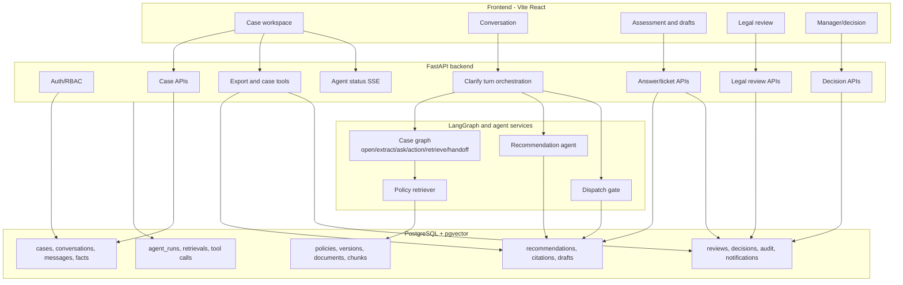
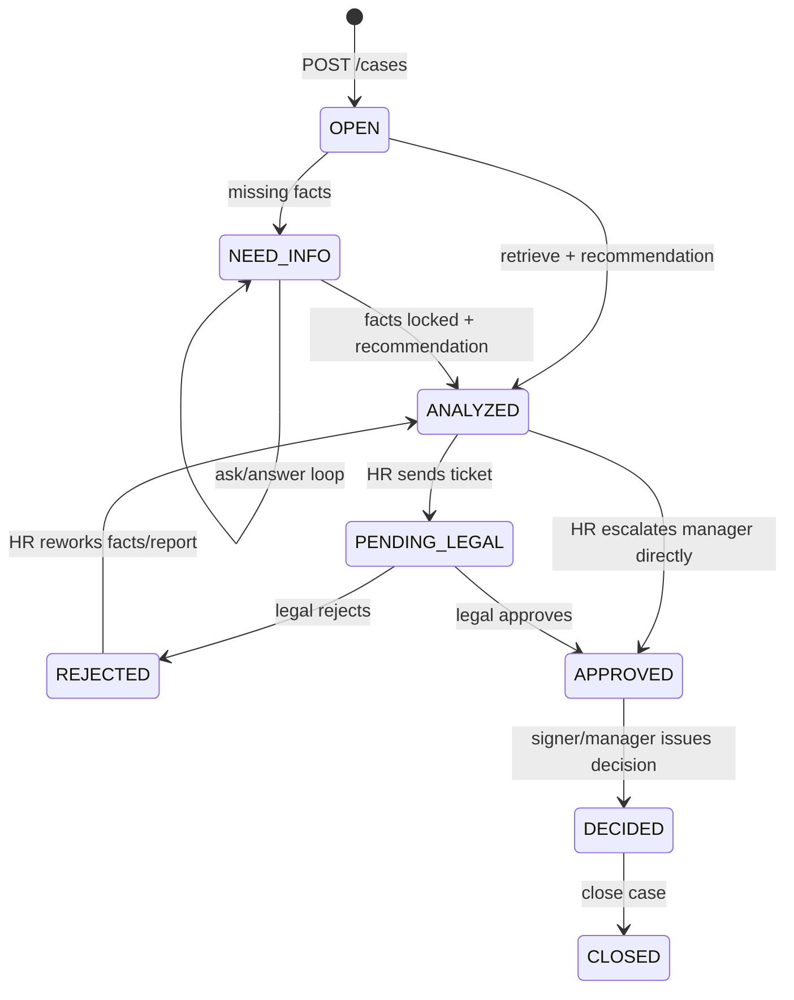

# HR Help - Architecture

- **Project:** P-029
- **Application:** HR Help
- **Updated:** 03/10/2026
- **Scope:** FastAPI backend, LangGraph multi-agent workflow, PostgreSQL/pgvector data layer, Vite React frontend, export/case-tool surface.

This document describes the technical architecture that is implemented in the current codebase. For product-level sequence details, read `docs/features/features.md`.

## System Overview

HR Help is a human-in-the-loop HR disciplinary case system. The backend owns workflow state, authorization, audit, retrieval, recommendation storage, legal review, decision issuance, notification, and exports. The frontend renders the workflow and never decides sanctions or approval state by itself.

The multi-agent architecture is intentionally split into small contracts:

1. Case graph extracts and validates facts.
2. Retrieval produces a `CaseHandoff`.
3. Recommendation agent reads only that handoff and stores an assessment.
4. Dispatch gate reads a `ProposalHandoff` and either holds or prepares drafts.
5. Humans submit legal tickets, approve/reject, issue decisions, and close cases.

Raw handoff payloads are internal coordination data. They are persisted for traceability, but frontend code filters them out of visible chat/timeline/report layouts.

## High-Level Architecture



## Runtime Stack

| Layer | Technology | Main paths |
|---|---|---|
| Frontend | Vite, React, TypeScript, TanStack Query, React Router | `frontend/src` |
| API | FastAPI, Pydantic, SQLAlchemy async | `src/main.py`, `src/features/*/controller.py` |
| Workflow | LangGraph | `src/agents`, `src/features/*/model` |
| LLM planning | Mistral-compatible planner config | `src/features/clarify/model/planner.py`, `prompt.py` |
| Retrieval | PostgreSQL/pgvector hybrid search | `src/features/cite/model/*` |
| Database | PostgreSQL with pgvector | `src/models`, migrations |
| Export | JSON, Markdown, DOCX | `src/features/export`, `src/features/answer/model/case_tools.py` |

## Backend Module Boundaries

`src/main.py` registers feature routers under `/api/v1`.

| Module | Responsibility |
|---|---|
| `src/common` | Auth deps, access checks, audit, errors, idempotency, notification helpers, workflow guards |
| `src/core/security` | RBAC roles/permissions and request guards |
| `src/features/opencase` | Create/read/update/reopen cases and manage case access |
| `src/features/clarify` | Chat/fact APIs, fact extraction, graph routing, turn orchestration |
| `src/features/cite` | Policy search, query building, handoff assembly |
| `src/features/answer` | Recommendation storage, dispatch gate, ticket/escalation, case document tools |
| `src/features/assessment` | Assessment confirmation/version support |
| `src/features/legal_review` | Legal queue, review pack, approve/reject |
| `src/features/decision` | Manager queue, decision preview, issue decision, precedent, close |
| `src/features/export` | Export stored artifacts and expose MCP-style tool schemas/calls |
| `src/features/timeline` | Read-only timeline projection |
| `src/features/notification` | Notifications |
| `src/features/dashboard` | Operational counters |

Controllers stay thin: they validate auth/permission and call model/service functions. Workflow decisions live in model/service modules, not in frontend code.

## API Architecture

Key entry points:

| Capability | API | Backend path |
|---|---|---|
| Auth | `POST /api/v1/auth/login` | `src/common/auth.py` |
| Open case | `POST /api/v1/cases` | `src/features/opencase/controller.py` |
| Chat turn | `POST /api/v1/cases/{case_id}/messages` | `src/features/clarify/controller.py` |
| Confirm facts | `POST /api/v1/cases/{case_id}/facts/confirm` | `src/features/clarify/controller.py` |
| Read answer | `GET /api/v1/cases/{case_id}/answer` | `src/features/answer/controller.py` |
| Send legal ticket | `POST /api/v1/cases/{case_id}/ticket` | `src/features/answer/controller.py` |
| Escalate manager | `POST /api/v1/cases/{case_id}/escalate` | `src/features/answer/controller.py` |
| Legal review | `/api/v1/legal/reviews/queue`, `/api/v1/cases/{case_id}/reviews` | `src/features/legal_review/controller.py` |
| Decision | `/api/v1/manager/queue`, `/api/v1/cases/{case_id}/decisions` | `src/features/decision/controller.py` |
| Export/tools | `/api/v1/cases/{case_id}/export/{kind}`, `/api/v1/cases/case-tools` | `src/features/export/controller.py` |

Idempotent mutating workflow routes accept `Idempotency-Key` where repeat requests can otherwise duplicate side effects.

## Multi-Agent Design

### Agent 1: Case Graph

Main files:

- `src/agents/case_graph.py`
- `src/features/clarify/model/graph.py`
- `src/features/clarify/model/turns.py`
- `src/features/clarify/model/prompt.py`
- `src/features/clarify/model/decision.py`
- `src/features/clarify/model/policy.py`
- `src/features/clarify/model/assess.py`

Graph shape:

```text
START
  -> open -> END
  -> extract
       -> ask -> END
       -> action -> END
       -> retrieve -> handoff -> END
       -> done -> END
```

Important design point: the LLM planner does not select graph edges. It produces a structured `ClarifyDecision`; Python validates facts and maps the state to `ask`, `action`, `retrieve`, or `done`.

`open` exists in the graph for a consistent request contract, but it does not call an LLM. It inserts `cases` and `conversations`.

### Extract And Route

`extract_node` supports two modes:

| Mode | Used when | Implementation |
|---|---|---|
| Rule/regex projection | `step == "cite"` or semantic planning disabled | `assess(...)` |
| Semantic planner | Normal chat with `semantic=true` | `plan_turn(...)` then `apply_decision(...)` |

`route_after_extract` decides:

| Edge | Meaning |
|---|---|
| `ask` | Conflict or required facts are missing/unconfirmed |
| `action` | Natural-language request that should not run downstream agents |
| `retrieve` | Facts are locked and date/run metadata are ready |
| `done` | No more graph work in this turn |

### Action Boundary

The action branch handles user prompts such as policy questions, show current assessment, or unsupported commands. It does not continue to recommendation/dispatch.

Examples:

- Policy/legal/company-rule question: use the retriever as a RAG tool and return bounded citations.
- Show assessment: `turns.py` loads the stored answer if available.
- Approve/sign/close/bypass/delete: return a safe boundary response.

### Retrieval And CaseHandoff

Retrieval runs only when required facts are locked and the case has `incident_date`. The retriever searches effective policy chunks for that date and `handoff_node` builds `CaseHandoff`.

Main files:

- `src/features/cite/model/pipeline.py` — the retrieval sub-graph
- `src/features/cite/model/search.py` — audited entry point (`search_policies`)
- `src/features/cite/model/store.py` — SQL and the in-force filter
- `src/features/cite/model/graph_expand.py` — hop-1 citation expansion and failure isolation
- `src/features/cite/model/query.py` — `SearchQuery` input contract
- `src/features/cite/model/page_index.py` — article-outline fallback
- `src/agents/handoff.py` — `CaseHandoff` / `CitedPassage`

The retrieval sub-graph is a LangGraph `StateGraph` that fans out three retrievers in parallel and fuses them:

```text
START ─┬─ similarity ──→ pgvector HNSW cosine          K=8  ─┐
START ─┼─ bm25 ────────→ ts_rank on search_tsv          K=8  ─┼→ rrf (k=60) → expand → rerank ─┬→ END
START ─┴─ lexical ─────→ ILIKE term + term-overlap rank K=8  ─┘                                   └→ page_index → END
```

Rules that matter when changing this code:

- **Every arm goes through `_candidate_stmt()`** in `store.py`, so the in-force filter (`policy_versions.effective_from <= incident_date AND (effective_to IS NULL OR effective_to >= incident_date)`, `status='ACTIVE'`, `policy.is_active`, `ingest_status IN ('CHUNKED','EMBEDDED')`) can never be bypassed by adding a fourth arm.
- **A failing arm degrades, it does not fail the turn.** `_arm()` catches per-retriever exceptions and returns an empty list; RRF then treats that arm as contributing no rank mass.
- **Graph expansion runs after fusion.** The top five RRF hits seed one outgoing and one incoming edge read on `chunk_references`. Only HIGH-confidence, non-review edges with an internal target qualify. Neighbor hydration reuses `_candidate_stmt()`, preserving the incident-date and document eligibility filters. Existing fused hits retain their scores/origin; at most twelve new neighbors receive the best seed score × 0.6. The stable score sort keeps fused hits first on ties. `fused` stays available separately from `expanded` for debugging.
- **Graph errors preserve the original fused result.** Reads use a savepoint so a failed SQL query cannot poison the request transaction. New hits carry `origin="graph"`, recorded as the ledger retrieval method; traversed seed/source/target IDs, rules, and confidence are recorded in `tool_calls.output.graph_provenance`. Retrieval mode remains `hybrid`.
- **`page_index` is a fallback, not a second chance.** It runs only when all three ranked arms return nothing, and `retrieval` is then set to `page_index`, which makes the synthesis path abstain instead of guessing.
- **`rerank` is currently a pass-through.** `cite/model/rerank.py` returns the expanded list unchanged; the node exists as the seam for a cross-encoder. The eight fused hits can be joined by up to twelve graph neighbors; expansion does not change rerank scoring or introduce another final top-8 cut.

`CaseHandoff` is the immutable contract passed to downstream agents. It contains case metadata, locked facts, fact lines, retrieved passages, and retrieval flags.

Graph expansion requires the live `chunk_references` table to be populated. After the corpus ETL (`seed_hr_from_legal.py`), run `python -m scripts.copy_chunk_references` with the configured database. An empty graph safely leaves retrieval unchanged; no new migration is required by the expansion feature.

### Agent 2: Recommendation

Main files:

- `src/features/clarify/model/multi_agent.py`
- `src/features/answer/model/answers.py`
- `src/features/answer/model/agent.py`
- `src/features/answer/model/draft.py`
- `src/features/answer/model/store.py`

Input: `CaseHandoff`.

Output:

- `recommendations` row with status `DRAFT`.
- citation rows attached to that recommendation.
- optional `case_violations` link.
- `cases.status = ANALYZED`.
- `AnswerView` for frontend and subsequent dispatch.

The recommendation agent synthesizes facts and retrieved evidence into a report, rationale, sanction candidate, risk level, process steps, and evidence layers. It does not approve or send the case.

### Agent 3: Dispatch Gate

Main files:

- `src/features/clarify/model/multi_agent.py`
- `src/features/answer/model/proposal.py`
- `src/features/answer/model/dispatch.py`
- `src/features/answer/model/send.py`
- `src/features/answer/model/release.py`

Input: `ProposalHandoff`, built from `CaseHandoff + AnswerView`.

The dispatch graph is deterministic:

```text
gate -> draft -> END
gate -> END
```

It holds when:

- sanction is open or `TERMINATION`;
- risk is `HIGH`/`CRITICAL`;
- internal rule is missing;
- required procedure steps are not done.

On `SUBMIT`, it creates preview draft texts only. It does not persist legal drafts until HR explicitly calls `POST /api/v1/cases/{case_id}/ticket` or `POST /api/v1/cases/{case_id}/escalate`.

## Case Workflow



Human decision boundaries:

- HR chooses whether to send legal or escalate manager.
- Legal approves/rejects submitted tickets.
- Manager/signer issues the final decision.
- Agent output is advisory and draft-producing.

## Data Architecture

Primary data groups:

| Group | Tables/models |
|---|---|
| Identity/access | `users`, `case_access`, token/revocation models |
| Case core | `cases`, `conversations`, `messages`, `case_facts` |
| Knowledge base | `policies`, `policy_versions`, `documents`, `document_chunks` |
| Agent ledger | `agent_runs`, retrieval/tool-call related tables |
| Assessment output | `recommendations`, citations, `case_violations`, `case_drafts` |
| Human review | `reviews`, `disciplinary_decisions` |
| Governance | `audit_logs`, `notifications`, `idempotency_keys` |

Knowledge retrieval uses effective-date filtering against policy versions/chunks. This is critical because the applicable rule is determined by `cases.incident_date`, not by the current date.

### Two corpus stores, and which one is live

The database holds two copies of the same corpus. Only one is read at runtime.

| | `document_chunks` (live) | `legal_*` (backup / build-time) |
|---|---|---|
| Read by | `src/features/cite/model/store.py` — every retrieval arm | nothing in `src/` |
| Rows | 1377 | 1377 across `legal_chunks` / `legal_chunk_embeddings`, 599 refs |
| Primary key | UUID; semantic id kept in `chunk_metadata['legal_chunk_id']` | semantic, e.g. `BLLD:CVIII:M01:A125` |
| Populated by | `scripts/seed_hr_from_legal.py` (one-time ETL from `legal_*`) | `scripts/seed_legal.py` + `scripts/embed_legal.py` |
| Cross-reference graph | `chunk_references`: runtime hop-1 traversal in both directions after RRF | `legal_chunk_references` (599 build-time edges, copied by `scripts/copy_chunk_references.py`) |

`legal_*` is treated as the build-time staging area and the recoverable copy of the corpus. Dropping those tables is safe for the case flow but **destroys the graph and the semantic chunk ids**, so the ETL cannot be re-run. `handoff/full_build_phase_p029.dump` remains the only full snapshot.

**Corpus provenance is not yet verified.** The chunks are generated from `.docx` by MarkItDown and have not been checked article-by-article against the official texts. Treat `document_chunks` as demo-grade, not as an authoritative legal source.

## Frontend Architecture

Main files:

- `frontend/src/services/api.ts`
- `frontend/src/services/sse.ts`
- `frontend/src/features/case-management/CaseWorkspace.tsx`
- `frontend/src/features/conversation/*`
- `frontend/src/features/assessment/*`
- `frontend/src/features/legal-review/*`
- `frontend/src/features/decision/*`
- `frontend/src/features/timeline/TimelinePanel.tsx`
- `frontend/src/lib/workflow.ts`
- `frontend/src/lib/report.ts`
- `frontend/src/lib/session.ts`

`CaseWorkspace` is the case shell. It loads case header, facts, answer, messages, handoff, and agent status, then provides them via context.

Frontend rules:

- React Query owns server cache and invalidation.
- `workflow.ts` mirrors stored case status/ticket disposition only; it does not infer sanctions.
- `report.ts` detects raw `HANDOFF` payloads.
- `session.ts`, `CaseWorkspace`, `TimelinePanel`, `AssessmentPanel`, and `LegalCasePage` prevent raw handoff payloads from being rendered.
- `ReviewMinutes` shows the readable assessment/draft and can export DOCX through the export API.

## Export And Case Tools

Export is read-only with respect to workflow state. It reads stored rows and renders:

- JSON
- Markdown
- DOCX

Main files:

- `src/features/export/controller.py`
- `src/features/export/model.py`
- `src/features/answer/model/case_tools.py`

MCP-style case tools expose schemas and safe calls:

| Tool | Purpose |
|---|---|
| `create_violation_minutes_form` | Build a violation/minutes form from case and answer |
| `create_legal_ticket_form` | Build a legal ticket form |
| `export_case_document_word` | Export assessment/ticket/decision DOCX |

DOCX files are written to `/tmp/hr_case_exports`.

## Security And Governance

Implemented controls:

- JWT actor resolution through FastAPI dependencies.
- RBAC permission guards in controllers.
- Case-level access checks in model/service functions.
- Human approval boundaries enforced in backend services.
- Pydantic schemas for request/response validation.
- Idempotency keys on side-effect routes.
- Audit log writes for important workflow transitions.
- Notifications for legal, manager, and HR workflow events.

Architecture rule: user-provided text, stored messages, retrieved documents, and attached documents are data, not instructions. Planner prompts explicitly reject instruction following from case narratives.

## Reliability And Failure Handling

- A failed chat turn marks `agent_runs` failed and returns a bounded API error.
- Fact confirmation rolls back if retrieval/answer publication fails.
- Ticket/escalation uses idempotency claims to avoid duplicate submissions.
- Dispatch failures do not auto-submit legal tickets.
- Previous recommendations can be superseded when facts change.
- Raw handoff can be stored for traceability while hidden from UI.

## Design Decisions

| Decision | Choice | Reason |
|---|---|---|
| API framework | FastAPI | Async request handling, dependency-based auth, Pydantic schemas |
| Frontend | Vite React | Fast local dev and type-safe UI code |
| Workflow | LangGraph + explicit Python orchestration | Graph handles branchable agent state; Python enforces business invariants |
| Edge control | Python, not LLM | Prevents prompt text from directly driving legal/workflow transitions |
| Handoff contracts | `CaseHandoff`, `ProposalHandoff` | Keeps sub-agent boundaries auditable and testable |
| Retrieval | Effective-date policy search with pgvector/hybrid search | Applicable rules depend on incident date |
| Human approvals | Backend-only workflow services | Legal/manager/signature actions must not be performed by agents |
| Export | Stored data rendering | Export must not rerun agents or mutate workflow state |

## Review Reading Order

For architecture/code review, read in this order:

1. `src/main.py`
2. `src/features/opencase/controller.py`
3. `src/features/clarify/controller.py`
4. `src/features/clarify/model/turns.py`
5. `src/agents/case_graph.py`
6. `src/features/clarify/model/graph.py`
7. `src/features/cite/model/search.py`
8. `src/features/cite/model/graph.py`
9. `src/features/clarify/model/multi_agent.py`
10. `src/features/answer/model/answers.py`
11. `src/features/answer/model/dispatch.py`
12. `src/features/answer/model/send.py`
13. `src/features/legal_review/model/service.py`
14. `src/features/decision/model/service.py`
15. `src/features/export/model.py`
16. `frontend/src/features/case-management/CaseWorkspace.tsx`
17. `frontend/src/lib/workflow.ts`
18. `frontend/src/lib/report.ts`

## Known Architecture Notes

- `POST /api/v1/chat` belongs to the template/sample agent surface, not the HR case workflow.
- `open` is a graph node but does not call LLM.
- `HANDOFF` messages are internal agent ledger data and should not be shown as UI content.
- Recommendation may produce a draft even when dispatch holds; this lets HR read the assessment and resolve missing/unsafe conditions.
- Legal review and final decision are separate human workflow services, not graph nodes.
