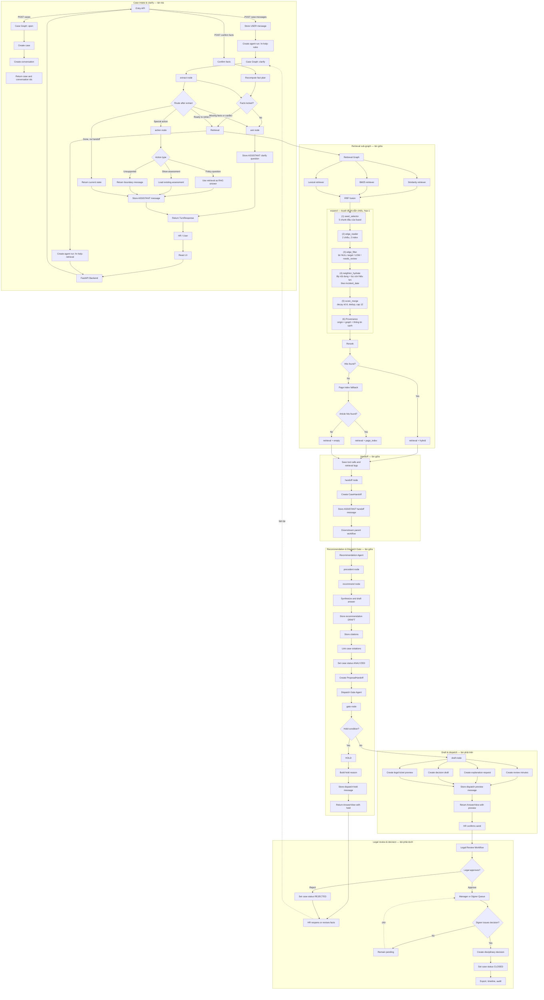

# P-029 — Flowchart (bản Markdown/Mermaid)

Bản dựng lại từ `P029-flowchart.png` (6744×7406). Mục tiêu: chữ đọc được, sửa được, render trên GitHub / VS Code (cần extension Mermaid Preview).

> Vài cạnh vòng (loop-back) trong ảnh gốc bị rối dây nên ở đây lược giản. Cấu trúc node & luồng chính giữ nguyên.

## Đọc nhanh 4 làn

- **Làn trái — Intake & Clarify:** API vào → mở case, nhận tin nhắn, xác nhận facts → extract → hỏi thêm (ask) hoặc hành động (action) → trả `TurnResponse` về UI.
- **Làn giữa — Retrieval → Handoff → Recommendation:** 3 retriever song song → RRF → rerank → (có hit?) → đóng gói `CaseHandoff` → Recommendation Agent chạy `precedent → recommend → draft` → `ProposalHandoff` → Dispatch Gate.
- **Làn phải trên — Draft & dispatch:** `draft node` sinh 4 loại tài liệu (minutes / explanation / decision draft / legal ticket preview) → preview → HR xác nhận gửi.
- **Làn phải dưới — Legal review & Decision:** Legal duyệt/từ chối → hàng đợi Manager/Signer → ra quyết định → CLOSED → export.

## Sơ đồ

## Chú thích

- Node **hình thoi `{}`** = điểm quyết định (trong ảnh gốc vẽ nét đứt).
- Nhãn trên mũi tên (`POST cases`, `Yes`, `No`, `Ready to retrieve`, `Reject`, `Approve`…) = điều kiện rẽ nhánh.
- Cạnh nét đứt (`.->`) = vòng lặp/làm lại, đã lược giản so với ảnh gốc.

## GraphRAG — kiến trúc mở rộng (đã vẽ thẳng vào sơ đồ trên)

Sơ đồ lớn ở trên đã tính cả **node `expand`** ngay trong sub-graph Retrieval, nằm giữa
`RRF fusion` và `Rerank` — đó là cách đồ thị dẫn chiếu (`chunk_references`, 599 cạnh,
hiện chưa runtime nào đọc) được đưa vào đường retrieval thật. Bên trong `expand` là 6
khối, cũng vẽ ngay trong sơ đồ đó (sub-graph `expand`).

**Vì sao đặt ở đây (không phải sau Rerank):** Rerank là bước sắp xếp cuối và chốt
danh sách trả ra. Expand chạy sau Rerank thì neighbor mới bị append thô, không được
sắp lại và rơi ngoài top-k đã cắt. Đặt trước Rerank để neighbor được trộn rồi sắp
chung một lượt. Cũng **không làm retriever thứ 4 chạy song song** — graph không có
query riêng, nó phải có kết quả của 3 nhánh kia làm hạt giống.

### Ý tưởng (nói bằng lời)

Text search chỉ tìm chunk có chữ giống câu hỏi. Văn bản luật thì có tính **viện dẫn**:
Nội quy viện dẫn Điều 125 BLLD, hoặc Điều 125 nói "theo khoản 2 Điều 34". Search có
thể tìm ra Nội quy nhưng không bao giờ tìm ra Điều 125 nếu câu hỏi không nhắc tới nó —
trong khi đó lại chính là "căn cứ bắt buộc". Đồ thị đã ghi sẵn 599 quan hệ viện dẫn,
việc còn lại là **đọc nó lúc truy vấn**: tìm được chunk nào liên quan thì lần theo
các mũi tên viện dẫn để kéo thêm điều mà nó dẫn tới.

### Kiến trúc nội bộ khối `expand` (6 khối)

6 khối `(1)…(6)` đã vẽ trong sơ đồ lớn ở trên (sub-graph `expand`). Tóm tắt:

**Mô hình đồ thị:** node = chunk trong `document_chunks`; cạnh = dòng `chunk_references`,
**có hướng** (A viện dẫn B) và **có nhãn** (`rule`, `confidence`). 1377 node / 599 cạnh
→ đồ thị rất thưa (degree ra trung bình < 0.5), hop-1 chỉ thêm vài node, không bùng nổ.
Trừ 63 cạnh external (target NULL), phần duyệt được là ~536 cạnh nội bộ giữa 4 văn bản.

| Khối | Làm gì | Chi tiết đáng chú ý |
|---|---|---|
| (1) seed_selector | Lấy 5 chunk đầu của `fused` làm hạt giống (id + điểm) | Không lấy nhiều: seed rác kéo neighbor rác |
| (2) edge_reader | 2 truy vấn SQL: xuôi `source_chunk_id = ANY(seeds)`, ngược `target_chunk_id = ANY(seeds)` | Dùng index `uq_chunk_references` / `ix_chunk_references_target_source`. **Đọc thẳng SQL**, không cache đồ thị vào RAM — để lọc in-force cùng câu truy vấn và tránh cache trỏ sai sau khi corpus rebuild (UUID sinh mới) |
| (3) edge_filter | Bỏ cạnh `target_chunk_id IS NULL`, `confidence='LOW'`, `needs_review=true` | Lọc tại tầng cạnh là rẻ nhất |
| (4) neighbor_hydrate | Lấy nội dung neighbor, JOIN qua `_candidate_stmt` + `in_force_filter(incident_date)` | **Văn bản được viện dẫn có thể đã hết hiệu lực** tại ngày vi phạm (vd NĐ 145 hết hiệu lực 09/09/2026) → không kéo vào. Đây là lý do graph phải nằm trong pipeline retrieval, không phải công cụ tra cứu riêng |
| (5) score_merge | Gộp cạnh/seed trùng; điểm = `max(điểm seed) × 0.6`; dedup; cap 12; sort ổn định | Hệ số 0.6 = "tin nhưng tin ít hơn kết quả search trực tiếp" → chunk tìm bằng text vẫn thắng khi hòa điểm |
| (6) Provenance | Gắn `origin="graph"` + giữ thông tin cạnh (được điều nào viện dẫn) | Phục vụ audit ledger; `retrieval` mode vẫn là `"hybrid"` |

**Fail-isolation:** lỗi graph → trả `fused` nguyên vẹn. Retrieval không bao giờ chết vì graph.

### Giới hạn hiện tại & hướng phát triển tương lai

**Giới hạn của v1 (cố ý, không phải bug):**
- Đồ thị chỉ có **1 loại cạnh: "viện dẫn"**. Quan hệ "sửa đổi/thay thế/kế thừa" đang ở cấp văn bản (`legal_documents.amended_by`), chưa thành cạnh chunk.
- Chỉ **1 hop**.
- Cạnh `confidence='LOW'` bị **bỏ hẳn**.
- `GRAPH_EDGE_DECAY=0.6`, `GRAPH_SEED_K=5`, `GRAPH_MAX_EXPANSION=12` là số **tune tay**, chưa có cơ sở đo.
- Seed cố định top-5, chưa lọc theo ngưỡng điểm hay đa dạng nguồn.
- 63 cạnh external (target NULL) **không duyệt được** — chưa có chunk cho văn bản ngoài corpus (Luật BHXH, Công đoàn…).
- Rerank vẫn pass-through → neighbor chưa được chấm lại ngữ nghĩa.
- **Chưa có eval (B8)** để so baseline vs graph.

**Hướng phát triển:**
- Mở rộng **loại cạnh** (sửa đổi/thay thế/kế thừa) hoặc dẫn xuất từ `amended_by` → đồ thị giàu ngữ nghĩa hơn.
- **Hop-2 có kiểm soát** / personalized PageRank khi corpus lớn hơn.
- Đưa cạnh **LOW vào với hệ số phạt** thay vì loại bỏ.
- **Tune tham số bằng eval** thay vì đoán (decay, seed_k, cap).
- Gắn **cross-encoder rerank thật** → neighbor được chấm lại, giảm phụ thuộc vào decay.
- **Seed theo ngưỡng/đa dạng** thay vì top-5 cứng.
- Bổ sung chunk cho **văn bản ngoài corpus** để nối các cạnh external.
- **Cache đồ thị** nếu corpus lớn (đánh đổi với độ tươi của dữ liệu).
- Xa hơn: **community detection / global GraphRAG** cho câu hỏi tổng hợp.

> Chi tiết triển khai (thay đổi theo file, tests, verification): `plans/graphrag-hop1-retrieval.md`.
