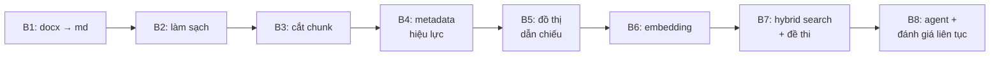

# Data Pipeline — toàn cảnh 8 bước (P-029)

_1 database duy nhất (`build_phase_p029`): 3 văn bản luật đi vào, hệ tri thức
sẵn sàng cho RAG đi ra. Mỗi bước nạp thêm 1 lớp ý nghĩa lên cùng dữ liệu,
không bước nào sửa chữ của bước trước._



## Bảng tổng (đọc bảng này là đủ hình dung)

| Bước | Ý nghĩa 1 dòng | Vào → Ra | Trạng thái |
|---|---|---|---|
| B1 Ingestion | Biến file Word gốc thành Markdown giữ cấu trúc Chương/Mục/Điều | `data/raw/*.docx` → `data/markdown/*.md` | ✅ xong |
| B2 Preprocessing | Xóa nhiễu (bảng trình bày, escape sai) để bước cắt không lệch | md thô → `data/cleaned_markdown/` | ✅ xong (`step2/`, có test) |
| B3 Chunking | Cắt văn bản theo **Điều → Khoản → Điểm**, giữ ngữ cảnh cha + phát hiện dẫn chiếu thô | md sạch → `data/chunk/*.json` (**1377 chunk**: BLLD 381 / NĐ145 377 / NĐ283 531 / NQCT 88) | ✅ xong (có golden test) |
| B4 Metadata | Đưa 4 văn bản + 1377 chunk vào Postgres kèm hiệu lực, sẵn sàng lọc | JSON → `legal_documents` (4) + `legal_chunks` (1377) | ✅ xong |
| B5 Graph | Biến dẫn chiếu ("khoản 2 Điều 169") thành cạnh nối giữa các chunk | refs thô → `legal_chunk_references` (**599**) → `chunk_references` | ✅ xong; runtime đọc hop-1 qua node `expand` |
| B6 Embedding | Biến chữ thành 1377 vector `mistral-embed` (tài sản tốn quota) | chunks → `legal_chunk_embeddings` (1377×1024) | ✅ xong |
| B7 Search | Máy tìm kiếm lai (vector + từ khóa) + bộ đề thi chống hồi quy | vectors → `hybrid_search()` + `legal_golden.json` (17 query) | ⚠️ **đã gỡ 2026-10-06** — xem mục B7 bên dưới |
| B8 Agent | Vòng lặp user hỏi → agent đáp → log lại để đo liên tục | _milestone sau_ | ⬜ chưa làm |

## Từng bước làm gì, vì sao

**B1 — docx → md.** Dùng MarkItDown. Đầu ra 3 file trong `data/markdown/`
(BLLD hợp nhất 18/VBHN-VPQH, NĐ145, NĐ283). Không có md sạch thì mọi bước sau
vô nghĩa — đây là nền.

**B2 — làm sạch.** (`step2/step2_preprocessing.py`, kế hoạch
`step2/preprocessing_plan.md`, test `step2/test_step2.py`.) Phẳng hóa bảng trang
trí đầu file, sửa ký tự markdown escape sai, chuẩn hóa tiêu đề Chương/Điều.
Ý nghĩa: rác định dạng mà lọt xuống B3 sẽ thành chunk rác trong DB.

**B3 — cắt theo ngữ nghĩa luật.** (`step3/`: `hierarchy_parser.py`,
`chunking_engine.py`, `cross_reference_resolver.py`, `anomaly_detector.py`...)
Không cắt máy móc theo số từ (sẽ mất gốc "đoạn này thuộc Điều nào").
Mỗi chunk mang `header_context` (breadcrumb Văn bản > Chương > Mục > Điều) +
`meta` (token, penalty, flags...). Đầu ra đóng băng 6 file JSON trong
`data/chunk/`, có `source_manifest.json` niêm phong hash — mọi bước sau đối
chiếu với manifest này.

**B4 — metadata & hiệu lực.** (`scripts/seed_legal.py` nửa đầu,
`alembic/versions/0001_legal_schema.py`.) Upsert 3 documents (BLLD =
PARTIALLY_AMENDED vì 5 footnote sửa đổi, 2 NĐ = ACTIVE), bulk insert 1289
chunk với cột lọc riêng (`article_number`, `clause_number`, `point_letter`,
`chunk_level`). Ý nghĩa: B7 lọc theo Điều/khoản bằng cột index, không phải
mò trong JSON.

**B5 — đồ thị dẫn chiếu.** (Nửa sau `seed_legal.py`.) Resolve mỗi dẫn chiếu
theo thứ tự Điểm → Khoản → Điều; trỏ ra luật ngoài bộ 3 thì `target_chunk_id`
NULL (60 dòng — **không phải dữ liệu hỏng**). Ý nghĩa: agent trả lời được câu
hỏi dạng "khoản này dẫn tới đâu", và đi ngược "điều này được ai trích dẫn".
Runtime hiện đọc bản sao `chunk_references` qua node `expand` trong
`src/features/cite/model/graph_expand.py`: lấy top-5 seed từ RRF, duyệt một hop
cả hai chiều, chỉ nhận cạnh HIGH không cần review và neighbor còn hiệu lực
tại `incident_date`. Thêm tối đa 12 neighbor với điểm seed tốt nhất × 0.6;
hit mới có `origin="graph"`, cạnh dẫn chiếu được ghi vào audit `tool_calls`.

**B6 — nhúng vector.** (`scripts/embed_legal.py`, migration `0003`.) 1289 text
(`header_context + text`) → 41 request batch-32 → 683 096 tokens (~68% trần V7),
1 RPS có log kiểm toán từng request. Bảng riêng + `content_sha256` để chữ bị
sửa thì vector cũ lộ mặt, reseed B5 không xóa mất tiền đã đốt. (Con số 1289 là
của lần embed đầu tiên, 2026-09-28; sau khi mở rộng NQCT lên 1377 chunk thì
phần NQCT được embed bổ sung. Chi tiết: `data/chunk/CHANGELOG_B6B7.md` §1–2 và
`data/chunk/CHANGELOG_P029_NQCT_2026-10.md`.)

**B7 — tìm kiếm lai + đề thi.** ~~(`src/services/hybrid_search.py`.)~~ **Đã gỡ
2026-10-06.** Vector top-20 + BM25 top-20 gộp RRF k=60.

> **Sự thật quan trọng về kiến trúc:** `hybrid_search()` **không phải** đường mà
> agent dùng. Nó chỉ được gọi từ script đo. Đường retrieval thật của hồ sơ là
> LangGraph sub-graph ở `src/features/cite/model/pipeline.py` — 3 nhánh song song
> (`similarity` / `bm25` / `lexical`) → RRF → **expand hop-1** → rerank → fallback `page_index` — và
> đọc bảng `document_chunks` + `chunk_references`, không đọc `legal_*`. Vì vậy số đo của B7 **không mô
> tả** hệ thống đang chạy. Xem `ARCHITECTURE.md` mục "Retrieval And CaseHandoff".

**B8 — agent + đánh giá liên tục.** Chưa làm. Đường agent đã có sẵn (`cite/model/pipeline.py`)
và đã tiêu thụ graph hop-1 trong retrieval thật;
nhưng **chưa từng được đo** — chưa có bộ đề nào chạy qua đường đó. Đây là lỗ hổng
đo lường lớn nhất của dự án, và cũng là chỗ nên làm khi thiết kế lại corpus.

## Về 2 FAIL đã biết của đường vector-only

> **Lịch sử, đã gỡ cùng B7 (2026-10-06).** Đường vector-only trượt 3/10 query
> (Điều 118 rank 7, Điều 1 NĐ145 rank 15, Điểm a1 Điều 38 rank 23) — đã chứng
> minh là giới hạn của `mistral-embed` trên tiếng Việt (HNSW bit-for-bit như quét
> tay, re-embed cosine = 1,0), không phải bug. Chi tiết ở `CHANGELOG_B6B7.md` §9.

Kết luận vẫn giữ nguyên và còn đúng hơn bây giờ: **đừng đổi embedding model.**
Cái thiếu không phải model tốt hơn, mà là một bộ đo chạy đúng đường agent gọi.

## Người mới bắt đầu từ đâu

1. Đọc bảng tổng ở trên + `pipeline_design.md` (thiết kế gốc).
2. Muốn hiểu từng bước: plan trong `step2/preprocessing_plan.md`,
   `step3/semantic_chunking_plan.md`, `step4_5_plan.md`, `step6_7_plan.md`.
   *(Các plan này là bản chốt tại ngày viết — số trong đó có thể cũ hơn thực tế
   sau khi mở rộng NQCT. Số hiện tại lấy từ `scripts/corpus_expectations.py`.)*
3. Muốn thấy DB thật: mở `handoff/README.md` (bản dump nào để deploy), import
   rồi chạy các câu SQL đếm ở **mục 4** của file đó.
4. Muốn hiểu số liệu lịch sử: `data/chunk/CHANGELOG_B4B5.md` +
   `data/chunk/CHANGELOG_B6B7.md` + `data/chunk/CHANGELOG_P029_NQCT_2026-10.md`.

## Chạy lại từ đầu (máy mới)

```bash
docker compose up -d db
# import bản full — xem handoff/README.md mục 0-2
powershell -ExecutionPolicy Bypass -File scripts/restore_handoff.ps1
python -m pytest -q     # cổng chặn chính còn lại
# rồi chạy SQL đếm ở handoff/README.md mục 4 — kỳ vọng 4/1377/599/1377/1377
```
