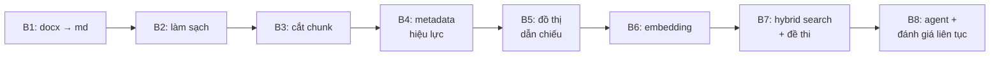

# Data Pipeline — toàn cảnh 8 bước (P-029)

_1 database duy nhất (`build_phase_p029`): 3 văn bản luật đi vào, hệ tri thức
sẵn sàng cho RAG đi ra. Mỗi bước nạp thêm 1 lớp ý nghĩa lên cùng dữ liệu,
không bước nào sửa chữ của bước trước._



## Bảng tổng (đọc bảng này là đủ hình dung)

| Bước | Ý nghĩa 1 dòng | Vào → Ra | Trạng thái |
|---|---|---|---|
| B1 Ingestion | Biến file Word gốc thành Markdown giữ cấu trúc Chương/Mục/Điều | `data/raw/*.docx` → `data/markdown/*.md` | ✅ xong |
| B2 Preprocessing | Xóa nhiễu (bảng trình bày, escape sai) để bước cắt không lệch | md thô → `data/cleaned_markdown/` | ✅ xong (`step2/`, có test) |
| B3 Chunking | Cắt văn bản theo **Điều → Khoản → Điểm**, giữ ngữ cảnh cha + phát hiện dẫn chiếu thô | md sạch → `data/chunk/*.json` (1289 chunk) | ✅ xong (có golden test) |
| B4 Metadata | Đưa 3 văn bản + 1289 chunk vào Postgres kèm hiệu lực, sẵn sàng lọc | JSON → `legal_documents` (3) + `legal_chunks` (1289) | ✅ xong, verify **70/70** |
| B5 Graph | Biến dẫn chiếu ("khoản 2 Điều 169") thành cạnh nối giữa các chunk | refs thô → `legal_chunk_references` (565) | ✅ xong, verify **70/70** |
| B6 Embedding | Biến chữ thành 1289 vector `mistral-embed` (tài sản tốn quota) | chunks → `legal_chunk_embeddings` (1289×1024) | ✅ xong, verify **76/2** (2 FAIL đã biết, xem dưới) |
| B7 Search | Dựng máy tìm kiếm lai (vector + từ khóa) và bộ đề thi chống hồi quy | vectors → `hybrid_search()` + `legal_golden.json` (10 query) | ✅ xong (hybrid Hit@5 0,9) |
| B8 Agent | Vòng lặp user hỏi → agent đáp → log lại để đo liên tục | _milestone sau_ | ⬜ chưa làm |

## Từng bước làm gì, vì sao

**B1 — docx → md.** Dùng MarkItDown. Đầu ra 3 file trong `data/markdown/`
(BLLD hợp nhất 18/VBHN-VPQH, NĐ145, NĐ283). Không có md sạch thì mọi bước sau
vô nghĩa — đây là nền.

**B2 — làm sạch.** (`step2/step2_preprocessing.py`, kế hoạch
`step2/preprocessing_plan.md`, test `step2/test_step2.py`.) Phẳng hóa bảng trang
trí đầu file, sửa ký tự markdown escape sai, chuẩn hóa tiêu đề Chương/Điều.
Ý nghĩa: rác định dạng mà lọt xuống B3 sẽ thành chunk rác trong DB.

**B3 — cắt theo ngữ nghĩa luật.** (`step3/`: `hierarchy_parser.py`,
`chunking_engine.py`, `cross_reference_resolver.py`, `anomaly_detector.py`...)
Không cắt máy móc theo số từ (sẽ mất gốc "đoạn này thuộc Điều nào").
Mỗi chunk mang `header_context` (breadcrumb Văn bản > Chương > Mục > Điều) +
`meta` (token, penalty, flags...). Đầu ra đóng băng 6 file JSON trong
`data/chunk/`, có `source_manifest.json` niêm phong hash — mọi bước sau đối
chiếu với manifest này.

**B4 — metadata & hiệu lực.** (`scripts/seed_legal.py` nửa đầu,
`alembic/versions/0001_legal_schema.py`.) Upsert 3 documents (BLLD =
PARTIALLY_AMENDED vì 5 footnote sửa đổi, 2 NĐ = ACTIVE), bulk insert 1289
chunk với cột lọc riêng (`article_number`, `clause_number`, `point_letter`,
`chunk_level`). Ý nghĩa: B7 lọc theo Điều/khoản bằng cột index, không phải
mò trong JSON.

**B5 — đồ thị dẫn chiếu.** (Nửa sau `seed_legal.py`.) Resolve mỗi dẫn chiếu
theo thứ tự Điểm → Khoản → Điều; trỏ ra luật ngoài bộ 3 thì `target_chunk_id`
NULL (60 dòng — **không phải dữ liệu hỏng**). Ý nghĩa: agent trả lời được câu
hỏi dạng "khoản này dẫn tới đâu", và đi ngược "điều này được ai trích dẫn".

**B6 — nhúng vector.** (`scripts/embed_legal.py`, migration `0003`.) 1289 text
(`header_context + text`) → 41 request batch-32 → 683 096 tokens (~68% trần V7),
1 RPS có log kiểm toán từng request. Bảng riêng + `content_sha256` để chữ bị
sửa thì vector cũ lộ mặt, reseed B5 không xóa mất tiền đã đốt. Chi tiết:
`data/chunk/CHANGELOG_B6B7.md` §1–2.

**B7 — tìm kiếm lai + đề thi.** (`src/services/hybrid_search.py`.) Vector
top-20 (gần nghĩa) + BM25 top-20 (trùng từ) gộp bằng RRF k=60; chỉ lộ `top_k`.
10 query golden phủ 3 văn bản × 3 cấp chunk, đáp án ghim sau khi đọc tay.
Ý nghĩa kép: (1) đây là **cửa duy nhất** agent gọi khi phục vụ user;
(2) là **chuông báo cháy** — sau này đổi model/chunking mà rớt điểm là biết ngay.
Số đo: hybrid Hit@5 **0,900**, MRR **0,650**, đúng Điều 10/10.

**B8 — agent + đánh giá liên tục.** Chưa làm (plan dặn log retrieval đi cùng
milestone agent, không phải B7). B7 đã để sẵn cửa `hybrid_search()` cho milestone
này gọi.

## 2 FAIL đã biết (đọc để khỏi tưởng milestone hỏng)

Đường **vector-only** trượt 3/10 query (Điều 118 rank 7, Điều 1 NĐ145 rank 15,
Điểm a1 Điều 38 rank 23) — đã chứng minh là giới hạn của `mistral-embed` trên
tiếng Việt (HNSW bit-for-bit như quét tay, re-embed cosine = 1,0), không phải
bug. Không nới gì để cho xanh; đường agent dùng (hybrid) vẫn đạt sàn V6.
Người review chọn hướng xử lý ở `CHANGELOG_B6B7.md` §9, ký tay ở
`eval/verify_retrieval_manual.md`.

## Người mới bắt đầu từ đâu

1. Đọc bảng tổng ở trên + `pipeline_design.md` (thiết kế gốc).
2. Muốn hiểu từng bước: plan trong `step2/preprocessing_plan.md`,
   `step3/semantic_chunking_plan.md`, `step4_5_plan.md`, `step6_7_plan.md`.
3. Muốn thấy DB thật: mở `handoff/README.md` (bản dump nào để deploy) rồi chạy
   `python scripts/verify_db.py` (70 check) + `python scripts/verify_embeddings.py`.
4. Muốn hiểu số liệu: `data/chunk/CHANGELOG_B4B5.md` + `data/chunk/CHANGELOG_B6B7.md`.

## Chạy lại từ đầu (máy mới)

```bash
docker compose up -d db
# import bản full (đủ 4 bảng legal, head 0003) — xem handoff/README.md mục 0-2
python -m alembic upgrade head   # no-op nếu vừa import
python scripts/verify_db.py         # expect 70 PASS
python scripts/verify_embeddings.py # expect 76 PASS, 2 FAIL (đã biết, xem trên)
```
