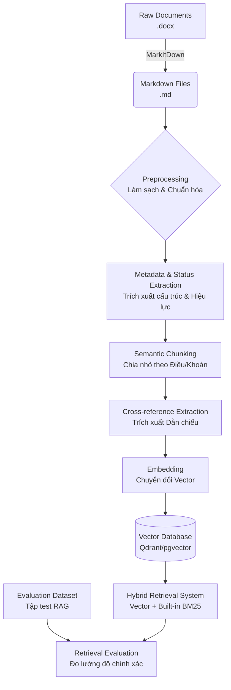

# Thiết kế Data Pipeline xử lý Văn bản pháp luật

Dựa trên việc phân tích cấu trúc của 3 file markdown (Bộ luật Lao động 18/VBHN-VPQH, Nghị định 283/2026/NĐ-CP, Nghị định 145/2020/NĐ-CP), có thể thấy các văn bản này có cấu trúc phân cấp pháp lý rất chuẩn mực theo thứ tự: `Chương -> Mục -> Điều -> Khoản -> Điểm`. 

Việc xây dựng một data pipeline tối ưu cho ứng dụng AI/RAG (Retrieval-Augmented Generation) trong lĩnh vực pháp lý yêu cầu bảo toàn tuyệt đối ngữ cảnh (context), phân cấp của các quy định, **tính liên kết (Cross-reference)** và **hiệu lực của văn bản**. Nếu chia nhỏ văn bản (chunking) một cách máy móc theo số lượng từ, hệ thống sẽ bị mất gốc ngữ cảnh (không biết đoạn văn đang thuộc Điều nào, Chương nào, của Văn bản nào).

Dưới đây là kiến trúc Data Pipeline được thiết kế để xử lý dữ liệu này:

## 1. Sơ đồ Pipeline Tổng quan



## 2. Chi tiết các bước (Pipeline Steps)

### Bước 1: Ingestion & Conversion (Chuyển đổi định dạng)
- **Đầu vào:** Tệp Word (`.docx`) gốc từ thư mục `raw/`.
- **Thực thi:** Sử dụng công cụ (như `MarkItDown`) để chuyển đổi sang cấu trúc Markdown. (Bước này đã hoàn thành thành công và lưu ở `data/markdown/`).

### Bước 2: Preprocessing (Làm sạch và Chuẩn hóa)
- **Mục tiêu:** Loại bỏ nhiễu và định dạng thừa, giúp bước chia văn bản sau này chính xác hơn.
- **Hành động cụ thể:**
  - Xóa hoặc làm phẳng các bảng (table) mang tính trình bày ở đầu file.
  - Sửa các ký tự markdown bị escape sai (ví dụ: `\_`, khoảng trắng thừa).
  - Đảm bảo các định dạng tiêu đề (Chương, Điều) có quy chuẩn rõ ràng.

### Bước 3: Semantic Chunking (Phân mảnh theo ngữ nghĩa pháp lý)
- **Chiến lược chunking ưu tiên:** Chia cắt văn bản ở cấp độ **Điều (Article)**. 
- Nếu một Điều quá dài vượt quá context window, tiếp tục cắt nhỏ ở cấp độ **Khoản (Clause)**.
- **Cấu trúc một Chunk lý tưởng cần được gộp thêm ngữ cảnh mẹ:**
  ```text
  [Văn bản: Nghị định 145/2020/NĐ-CP] - [Chương I: NHỮNG QUY ĐỊNH CHUNG]
  Điều 1. Phạm vi điều chỉnh
  Nghị định này quy định chi tiết và hướng dẫn thi hành một số nội dung...
  ```

### Bước 4: Metadata & Status Extraction (Trích xuất Metadata và Hiệu lực)
- Mỗi chunk sẽ được đính kèm các metadata và lưu vào **cột `JSONB` trong DB (PostgreSQL)** để hỗ trợ hybrid search/filtering siêu tốc:
  - Phân cấp: `{"document_name": "NĐ 145/2020", "chapter": "I", "article_number": 1}`
- **Trạng thái hiệu lực (Effective status):** Đảm bảo bảng `documents` trong DB có cột `status` (Active, Inactive, Partially_Amended) và FK `amended_by_id` trỏ đến văn bản mới hơn.

### Bước 5: Cross-reference Extraction (Trích xuất Dẫn chiếu) - *CRITICAL*
- Dùng Regex hoặc NER để quét các câu như *"theo quy định tại khoản 2 Điều X"*.
- **Database Mapping:** Các dẫn chiếu này sẽ được insert thẳng vào **bảng `chunk_references`** (Junction Table) với `source_chunk_id` và `target_chunk_id`, hình thành Knowledge Graph ngay trong PostgreSQL.

### Bước 6: Embedding (Nhúng Vector)
- **Mô hình nhúng:** `BGE-M3` (hoặc `OpenAI text-embedding-3-large`) để tối ưu hiểu tiếng Việt chuyên ngành.

### Bước 7: Storage, Indexing & Hybrid Search (Lưu trữ và Truy xuất)
- **Vector Database:** Sử dụng `pgvector` hoặc `Qdrant` để lưu Vector kèm Metadata.
- **BM25 Search:** Sử dụng Hybrid Search của Qdrant hoặc `rank_bm25` chạy local.

### Bước 8: Continuous Evaluation (Đánh giá liên tục)
- **Tập dữ liệu test (Golden Dataset):** Để test trước khi go-live.
- **Database Mapping:** Tại môi trường Production, mỗi lần truy xuất RAG, hệ thống sẽ log lại vào **bảng `retrievals`** (`agent_run_id`, `document_chunk_id`, `score`, `method`). Dữ liệu này giúp đo lường liên tục các chỉ số như `Hit Rate`, `MRR` để tinh chỉnh AI.
