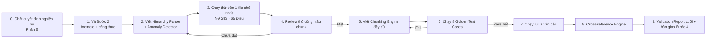

# Kế hoạch Triển khai Bước 3 — Semantic Chunking
**Dựa trên:** `semantic_chunking_plan.md` (Gemini) đã được verify chéo với dữ liệu thật + 2 rủi ro bổ sung mới phát hiện.

---

## 0. Việc verify — Kết luận

Không cần verify thêm về mặt dữ liệu. Các claim quan trọng nhất của Gemini (footnote bị dính số, công thức lương mất, chapeau dính heading, thống kê độ dài Điều) đã được đối chiếu trực tiếp và **khớp gần như tuyệt đối** với 3 file gốc. Chỉ có phần "nguyên nhân kỹ thuật" (tên hàm `detect_boundaries`, `_collect_wrapped_title` trong `step2_preprocessing.py`) là suy diễn không kiểm chứng được — khi sửa code thật, tự tìm trong source Bước 2 của bạn, đừng tìm đúng tên hàm đó.

Bổ sung 1 rủi ro mới (đã verify): rule cross-reference dựa theo "số Điều > 115 → suy ra là BLLĐ" sẽ **sai** với câu dạng liệt kê dùng chung 1 qualifier ở cuối, ví dụ *"Điều 112, Điều 113, Điều 114 và Điều 115 của Bộ luật Lao động"* — 3 Điều đầu (≤115) sẽ bị đọc nhầm thành self-reference. Đã đưa vào mục 3.4 bên dưới.

---

## 1. Nguyên tắc sắp xếp thứ tự triển khai

**Không chạy thẳng Bước 3 trên dữ liệu hiện tại.** Có 2 lỗi ở Bước 2 (mất định nghĩa footnote, ảnh công thức rỗng) là lỗi **mất dữ liệu vĩnh viễn** nếu không xử lý trước — một khi đã chunk và nhúng vector mà thiếu dữ liệu gốc, sửa lại sau sẽ tốn công gấp đôi (phải re-chunk, re-embed, re-index). Thứ tự bắt buộc:



---

## 2. Bước 0 — Chốt quyết định nghiệp vụ (chặn trước khi code)

Đây là 5 câu hỏi Gemini nêu ở Phần E. Đề xuất chốt luôn theo hướng an toàn nhất để không nghẽn tiến độ — bạn chỉ cần review lại, không cần tự nghĩ từ đầu:

| # | Quyết định | Đề xuất chốt | Lý do |
|---|---|---|---|
| 1 | Công thức lương bị mất ở Điều 56, 57 NĐ145 | **Chép tay công thức thật vào file patch** `formulas_patch.json` (map theo `article_number + clause_number → LaTeX/text công thức`), áp dụng ngay sau Bước 1, trước Bước 2 | Đây là dữ liệu định lượng quan trọng nhất trong toàn bộ NĐ145 (tính lương làm đêm) — không thể chấp nhận mất |
| 2 | 6 footnote sửa đổi bị cắt ở VBHN | **Hotfix Bước 2**: sửa lại đúng đoạn logic đang coi bảng "VĂN PHÒNG QUỐC HỘI" là tail-marker, khôi phục phần định nghĩa footnote gốc | Đây là bug ở Bước 2, sửa gốc rẻ hơn vá tạm ở Bước 3 |
| 3 | Lỗi trùng "Chương XI" trong NĐ145 | **Giữ số gốc + gắn số chuẩn hoá song song**: hiển thị `"Chương XI: ĐIỀU KHOẢN THI HÀNH (mã hệ thống: XII)"` | Người dùng cuối tra cứu theo văn bản công báo thật (ghi "Chương XI"), không nên tự ý đổi số hiển thị — nhưng hệ thống cần mã nội bộ không trùng để tránh đè dữ liệu |
| 4 | Ngưỡng token theo model embedding | **Chốt BGE-M3, ngưỡng 500 tokens** (giảm nhẹ từ đề xuất 650 của Gemini để an toàn hơn cho retrieval precision) | Đã có trong `pipeline_design.md` gốc là BGE-M3 → không cần đợi quyết định thêm |
| 5 | UX hiển thị NĐ283 (hành vi + phạt bổ sung nằm khác Khoản) | **Dùng `parent_chunk_id` + truy xuất kèm "sibling penalty clauses"** khi trả lời — tức khi match trúng 1 hành vi, tự động kèm luôn khoản "hình thức phạt bổ sung" và "biện pháp khắc phục hậu quả" cùng Điều vào context trả lời | Đúng như Gemini đề xuất, không có phương án khác an toàn hơn |

→ Nếu bạn không phản hồi gì khác, plan bên dưới coi như đã chốt theo bảng này.

---

## 3. Chiến lược kỹ thuật theo từng thành phần

### 3.1. Patch Bước 2 (bắt buộc làm trước)
- **Formula patch:** tạo `formulas_patch.json`, chạy 1 script nhỏ tìm-thay `` bằng công thức text/LaTeX tương ứng, dựa vào `article_number` + vị trí xuất hiện thứ mấy trong Điều (vì 1 Điều có thể có nhiều công thức, như Điều 56 có 2 công thức).
- **Footnote patch:** viết lại đúng đoạn regex đang cắt nhầm phần cuối văn bản; nếu không tìm lại được nội dung 6 footnote gốc (do đã bị Bước 1 MarkItDown làm hỏng từ đầu), **fallback**: giữ nguyên anchor `[[N]](#footnote-N)` trong text nhưng gắn `effective_status: "NEEDS_MANUAL_REVIEW"` thay vì cố suy đoán nội dung sửa đổi — tuyệt đối không bịa nội dung sửa đổi luật.
- Sau patch, chạy lại `metadata_summary.json` validation để đảm bảo `total_parsed_articles` không đổi (220/65/115) — patch không được làm lệch số Điều.

### 3.2. Hierarchy Parser + Anomaly Detector (làm trước Chunking Engine, tách module riêng)
Tách thành module độc lập, **không gộp chung với chunking logic**, vì:
- Cần chạy được độc lập để review nhanh cây phân cấp trước khi chunk (tránh phải chunk lại toàn bộ chỉ vì parser sai).
- Output là 1 cây JSON trung gian (`document_tree.json`) — dùng làm input cho cả Chunking Engine (Bước 3) lẫn Cross-reference Engine (Bước 5), tránh parse 2 lần.

Việc bắt buộc trong module này:
- Phát hiện & gắn cờ số Chương/Mục trùng hoặc nhảy cóc (đã có thuật toán trong Phần C của Gemini — dùng được, chỉ cần code hoá).
- Tách chapeau ra khỏi heading Điều (xử lý case Điều 3 BLLĐ).
- Xử lý "Khoản 1 ngầm" (case Điều 1 NĐ283: có Điểm a,b,c trước khi có số "2.") — coi toàn bộ đoạn trước "2." là Khoản 1 ẩn danh, gán `clause_number: 1, clause_number_is_implicit: true`.

### 3.3. Chunking Engine
Theo đúng pseudocode Phần C của Gemini (Điều → Khoản → Điểm theo ngưỡng token), 3 điểm cần làm chặt hơn khi code hoá:
- **Chapeau kế thừa xuống tận cấp Điểm**, không chỉ cấp Khoản (test case 5 đã minh hoạ đúng nhu cầu này — "Clause Context Envelope").
- **Với NĐ283 riêng**: implement rule "Atomic Penalty Unit" là **bắt buộc mặc định**, không phải nhánh phụ — vì đã đo được 80% Điều của NĐ283 dài >300 từ, tức đa số sẽ đi qua nhánh cắt Khoản/Điểm.
- Ghi `token_count` thật (dùng tokenizer BGE-M3, không ước lượng bằng số từ) vào metadata mỗi chunk để phục vụ audit sau này.

### 3.4. Cross-reference Rule Engine — vá thêm rule bị thiếu
Bổ sung **Rule 4 (List Expansion)** vào flowchart của Gemini, đặt **trước** Rule 3 (Boundary Check) về độ ưu tiên:
> Nếu gặp chuỗi liệt kê `Điều A, Điều B, ... và Điều Z <qualifier>` (qualifier chỉ xuất hiện 1 lần ở cuối chuỗi) → áp dụng qualifier đó cho **toàn bộ** các Điều trong chuỗi, không chỉ Điều gần nhất.

Thứ tự ưu tiên rule cuối cùng nên là: **Rule tường minh > Rule List Expansion > Rule Scoped Chapeau (Điều 1) > Rule Boundary (range số) làm phương án cuối cùng và luôn gắn `confidence: "LOW"` để con người review**, vì Boundary Check là suy luận yếu nhất trong 4 rule.

---

## 4. Cấu trúc thư mục / module đề xuất

```
pipeline/
├── step2_preprocessing/
│   ├── formulas_patch.json          # công thức lương chép tay
│   └── hotfix_footnote_extract.py
├── step3_chunking/
│   ├── hierarchy_parser.py          # Điều 3.2
│   ├── anomaly_detector.py          # gắn anomaly_flags
│   ├── chunking_engine.py           # Điều 3.3
│   ├── cross_reference_resolver.py  # Điều 3.4
│   └── schema.py                    # Data model Phần B của Gemini
├── tests/
│   └── golden_test_cases/           # 8 test case, mỗi case 1 file input/expected
└── validation/
    └── validation_report_template.md
```

---

## 5. Kế hoạch chạy thử (Rollout) theo từng mốc

| Mốc | Phạm vi | Tiêu chí đạt (Definition of Done) |
|---|---|---|
| M1 | Patch Bước 2 xong | `metadata_summary.json` chạy lại vẫn ra 220/65/115 Điều, không mất Điều nào; công thức lương hiển thị đúng text |
| M2 | Hierarchy Parser chạy trên NĐ283 (file nhỏ nhất, 65 Điều) | `document_tree.json` sinh ra đúng 6 Chương, 6 Mục, không lỗi crash; Điều 1 được parse đúng "Khoản 1 ngầm" |
| M3 | Review thủ công 15–20 chunk mẫu (ưu tiên các Điều dài nhất: Điều 49, 48, 58 NĐ283; Điều 219 BLLĐ) | Người đọc thấy chunk đứng độc lập vẫn hiểu được ngữ cảnh (không cần đọc thêm Điều gốc mới hiểu) |
| M4 | Chạy 8 Golden Test Case | Pass 8/8; nếu fail, sửa Chunking Engine, không sửa test case cho khớp code |
| M5 | Chạy full 3 văn bản (220+65+115 = 400 Điều) | 100% Điều có ít nhất 1 chunk; 0% chunk vượt ngưỡng token tối đa; toàn bộ `anomaly_flags` được liệt kê ra file audit riêng để review thủ công (ước tính rất ít, vì chỉ có 1 lỗi Chương trùng + vài chỗ ảnh công thức) |
| M6 | Cross-reference Engine chạy trên toàn bộ chunk | Tỷ lệ resolve `confidence: HIGH` (rule tường minh + list expansion) nên chiếm phần lớn; các case rơi vào `confidence: LOW` (boundary check) xuất ra danh sách riêng để review tay trước khi insert vào `chunk_references` |
| M7 | Bàn giao Bước 4 (DB load) | `document_tree.json` + toàn bộ chunk + `validation_report.md` sẵn sàng, không còn `anomaly_flags` ở mức "Cực cao"/"Cao" chưa xử lý |

---

## 6. Rủi ro cần theo dõi trong lúc code (ngoài các edge case đã liệt kê)

1. **Không tự động hoá việc suy đoán nội dung 6 footnote đã mất** — nếu không phục hồi được từ nguồn `.docx` gốc, để trống và gắn cờ, tuyệt đối không để AI tự "đoán" luật nào sửa đổi Điều nào.
2. **Rule Boundary Check (số Điều > max) chỉ nên chạy sau khi Rule List Expansion đã xử lý xong** — nếu code sai thứ tự, sẽ tái tạo đúng lỗi đã phát hiện ở mục 3.4.
3. Khi patch công thức lương, nhớ **giữ nguyên số lượng công thức đúng vị trí** (Điều 56 có 2 công thức, Điều 57 có 3 công thức) — đừng gộp nhầm công thức của Điều này sang Điều kia.
