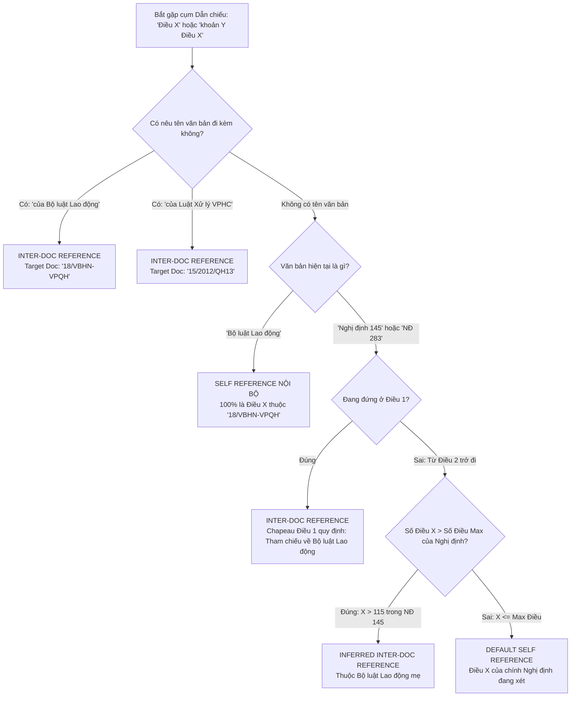
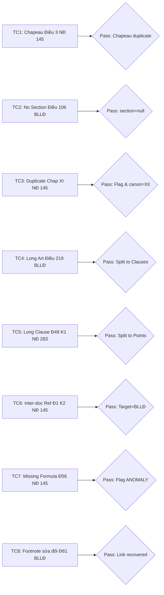

# Kế hoạch Thiết kế & Thực thi Bước 3: Semantic Chunking cho Văn bản Pháp luật Việt Nam

**Dự án:** Hệ thống RAG Pháp luật Lao động Việt Nam  
**Tài liệu tham chiếu:** `pipeline_design.md`, `metadata_summary.json`  
**Tập dữ liệu kiểm chứng thực tế:**
1. `2026_131_18_VBHN-VPQH.md` (Bộ luật Lao động hợp nhất)
2. `nghi-dinh-145-2020-huong-dan-thi-hanh-dieu-kien-lao-dong-va-quan-he-lao-dong.md` (Nghị định 145/2020/NĐ-CP)
3. `283_2026_ND-CP_642116.md` (Nghị định 283/2026/NĐ-CP xử phạt vi phạm hành chính)

---

## MỤC LỤC
1. [PHẦN A — Báo cáo Verify (Verification Report)](#phần-a--báo-cáo-verify-verification-report)
2. [PHẦN B — Sơ đồ Cây Phân cấp Dữ liệu (Data Model cho Metadata)](#phần-b--sơ-đồ-cây-phân-cấp-dữ-liệu-data-model-cho-metadata)
3. [PHẦN C — Thuật toán Chunking chi tiết (Pseudocode)](#phần-c--thuật-toán-chunking-chi-tiết-pseudocode)
4. [PHẦN D — Test Plan / Golden Test Cases](#phần-d--test-plan--golden-test-cases)
5. [PHẦN E — Câu hỏi cần làm rõ với Đội ngũ Dự án](#phần-e--câu-hỏi-cần-làm-rõ-với-đội-ngũ-dự-án)

---

## PHẦN A — Báo cáo Verify (Verification Report)

### 1. Đánh giá lại các giả định trong bản thiết kế gốc (`pipeline_design.md`)

| STT | Giả định gốc trong `pipeline_design.md` | Đánh giá | Dẫn chứng đối chiếu dữ liệu thật | Mức độ rủi ro |
| :--- | :--- | :---: | :--- | :---: |
| **G1** | Cấu trúc phân cấp pháp lý chuẩn mực, đồng nhất: `Chương -> Mục -> Điều -> Khoản -> Điểm` | **Sai** | - NĐ 145: Chương I, II, VII, VIII, IX, X, XI không có Mục; Chương III, IV, V có Mục.<br>- BLLĐ: Điều 1, Điều 7 không chia Khoản (chỉ có 1 đoạn văn duy nhất).<br>- NĐ 283: Điều 1 có đoạn mở đầu chứa Điểm a, b, c rồi nhảy cóc tới Khoản 2 (không có số "1."). | **Cao** |
| **G2** | Chiến lược chunking ưu tiên: Cắt ở cấp **Điều**; chỉ khi Điều quá dài mới cắt xuống **Khoản** | **Đúng một phần** | - Trong BLLĐ: 84.1% Điều có độ dài < 300 từ (phù hợp 1 Điều = 1 chunk).<br>- Trong NĐ 283: 80% Điều dài > 300 từ, 58.5% > 500 từ, Điều 49 dài **3.428 từ** (12 khoản, 58 điểm). Với văn bản xử phạt, cắt xuống Khoản/Điểm là **luồng chính (default)**, không phải ngoại lệ. | **Cao** |
| **G3** | Mỗi Điều chỉ cần cắt tối đa xuống cấp **Khoản** là giải quyết được vấn đề độ dài | **Sai** | - Dữ liệu thực tế cho thấy rất nhiều Khoản vượt ngưỡng 500-900 từ:<br>  + NĐ 283: Điều 58 Khoản 5 (967 từ, 4 điểm), Điều 49 Khoản 1 (757 từ, 11 điểm).<br>  + NĐ 145: Điều 89 Khoản 1 (878 từ, 5 điểm), Điều 8 Khoản 4 (875 từ, 3 điểm).<br>→ Nếu dừng ở Khoản, chunk vẫn dài ~1.200–1.400 token, buộc phải có cơ chế cắt tiếp xuống cấp **Điểm**. | **Cao** |
| **G4** | Ngữ cảnh mẹ thêm vào đầu chunk chỉ gồm: `[Tên văn bản] - [Chương]` | **Sai** | - Nếu cắt xuống Khoản/Điểm, chỉ có Tên văn bản + Chương là **thiếu thông tin định danh**: Mất số Điều, tên Điều, câu dẫn (chapeau) của Điều và mức phạt quy định ở đầu Khoản.<br>- Ví dụ tại NĐ 283: Điểm a Khoản 1 Điều 8 nếu chỉ gắn Chương II thì hoàn toàn không biết hành vi đó bị phạt bao nhiêu tiền và ai là đối tượng bị phạt. | **Cực cao** |
| **G5** | Không có đánh dấu Footnote sửa đổi trong VBHN | **Sai** | - File gốc `data/markdown/2026_131_18_VBHN-VPQH.md` **CÓ ĐẦY ĐỦ 6 FOOTNOTE** ở cuối văn bản (sau bảng xác thực của VPQH), chú thích rõ các Luật sửa đổi (Luật Công nghiệp công nghệ số, Luật Dân số, Luật Giáo dục nghề nghiệp) và ngày có hiệu lực.<br>- Trong thân văn bản có liên kết neo: `[[2]](#footnote-2)`, `[[3]](#footnote-3)`,... | **Cực cao** |

---

### 2. Các Edge Case nghiêm trọng phát hiện thêm ngoài 7 điểm đã nêu

#### Edge Case A: Bước 2 cắt mất toàn bộ nội dung Footnote 1–6 ở cuối file VBHN
- **Vị trí phát hiện:** Cuối tệp `data/markdown/2026_131_18_VBHN-VPQH.md` (sau bảng xác thực Văn phòng Quốc hội).
- **Nguyên nhân:** Hàm `detect_boundaries` trong `step2_preprocessing.py` có pattern `re.compile(r"^\s*\|\s*\*\*VĂN PHÒNG QUỐC HỘI\*\*")` thuộc nhóm `tail_patterns`. Bộ tiền xử lý hiểu nhầm bảng xác thực là phần chân trang kết thúc và **cắt bỏ toàn bộ 6 định nghĩa footnote ở sau**.
- **Hệ quả dây chuyền:** Trong file sạch `data/cleaned_markdown/2026_131_18_VBHN-VPQH.md`, các anchor gọi footnote trong thân văn bản bị mồ côi (dead link) và dính chặt vào số thứ tự khoản/điểm:
  - Dòng 830: `a)2[[2]](#footnote-2)` (Số `2` dính vào `a)`)
  - Dòng 848: `3.3[[3]](#footnote-3)` (Số `3` dính vào `3.`)
  - Dòng 1776: `1.4[[4]](#footnote-4)` (Số `4` dính vào `1.`)
  - Dòng 1985: `8a.5[[5]](#footnote-5)` (Số `5` dính vào `8a.`)
  - Dòng 2792: `## Chương XVII. ĐIỀU KHOẢN THI HÀNH6[[6]](#footnote-6)`
- **Mức độ rủi ro:** **Cực cao** (Gây sai lệch regex bóc tách khoản/điểm, ví dụ parser sẽ đọc thành Khoản "3.3" hoặc Điểm "a)2").

#### Edge Case B: Câu dẫn (Chapeau) bị dính liền vào Heading của Điều
- **Vị trí phát hiện:** `2026_131_18_VBHN-VPQH.md` dòng 28 (Điều 3).
- **Hiện tượng:** Dòng heading hiển thị:
  `#### Điều 3. Giải thích từ ngữ Trong Bộ luật này, các từ ngữ dưới đây được hiểu như sau:`
- **Nguyên nhân:** Bước 2 dùng logic gộp dòng tiêu đề (`_collect_wrapped_title`) khi độ dài dòng kế tiếp < 80 ký tự và không kết thúc bằng dấu chấm. Vì câu dẫn trong bản gốc nằm sát sau hoặc ngắt dòng ngắn, bộ gộp đã nuốt luôn câu dẫn vào tiêu đề Điều.
- **Mức độ rủi ro:** **Trung bình - Cao** (Metadata `article_title` bị sai lệch ngữ nghĩa; Điều 3 bị mất câu chapeau thực tế).

#### Edge Case C: Mất trắng công thức tính tiền lương do MarkItDown biến thành ảnh Base64 rỗng
- **Vị trí phát hiện:** `nghi-dinh-145-2020...md` dòng 1033, 1039, 1048, 1064 (Điều 56 và Điều 57).
- **Hiện tượng:** Toàn bộ công thức tính tiền lương làm việc vào ban đêm và tiền lương làm thêm giờ ban đêm bị biến thành chuỗi rỗng:
  ``
- **Mức độ rủi ro:** **Cực cao** (Người dùng hỏi RAG: *"Công thức tính tiền lương làm đêm theo NĐ 145?"* → Hệ thống truy xuất được chunk nhưng chunk không chứa công thức toán học, dẫn đến hallucination hoặc từ chối trả lời).

#### Edge Case D: Lỗi định danh văn bản trong `metadata_summary.json`
- **Vị trí phát hiện:** Tệp `metadata_summary.json` của Bước 2.
- **Hiện tượng:** 
  - NĐ 145 bị gán: `document_number: "145-2020-huong-dan-thi-hanh-dieu-kien-lao-dong-va-quan-he-lao-dong"` (lấy slug tên file thay vì số chuẩn `"145/2020/NĐ-CP"`).
  - NĐ 283 bị gán: `document_number: "283_2026_ND-CP_642116"` (dính ID tải văn bản `642116`).
  - BLLĐ bị gán: `document_number: "2026_131_18_VBHN-VPQH"` thay vì `"18/VBHN-VPQH"`.
- **Mức độ rủi ro:** **Cao** (Gây vỡ mô-đun trích xuất cross-reference ở Bước 5 khi join ID văn bản).

#### Edge Case E: Khoản 1 "ngầm" (Implicit Clause 1) chứa Điểm trong NĐ 283
- **Vị trí phát hiện:** `283_2026_ND-CP_642116.md` dòng 12–23 (Điều 1).
- **Hiện tượng:** Sau heading Điều 1 là một đoạn văn quy định phạm vi, theo sau là `a)`, `b)`, `c)`, rồi mới đến `2. Các hành vi vi phạm...`. Hoàn toàn không có ký hiệu `1.`.
- **Mức độ rủi ro:** **Cao** (Nếu parser quét ranh giới khoản theo regex `^\s*\d+\.\s+`, toàn bộ phần nội dung trước Khoản 2 sẽ bị coi là chapeau hoặc bị nuốt trọn vào metadata, làm mất các Điểm a, b, c).

---

## PHẦN B — Sơ đồ Cây Phân cấp Dữ liệu (Data Model cho Metadata)

Để hỗ trợ Hybrid Search, Graph Navigation (Junction Table) và Context Reconstruction (tái cấu trúc ngữ cảnh đầy đủ khi generate câu trả lời), mỗi chunk ở Bước 3 phải tuân theo cấu trúc Data Model chuẩn hóa dưới đây:

### Bảng Schema Metadata cho từng Chunk

| Tên trường (Field Name) | Kiểu dữ liệu | Nullable | Mô tả & Quy tắc nghiệp vụ | Ví dụ thực tế |
| :--- | :--- | :---: | :--- | :--- |
| `chunk_id` | String | Không | Định danh duy nhất theo chuẩn phân cấp RESTful-like | `"ND145_2020:C03:M01:A03:C01"` |
| `parent_chunk_id` | String | Có | Trỏ tới chunk cha trực tiếp để join cây ngữ cảnh | `"ND145_2020:C03:M01:A03"` |
| `document_id` | String | Không | Mã số định danh chuẩn quốc gia của văn bản | `"145/2020/NĐ-CP"`, `"18/VBHN-VPQH"` |
| `document_type` | Enum | Không | Loại văn bản pháp lý: `BO_LUAT`, `NGHI_DINH`, `THONG_TU` | `"NGHI_DINH"` |
| `document_form` | Enum | Không | Hình thức: `VAN_BAN_GOC`, `VAN_BAN_HOP_NHAT` | `"VAN_BAN_GOC"` |
| `chapter_raw` | String | Có | Số thứ tự Chương ghi trên văn bản gốc | `"XI"` |
| `chapter_canonical` | String | Có | Số thứ tự Chương đã chuẩn hóa để chống đè dữ liệu | `"XII"` (cho Chương XI thứ hai của NĐ 145) |
| `chapter_title` | String | Có | Tiêu đề đầy đủ của Chương | `"ĐIỀU KHOẢN THI HÀNH"` |
| `section_number` | Integer | Có | Số thứ tự của Mục (null nếu chương không chia mục) | `1`, `null` |
| `section_title` | String | Có | Tiêu đề của Mục (null nếu không có Mục) | `"HỢP ĐỒNG LAO ĐỘNG VÔ HIỆU"`, `null` |
| `article_number` | Integer | Không | Số hiệu Điều (dạng số nguyên) | `3`, `55`, `219` |
| `article_title` | String | Không | Tiêu đề Điều đã được làm sạch, tách khỏi Chapeau | `"Sổ quản lý lao động"` |
| `clause_number` | Integer | Có | Số thứ tự Khoản (`null` nếu Điều không chia khoản) | `1`, `2`, `null` (như Điều 1 BLLĐ) |
| `point_letter` | String | Có | Ký hiệu Điểm (chữ cái thường: `a`, `b`, `c`, `đ`,...) | `"a"`, `"đ"`, `null` |
| `chunk_level` | Enum | Không | Cấp độ hạt nhân của chunk: `ARTICLE`, `CLAUSE`, `POINT` | `"CLAUSE"`, `"POINT"` |
| `has_chapeau` | Boolean | Không | Xác định Điều/Khoản có câu dẫn mở đầu hay không | `true`, `false` |
| `chapeau_text` | String | Có | Nội dung câu dẫn của Điều/Khoản cha được kế thừa | `"Việc lập, cập nhật, quản lý..."` |
| `penalty_range` | Object | Có | *(Riêng NĐ 283)* Trích xuất mức phạt: `min_vnd`, `max_vnd` | `{"min": 1000000, "max": 3000000}` |
| `penalty_subject`| String | Có | *(Riêng NĐ 283)* Chủ thể bị xử phạt | `"người sử dụng lao động"` |
| `effective_status`| Enum | Không | Trạng thái hiệu lực: `ACTIVE`, `AMENDED`, `EXPIRED` | `"ACTIVE"` |
| `amended_by` | Object | Có | Thông tin văn bản sửa đổi (từ Footnote) | `{"law_id": "124/2025/QH15", "effective": "2026-01-01"}` |
| `anomaly_flags` | List[String]| Không | Cờ cảnh báo bất thường để Audit / Human-in-the-loop | `["DUPLICATE_CHAPTER_NUMBER", "MISSING_FORMULA_IMAGE"]` |
| `token_count` | Integer | Không | Số lượng token tính theo tokenizer chuẩn (BGE-M3) | `342` |

---

## PHẦN C — Thuật toán Chunking chi tiết (Pseudocode)

### 1. Phân tích & Lựa chọn Ngưỡng Token (Token Threshold)
- **Đề xuất ngưỡng:**
  - `MAX_CHUNK_TOKENS = 650 tokens` (tương đương ~450–500 từ tiếng Việt).
  - `MIN_CHUNK_TOKENS = 80 tokens`.
  - `TARGET_OPTIMAL_TOKENS = 300 - 500 tokens`.
- **Lý do lựa chọn:**
  1. *Ngữ nghĩa pháp lý tiếng Việt:* Tiếng Việt đơn lập, trung bình 1 từ tiếng Việt = 1.3 - 1.4 token đối với BGE-M3 / OpenAI Tokenizer. Ngưỡng 650 tokens đảm bảo trọn vẹn một quy định hoàn chỉnh gồm câu dẫn + 3-5 điểm mô tả hành vi mà không bị gãy đoạn ý thức pháp lý.
  2. *Hạn chế loãng Semantic Density của Embedding Model:* Dù BGE-M3 hỗ trợ tối đa 8.192 tokens, các nghiên cứu thực nghiệm RAG đều chỉ ra rằng độ chính xác truy xuất (Retrieval Hit Rate / MRR) đạt đỉnh khi chunk nằm trong dải 256–512 tokens. Chunk quá dài (>1.000 tokens) khiến vector bị trung bình hóa, làm chìm các chi tiết phạt cụ thể hoặc điều kiện loại trừ.
  3. *Bảo toàn tỉ lệ Context vs Content:* Mỗi chunk đều phải cõng thêm một Header ngữ cảnh mẹ (~50–70 tokens). Nếu chunk quá nhỏ (<80 tokens), tỉ lệ metadata chiếm tới 50% nội dung, gây nhiễu embedding.

---

### 2. Xử lý chuyên biệt cho Văn bản Xử phạt (NĐ 283) — Cơ chế "Atomic Penalty Unit"
Trong văn bản xử phạt hành chính, một hành vi vi phạm ở Điểm a, b, c đứng tách rời **không có giá trị pháp lý** nếu không đi kèm:
- **Khung tiền phạt:** Quy định ở đầu Khoản (VD: *Phạt tiền từ 1.000.000đ đến 3.000.000đ*).
- **Chủ thể vi phạm:** Quy định ở đầu Khoản (VD: *đối với người sử dụng lao động*).
- **Biện pháp khắc phục hậu quả / Phạt bổ sung liên đới:** Quy định ở các khoản cuối của Điều.

**Quy tắc:**
Khi cắt một Khoản xử phạt xuống cấp Điểm, chunk con của Điểm bắt buộc phải được bọc trong một **Clause Context Envelope**:
```text
[Văn bản: NĐ 283/2026/NĐ-CP] > [Chương II] > [Điều 11: Tuyển dụng, quản lý]
[Khung phạt Khoản 1: Phạt tiền từ 1.000.000 đồng đến 3.000.000 đồng đối với người sử dụng lao động có một trong các hành vi sau đây:]
Điểm a) Không khai trình việc sử dụng lao động theo quy định.
```

---

### 3. Thuật toán Pseudocode (Step-by-Step)

```text
ALGORITHM SemanticLegalChunking:
INPUT: 
    - cleaned_markdown_text: String
    - doc_metadata: DocumentMetadata
    - footnotes_map: Map<Int, FootnoteInfo> // Khôi phục từ Bước 1/Bước 2
OUTPUT: 
    - chunk_collection: List<ChunkObject>
    - validation_report: ValidationReport

BEGIN
    // =========================================================================
    // GIAI ĐOẠN 1: TIỀN XỬ LÝ NHIỄU & PARSE CÂY PHÂN CẤP (HIERARCHY PARSER)
    // =========================================================================
    normalized_text = NormalizeLineEndingsAndSpaces(cleaned_markdown_text) // Chuyển CRLF -> LF, gộp dòng trống
    raw_nodes = SplitByStructuralHeadings(normalized_text) 
    
    current_chapter = null
    current_section = null
    chapter_tracker = NewCounter() // Theo dõi số chương để phát hiện trùng/nhảy cóc
    section_tracker = NewCounter()
    document_tree = InitializeTree(doc_metadata)

    FOR EACH node IN raw_nodes:
        IF node.type == "CHAPTER":
            chap_num_raw = ExtractRomanNumeral(node.heading)
            
            // Xử lý phát hiện số trùng hoặc nhảy cóc (Edge Case Chương XI NĐ 145)
            IF chapter_tracker.HasSeen(chap_num_raw):
                chap_canonical = ConvertToNextRoman(chap_num_raw) // Gợi ý: XI -> XII
                EmitAnomalyFlag("DUPLICATE_CHAPTER_NUMBER", 
                                "Phát hiện Chương bị trùng: " + chap_num_raw + ". Tự động chuẩn hóa thành: " + chap_canonical)
                current_chapter = CreateChapterNode(chap_num_raw, chap_canonical, node.title, flag="DUPLICATE")
            ELSE:
                CheckSequenceJump(chapter_tracker.Last(), chap_num_raw) // Cảnh báo nếu nhảy cóc (VD: III lên V)
                chapter_tracker.Register(chap_num_raw)
                current_chapter = CreateChapterNode(chap_num_raw, chap_num_raw, node.title)
                
            current_section = null // Reset Mục khi sang Chương mới
            document_tree.AddChapter(current_chapter)

        ELSE IF node.type == "SECTION":
            sec_num = ExtractArabicNumeral(node.heading)
            current_section = CreateSectionNode(sec_num, node.title)
            current_chapter.AddSection(current_section)

        ELSE IF node.type == "ARTICLE":
            // Xử lý Edge Case B: Chapeau dính vào tiêu đề Điều
            clean_art_title, embedded_chapeau = DisambiguateArticleTitleAndChapeau(node.heading, node.title)
            article_node = CreateArticleNode(node.article_number, clean_art_title)
            
            IF embedded_chapeau IS NOT NULL:
                article_node.chapeau = embedded_chapeau
                
            IF current_section IS NOT NULL:
                current_section.AddArticle(article_node)
            ELSE:
                current_chapter.AddArticle(article_node) // Hỗ trợ Chương không có Mục
                
            article_node.raw_body = node.body

    // =========================================================================
    // GIAI ĐOẠN 2: CHUNKING ĐA CẤP LINH HOẠT THEO NGƯỠNG TOKEN
    // =========================================================================
    chunks = []

    FOR EACH article IN document_tree.GetAllArticles():
        // 2.1 Bóc tách cấu trúc nội bộ của Điều (Chapeau, Khoản, Điểm)
        parsed_article = ParseArticleContent(article.raw_body, inherited_chapeau=article.chapeau)
        article_header = BuildHeaderContext(doc_metadata, article.chapter, article.section, article)
        
        full_article_tokens = CountTokens(article_header + "\n" + parsed_article.full_text)

        // NHÁNH 1: ĐIỀU NHỎ HƠN NGƯỠNG TỐI ĐA -> 1 CHUNK = 1 ĐIỀU
        IF full_article_tokens <= MAX_CHUNK_TOKENS:
            chunk = CreateChunk(
                level="ARTICLE",
                id=BuildChunkId(doc_metadata, article, clause=null, point=null),
                header_context=article_header,
                text=parsed_article.full_text,
                metadata=ExtractMetadataRecord(article, clause=null, point=null)
            )
            chunks.Append(chunk)
            CONTINUE

        // NHÁNH 2: ĐIỀU VƯỢT NGƯỠNG -> BẮT ĐẦU CẮT THEO KHOẢN
        EmitInfoLog("ARTICLE_SPLIT_TO_CLAUSES", "Điều " + article.number + " dài " + full_article_tokens + " tokens. Cắt xuống Khoản.")
        
        // Nhận diện và lưu câu dẫn mở đầu của Điều (Chapeau)
        article_chapeau = parsed_article.chapeau // Ví dụ: "Việc lập, quản lý sổ lao động được quy định như sau:"

        FOR EACH clause IN parsed_article.clauses:
            // Xây dựng ngữ cảnh thừa kế cho Khoản: Header cha + Câu dẫn Điều (nếu có)
            clause_context_prefix = article_header
            IF article_chapeau IS NOT NULL:
                clause_context_prefix += "\n(Áp dụng theo quy định chung của Điều: \"" + article_chapeau + "\")"

            clause_full_text = clause.text_with_points
            clause_tokens = CountTokens(clause_context_prefix + "\n" + clause_full_text)

            // NHÁNH 2.1: KHOẢN NẰM TRONG NGƯỠNG CHO PHÉP -> 1 CHUNK = 1 KHOẢN
            IF clause_tokens <= MAX_CHUNK_TOKENS:
                // Đối với NĐ 283: Trích xuất mức phạt & chủ thể gán vào metadata
                penalty_meta = ExtractPenaltyMetadataIfApplicable(clause.lead_sentence)

                chunk = CreateChunk(
                    level="CLAUSE",
                    id=BuildChunkId(doc_metadata, article, clause.number, point=null),
                    header_context=clause_context_prefix,
                    text=clause_full_text,
                    metadata=ExtractMetadataRecord(article, clause.number, point=null, extra=penalty_meta)
                )
                chunks.Append(chunk)
                CONTINUE

            // NHÁNH 2.2: KHOẢN VẪN VƯỢT NGƯỠNG (KHOẢN DÀI NHIỀU ĐIỂM a, b, c) -> CẮT TIẾP XUỐNG ĐIỂM
            EmitInfoLog("CLAUSE_SPLIT_TO_POINTS", "Khoản " + clause.number + " Điều " + article.number + " vượt ngưỡng. Cắt xuống Điểm.")
            
            clause_lead_sentence = clause.lead_sentence // Mức phạt & Chủ thể vi phạm
            point_context_prefix = clause_context_prefix + "\n[Quy định tại Khoản " + clause.number + ": \"" + clause_lead_sentence + "\"]"

            FOR EACH point IN clause.points:
                point_full_text = "Điểm " + point.letter + ") " + point.body
                point_tokens = CountTokens(point_context_prefix + "\n" + point_full_text)

                // Khôi phục liên kết Footnote nếu Điểm có footnote sửa đổi (Edge Case A)
                footnote_info = LookupFootnote(footnotes_map, article.number, clause.number, point.letter)
                
                chunk = CreateChunk(
                    level="POINT",
                    id=BuildChunkId(doc_metadata, article, clause.number, point.letter),
                    header_context=point_context_prefix,
                    text=point_full_text,
                    metadata=ExtractMetadataRecord(article, clause.number, point.letter, 
                                                  effective_status=footnote_info.status,
                                                  amended_by=footnote_info.amended_by)
                )
                chunks.Append(chunk)

    // =========================================================================
    // GIAI ĐOẠN 3: GẮN CROSS-REFERENCE RULE ENGINE
    // =========================================================================
    FOR EACH chunk IN chunks:
        chunk.references = ResolveCrossReferences(chunk.text, current_doc=doc_metadata, article=chunk.metadata.article_number)

    RETURN chunks, GenerateValidationReport(chunks)
END
```

---

### 4. Quy tắc suy luận Cross-Reference (Rule-Based Resolution Engine)



1. **Quy tắc Tường minh (Explicit):** 
   - Nếu câu chứa `của Bộ luật Lao động`, `của Luật...` $\rightarrow$ Target là `document_id` của văn bản được nêu tên.
   - Nếu câu chứa `của Nghị định này`, `Điều này`, `Khoản này` $\rightarrow$ Target là chính văn bản hiện tại.
2. **Quy tắc Thừa kế Phạm vi (Scoped Chapeau):**
   - Tại Điều 1 NĐ 145 (hoặc Điều 1 NĐ 283), câu dẫn nêu: *"...theo các điều, khoản sau đây của Bộ luật Lao động:"*. Mọi trích dẫn trần `khoản 3 Điều 12`, `Điều 35` ở các khoản con bên dưới **bắt buộc suy luận là tham chiếu sang Bộ luật Lao động**.
3. **Quy tắc Thẩm quyền & Giới hạn biên độ (Boundary Check):**
   - Ở các điều nội dung của NĐ 145 (có 115 Điều): Nếu gặp trích dẫn trần `Điều 169` (không có chữ BLLĐ), hệ thống kiểm tra `169 > 115` $\rightarrow$ Tự động phân giải thành tham chiếu ngoại tới Bộ luật Lao động (vì NĐ 145 không có Điều 169).
   - Nếu `X <= 115` và không có từ chỉ định $\rightarrow$ Áp dụng nguyên tắc lập pháp: Mặc định là dẫn chiếu nội bộ chính Nghị định 145.

---

## PHẦN D — Test Plan / Golden Test Cases



### Chi tiết 8 Golden Test Cases:

#### Test Case 1: Điều có Chapeau dẫn trước danh sách Khoản
- **Nguồn:** NĐ 145/2020/NĐ-CP — Điều 3 (dòng 48–60).
- **Đầu vào (Input):** Toàn văn Điều 3 gồm câu mở đầu (*"Việc lập, cập nhật, quản lý, sử dụng sổ quản lý lao động tại khoản 1 Điều 12 của Bộ luật Lao động được quy định như sau:"*) và 3 Khoản đánh số 1, 2, 3.
- **Đầu ra mong đợi (Expected Output):**
  - Nếu Điều 3 bị tách thành 3 chunk khoản: Mọi chunk con của Khoản 1, 2, 3 đều phải có trường `chapeau_text` chứa câu mở đầu trên và trong nội dung `context_header` phải hiển thị câu dẫn này trước nội dung của từng khoản.
- **Tiêu chí Pass/Fail:**
  - *Pass:* Chunk Khoản 2 đứng độc lập vẫn đọc được trọn vẹn ngữ cảnh: *"Việc lập, cập nhật... sổ quản lý lao động... được quy định như sau: 2. Sổ quản lý lao động được lập bằng bản giấy..."*.
  - *Fail:* Chunk Khoản 2 chỉ bắt đầu bằng *"2. Sổ quản lý lao động..."* mà không có câu dẫn.

#### Test Case 2: Điều thuộc Chương không có Mục cha
- **Nguồn:** 2026_131_18_VBHN-VPQH — Điều 106 (dòng 1424).
- **Đầu vào (Input):** Điều 106 nằm trực tiếp dưới `Chương VII. THỜI GIỜ LÀM VIỆC, THỜI GIỜ NGHỈ NGƠI` (Chương này không chia Mục).
- **Đầu ra mong đợi (Expected Output):**
  - Metadata chunk: `chapter_raw: "VII"`, `section_number: null`, `section_title: null`.
  - Header context: `[VĂN BẢN: 18/VBHN-VPQH] > [CHƯƠNG VII: THỜI GIỜ LÀM VIỆC, THỜI GIỜ NGHỈ NGƠI] > [ĐIỀU 106]`.
- **Tiêu chí Pass/Fail:**
  - *Pass:* Pipeline không báo lỗi `KeyError: 'section'`, trường `section` trong DB nhận giá trị `NULL`.
  - *Fail:* Pipeline bị văng exception hoặc ép gán Mục từ chương trước vào.

#### Test Case 3: Điều nằm trong Chương có lỗi đánh số trùng (Chương XI trùng)
- **Nguồn:** NĐ 145/2020/NĐ-CP — Điều 114 (dòng 2133).
- **Đầu vào (Input):** Điều 114 nằm dưới `## Chương XI. ĐIỀU KHOẢN THI HÀNH` (xuất hiện sau Chương XI Tranh chấp lao động ở dòng 1643).
- **Đầu ra mong đợi (Expected Output):**
  - Chunk metadata: `chapter_raw: "XI"`, `chapter_canonical: "XII"`, `chapter_title: "ĐIỀU KHOẢN THI HÀNH"`.
  - `anomaly_flags` chứa `["DUPLICATE_CHAPTER_NUMBER"]`.
- **Tiêu chí Pass/Fail:**
  - *Pass:* Ghi nhận cờ cảnh báo bất thường, không ghi đè/nhầm lẫn với Chương XI thứ nhất khi filter `chapter_canonical = "XII"`.
  - *Fail:* Đè dữ liệu với Chương XI trước hoặc im lặng bỏ qua cờ cảnh báo.

#### Test Case 4: Điều siêu dài buộc phải cắt xuống cấp Khoản
- **Nguồn:** 2026_131_18_VBHN-VPQH — Điều 219 (dòng 2800).
- **Đầu vào (Input):** Điều 219 có độ dài 1.651 từ (~2.200 token), gồm 9 Khoản sửa đổi nhiều luật khác nhau.
- **Đầu ra mong đợi (Expected Output):**
  - Tách thành tối thiểu 9 chunk cấp Khoản (hoặc nhiều hơn nếu Khoản dài).
  - Không có chunk nào có token > 650.
  - Mỗi chunk đều có Header context: `[BỘ LUẬT LAO ĐỘNG] > [CHƯƠNG XVII] > [ĐIỀU 219: SỬA ĐỔI, BỔ SUNG MỘT SỐ ĐIỀU CỦA CÁC LUẬT CÓ LIÊN QUAN...]`.
- **Tiêu chí Pass/Fail:**
  - *Pass:* 100% các chunk con của Điều 219 đều hợp lệ về token size và giữ được ID Điều mẹ.
  - *Fail:* Tồn tại 1 chunk đơn lẻ chứa trọn vẹn cả Điều 219 vượt quá context limit.

#### Test Case 5: Khoản xử phạt siêu dài buộc phải cắt tiếp xuống cấp Điểm
- **Nguồn:** 283_2026_ND-CP_642116 — Điều 49 Khoản 1 (dòng 1650).
- **Đầu vào (Input):** Khoản 1 Điều 49 dài 757 từ (~1.050 token), gồm câu dẫn mức phạt (*"Phạt tiền từ 10.000.000 đồng đến 20.000.000 đồng..."*) và 11 Điểm ($a, b, c, d, đ, e, g, h, i, k, l$).
- **Đầu ra mong đợi (Expected Output):**
  - Tách thành 11 chunk cấp Điểm (hoặc gộp cụm 2-3 điểm nếu ngắn).
  - Từng chunk điểm $a, b, c...$ đều phải có **Clause Context Envelope**:
    `[Khung phạt Khoản 1: Phạt tiền từ 10.000.000 đồng đến 20.000.000 đồng đối với doanh nghiệp hoạt động dịch vụ đưa người lao động đi làm việc ở nước ngoài...]`
- **Tiêu chí Pass/Fail:**
  - *Pass:* Tìm kiếm ngữ nghĩa với query *"Hành vi không đóng bảo hiểm cho người đi làm việc nước ngoài bị phạt bao nhiêu tiền?"* trả về trúng Điểm vi phạm KÈM mức phạt tiền cụ thể.
  - *Fail:* Chunk chỉ trả về hành vi vi phạm mà mất thông tin mức phạt tiền.

#### Test Case 6: Điều dẫn chiếu chéo liên văn bản (Inter-Document Reference)
- **Nguồn:** NĐ 145/2020/NĐ-CP — Điều 1 Khoản 2 (dòng 18).
- **Đầu vào (Input):** Văn bản ghi: *"2. Hợp đồng lao động theo khoản 4 Điều 21; điểm d khoản 1 Điều 35, điểm d khoản 2 Điều 36..."*.
- **Đầu ra mong đợi (Expected Output):**
  - Trường `references` trong metadata của chunk nhận diện chính xác target là Bộ luật Lao động (18/VBHN-VPQH):
    `[{"target_doc": "18/VBHN-VPQH", "article": 21, "clause": 4}, {"target_doc": "18/VBHN-VPQH", "article": 35, "clause": 1, "point": "d"}]`.
- **Tiêu chí Pass/Fail:**
  - *Pass:* Xác định đúng target doc là BLLĐ (thông qua scoped chapeau Điều 1), không trỏ nhầm vào Điều 21 của NĐ 145.
  - *Fail:* Trỏ nhầm self-reference hoặc để trống `target_doc`.

#### Test Case 7: Điều có ảnh Base64 chứa công thức bị thiếu (Anomaly Handling)
- **Nguồn:** NĐ 145/2020/NĐ-CP — Điều 56 Khoản 1 (dòng 1033).
- **Đầu vào (Input):** Đoạn văn bản có chuỗi ``.
- **Đầu ra mong đợi (Expected Output):**
  - Chunk vẫn được tạo ra để không mất nội dung phụ trợ.
  - Metadata `anomaly_flags` tự động gắn: `["MISSING_FORMULA_IMAGE", "REQUIRES_OCR_OR_MANUAL_REPAIR"]`.
  - Hệ thống ghi log cảnh báo ra file audit.
- **Tiêu chí Pass/Fail:**
  - *Pass:* Không làm crash pipeline chunking, cờ cảnh báo được ghi nhận để reviewer xử lý thủ công/OCR lại.
  - *Fail:* Bị lỗi regex làm chết tiến trình hoặc im lặng bỏ qua.

#### Test Case 8: Điểm có Footnote sửa đổi pháp luật trong VBHN
- **Nguồn:** 2026_131_18_VBHN-VPQH — Điều 61 Khoản 1 Điểm a (dòng 830).
- **Đầu vào (Input):** Đoạn text bị dính số do MarkItDown: `a)2[[2]](#footnote-2)Thành lập cơ sở giáo dục nghề nghiệp...`.
- **Đầu ra mong đợi (Expected Output):**
  - Ký tự Điểm được làm sạch về chuẩn: `point_letter: "a"`.
  - Khôi phục thông tin từ Footnote 2:
    `amended_by: {"law": "Luật Giáo dục nghề nghiệp số 124/2025/QH15", "clause": "điểm a khoản 1 Điều 43", "effective_date": "2026-01-01"}`.
  - `effective_status: "AMENDED"`.
- **Tiêu chí Pass/Fail:**
  - *Pass:* Nhận diện đúng điểm "a" (không bị parse thành "a)2"), metadata phản ánh chính xác nguồn luật sửa đổi.
  - *Fail:* Parse sai tên điểm hoặc mất thông tin luật sửa đổi.

---

## PHẦN E — Câu hỏi cần làm rõ với Đội ngũ Dự án

1. **Xử lý mất mát công thức tiền lương tại Điều 56 & 57 Nghị định 145:**
   - *Vấn đề:* MarkItDown đã làm mất hoàn toàn ảnh công thức (chỉ còn ``).
   - *Lựa chọn:* 
     - **Phương án 1 (Khuyến nghị):** Bổ sung file patch cấu hình (`formulas_patch.json`) chép lại công thức toán học chuẩn dạng văn xuôi hoặc LaTeX (ví dụ: `Tiền lương làm việc ban đêm = (Tiền lương giờ thực trả x 130%) x Số giờ làm việc`) để thay thế chuỗi ảnh rỗng trước khi chunking.
     - **Phương án 2:** Chấp nhận mất công thức, chỉ giữ lại phần text diễn giải xung quanh.

2. **Khôi phục 6 Footnotes bị Bước 2 cắt mất ở cuối file VBHN:**
   - *Vấn đề:* Bước 2 đã cắt bỏ toàn bộ định nghĩa Footnote 1 đến Footnote 6 ở cuối file `2026_131_18_VBHN-VPQH.md`.
   - *Lựa chọn:* Chạy một script vá (Hotfix Patch) cho Bước 2 để trả lại 6 footnotes vào cuối file `cleaned_markdown` hay inject metadata footnote trực tiếp trong một file từ điển độc lập ở Bước 3? *(Khuyến nghị: Chạy hotfix cho Bước 2 vì việc cắt chân trang đó là một bug vi phạm tính toàn vẹn dữ liệu).*

3. **Chính sách chuẩn hóa lỗi Chương XI trùng trong Nghị định 145:**
   - *Vấn đề:* Bản gốc công báo tồn tại 2 Chương XI liên tiếp.
   - *Lựa chọn:* Trong giao diện trả lời cho người dùng cuối (Chatbot/RAG), hệ thống nên hiển thị:
     - Giữ nguyên số gốc: *"Chương XI: ĐIỀU KHOẢN THI HÀNH"* (kèm chú thích hệ thống)?
     - Hay hiển thị số chuẩn hóa: *"Chương XII [Gốc: Chương XI]: ĐIỀU KHOẢN THI HÀNH"* để người dùng không bị bối rối?

4. **Lựa chọn Mô hình Embedding & Vector DB thực tế:**
   - *Vấn đề:* Ngưỡng token của tôi đề xuất (650 tokens) được tối ưu cho **BGE-M3** và **OpenAI text-embedding-3-large**.
   - *Lựa chọn:* Nếu đội dự án sử dụng các mô hình embedding khác (như PhoBERT, dải tối đa 256 tokens) thì ngưỡng token bắt buộc phải hạ xuống 200 tokens (buộc 100% phải cắt tới cấp Điểm).

5. **Chiến lược hiển thị kết quả xử phạt đối với người dùng (UX/Retrieval Strategy):**
   - *Vấn đề:* Ở NĐ 283, hành vi vi phạm (Khoản 1-4), hình thức phạt bổ sung (Khoản 5) và biện pháp khắc phục hậu quả (Khoản 6) nằm ở các Khoản khác nhau của cùng 1 Điều.
   - *Khuyến nghị:* Dùng `parent_chunk_id` để khi retrieve được 1 điểm phạt tiền, tự động expand lấy thêm chunk biện pháp khắc phục hậu quả cùng Điều. Đội dự án có đồng thuận với cơ chế này không?
