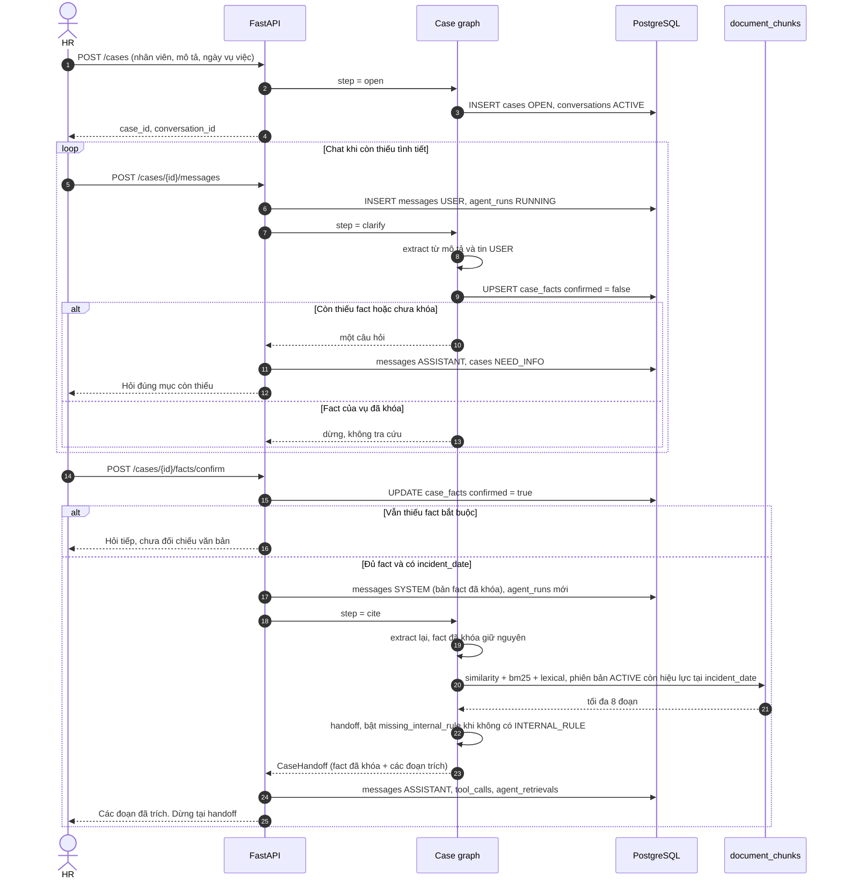
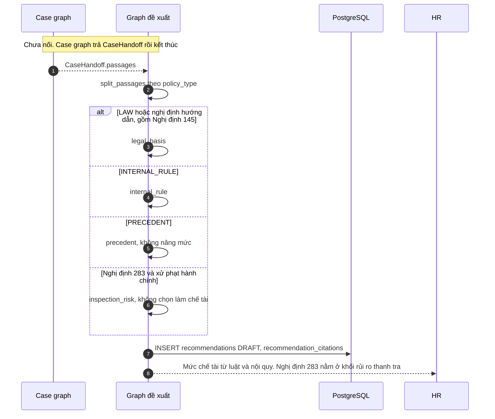

# Ghi lại cuộc trao đổi: kho `legal_*` và luồng `document_chunks`

- **Ngày:** 29/09/2026
- **Dự án:** P-029 HR Help
- **Phạm vi:** phân biệt hai kho văn bản, luồng retrieval của một vụ kỷ luật, và việc kho legal có tham gia feature hồ sơ hay không

Cuộc trao đổi bắt đầu từ nhận xét: thành viên pipeline thêm các bảng legal để chứa chunk và embedding của luật, nghị định, trong khi luồng retrieval của hồ sơ lại đọc `document_chunks`.

> **Cảnh báo — file lịch sử (cập nhật 06/10/2026).** Nội dung dưới đây ghi lại
> trạng thái ngày 29/09/2026, khi `document_chunks` **còn rỗng**. Từ đó ETL
> `scripts/seed_hr_from_legal.py` đã chạy: `document_chunks` nay có **1377 dòng**
> và corpus lên **4 văn bản / 1377 chunk / 599 cạnh dẫn chiếu**. Các câu trả lời
> còn đúng (hai kho tách biệt, cite không import `legal.*`) nhưng các câu nói
> "`document_chunks` rỗng" hoặc "chưa có lệnh INSERT" thì **đã lỗi thời**.
>
> Xem bản cập nhật: [`qa-legal-va-document-chunks.md`](./qa-legal-va-document-chunks.md).

## 1. Hai kho có dẫm chân nhau không

Hai kho không ghi đè và không đọc chung một dòng. Chúng nằm cùng một Postgres, không có khóa ngoại với nhau.

Luồng cite của hồ sơ (`search_policies` trong `src/features/cite/model/store.py`) chỉ đi theo:

`policies` → `policy_versions` → `documents` → `document_chunks`

Nó lọc phiên bản đang có hiệu lực vào `incident_date`, và chỉ lấy tài liệu có `ingest_status` là `CHUNKED` hoặc `EMBEDDED`. `recommendation_citations.chunk_id` trỏ vào `document_chunks.id` (UUID).

Kho legal là bốn bảng riêng, khóa dạng chuỗi (`BLLD:…`):

| Bảng | Việc của bảng |
|---|---|
| `legal_documents` | Một văn bản: Bộ luật Lao động, Nghị định 145/2020, Nghị định 283/2026 |
| `legal_chunks` | Chunk điều, khoản, điểm |
| `legal_chunk_embeddings` | Vector `mistral-embed` 1024 chiều |
| `legal_chunk_references` | Cạnh dẫn chiếu build-time; ETL sang `chunk_references`, được node `expand` đọc hop-1 trong retrieval thật |

`hybrid_search` trong `src/services/hybrid_search.py` chỉ join `legal_chunk_embeddings` với `legal_chunks`. Trong code ứng dụng không có chỗ nào gọi hàm này. Người gọi duy nhất là `scripts/eval_retrieval.py`.

Cùng một điều luật có thể được cắt thành chunk ở cả hai kho, thành hai bản sao độc lập. Cite của hồ sơ chỉ thấy bản nằm trong `document_chunks`. Dữ liệu pipeline đã nạp (Bộ luật Lao động, Nghị định 145, Nghị định 283, khoảng 1289 chunk) nằm trong `legal_chunks`. Code chưa có lệnh `INSERT` vào `document_chunks`. Nội quy công ty không có trong bộ seed legal. Phía hồ sơ chỉ coi một đoạn là nội quy khi `policies.policy_type` là `INTERNAL_RULE` và chunk đó nằm trong `document_chunks`.

Kho hồ sơ chọn phiên bản theo ngày vụ việc. Kho legal không có `effective_from` / `effective_to` và không lọc theo `incident_date`.

## 2. Ba loại dữ liệu của nghiệp vụ

Nghiệp vụ: HR nhập một vụ vào chatbot. Hệ thống dựa trên luật, nghị định và quy định công ty để đề xuất chế tài, tránh lẫn ba nguồn đó, và không trộn các vụ với nhau.

Hệ thống giữ ba loại dữ liệu. Chúng không thay nhau.

**Hồ sơ vụ việc** là một dòng `cases`: một nhân viên, một `incident_date`, một mô tả, một trạng thái. Chat nằm ở `conversations` và `messages`. `case_facts` là tờ tình tiết rút từ mô tả và tin nhắn của đúng vụ đó. Ví dụ nghỉ không phép cần loại hợp đồng, số ngày nghỉ, hình thức báo, đã lập biên bản chưa, đã yêu cầu giải trình chưa. Fact không phải điều luật, và không được đem đi tìm cho vụ khác.

**`document_chunks`** là lát đã cắt của một file chính sách. `documents` trong schema là file của một phiên bản chính sách, không phải hồ sơ kỷ luật. `policies.policy_type` nhận `LAW`, `DECREE`, `CIRCULAR`, `INTERNAL_RULE`, `PRECEDENT`. Cite dùng loại này để xếp đoạn vào căn cứ luật, nội quy, tiền lệ, hoặc cảnh báo thanh tra. Thiếu đoạn `INTERNAL_RULE` thì `missing_internal_rule` bật. Kho này hiện chưa có lệnh ghi chunk.

**Kho `legal_*`** là tủ văn bản đã cắt sẵn của pipeline. Chatbot chưa đọc. `hybrid_search` chỉ được script đánh giá gọi.

Một vụ đi như sau. HR tạo hồ sơ. Chat chạy bước làm rõ và ghi `case_facts` chưa xác nhận. Khi HR xác nhận đủ fact và hồ sơ có `incident_date`, cite tìm trong `document_chunks` của phiên bản còn hiệu lực ngày đó, rồi đóng `CaseHandoff`. Graph đề xuất chế tài là graph riêng và chưa được case graph gọi.

Sau handoff, `split_passages` xếp đoạn theo `policy_type`:

| Tầng | Nguồn | Dùng để |
|---|---|---|
| `legal_basis` | `LAW`, nghị định và thông tư hướng dẫn kỷ luật, gồm Nghị định 145 | Căn cứ công ty được xử lý |
| `internal_rule` | `INTERNAL_RULE` đúng ngày vụ việc | Mức cụ thể nội quy cho phép |
| `precedent` | `PRECEDENT` | Vụ đã xử trước. Không được nâng mức |
| `inspection_risk` | Nghị định 283 và văn bản xử phạt hành chính | Cảnh báo thanh tra. Không được chọn làm chế tài |

## 3. Sequence đang chạy

Cite chỉ đọc `document_chunks`. Kho `legal_*` không có mặt trong chuỗi. Graph đề xuất nằm sau `CaseHandoff` và chưa được gọi.

Bước đề xuất được thiết kế ngay sau handoff. Case graph hiện không gọi nó.

## 4. Ý nghĩa từng bảng quanh `document_chunks`

Nhóm này là kho văn bản căn cứ. Một chính sách tách thành bốn bậc.

| Bảng | Một dòng là gì |
|---|---|
| `policies` | Một chính sách. `code`, `name`, `policy_type`, `is_active`. Tắt `is_active` thì cite bỏ qua cả văn bản. |
| `policy_versions` | Một lần ban hành. `version`, `effective_from`, `effective_to` (tính cả ngày cuối), `status` là `DRAFT`, `ACTIVE` hoặc `ARCHIVED`. Hai bản của cùng một chính sách không chồng ngày. Mỗi chính sách chỉ một bản `ACTIVE`. |
| `documents` | File của một phiên bản: tên, loại, đường lưu, nguồn, số trang, `content_hash`. `ingest_status` đi `UPLOADED` → `CHUNKED` → `EMBEDDED`, lỗi thì `FAILED`. Cite chỉ đọc `CHUNKED` hoặc `EMBEDDED`. |
| `document_chunks` | Một lát của file. `content` là chữ. `article`, `clause`, `point` là điều, khoản, điểm. `chunk_index` là thứ tự. `section`, `section_title` là mục lục. `page_number` là trang. `metadata` giữ thêm thông tin như tên điều. `embedding` là vector 1024 chiều. |

Ví dụ: Bộ luật Lao động là một dòng `policies` với `policy_type = LAW`. Bản hợp nhất đang dùng là một dòng `policy_versions`. File của bản đó là một dòng `documents`. Điều 125 là một dòng `document_chunks`.

`agent_retrievals` ghi chunk mà một lượt cite vừa lấy: `agent_run`, hạng, điểm. `recommendation_citations` ghi chunk mà một đề xuất dựa vào, kèm `quote`. Graph đề xuất hiện chưa ghi các dòng citation.

## 5. Kho legal được đưa vào để làm gì

Kho `legal_*` là tủ của pipeline dữ liệu, dựng để một agent hỏi đáp luật gọi vào. Agent đó là bước B8 và chưa được làm. Hiện tủ này phục vụ script chấm chất lượng tìm kiếm.

Pipeline lấy ba file, cắt theo điều, khoản, điểm, rồi xếp bốn bảng:

| Bảng | Việc nó được tạo ra để làm |
|---|---|
| `legal_documents` | Một văn bản. Bộ luật Lao động là `PARTIALLY_AMENDED`. Hai nghị định là `ACTIVE`. |
| `legal_chunks` | 1289 đoạn. Giữ câu chữ, breadcrumb, số điều, số khoản, điểm, mức cắt `ARTICLE` / `CLAUSE` / `POINT`. |
| `legal_chunk_references` | 565 cạnh dẫn chiếu. Khoảng 60 chỗ trích luật ngoài ba văn bản thì để trống đích. |
| `legal_chunk_embeddings` | Vector 1024 chiều và hash của chữ lúc embedding. |

`hybrid_search` lấy 20 đoạn gần nghĩa cộng 20 đoạn trùng từ, rồi gộp. Bộ đề 10 câu đo hybrid đúng điều trong top 5 với 9/10 câu. README pipeline ghi cửa này là chỗ agent sẽ gọi. B8 chưa có. Luồng HR được viết trên chuỗi `document_chunks` từ trước và không rẽ sang cửa này. Khi gộp pipeline, bảng được đặt tiền tố `legal_` để khỏi đụng tên `documents` và `document_chunks`.

Hai nhóm cùng làm việc cắt văn bản thành đoạn để tìm, nên trùng chức năng ở việc đó. Phần còn lại khác nhau:

| | Nhóm `policies` → `document_chunks` | Nhóm `legal_*` |
|---|---|---|
| Ra đời từ | Schema xử lý hồ sơ kỷ luật | Pipeline nạp 3 văn bản, bước B4–B7 |
| Dùng cho | Cite của một vụ HR, rồi đề xuất chế tài | Agent hỏi đáp luật, bước B8 |
| Đang có dữ liệu trong code/pipeline | Chưa có lệnh ghi chunk | 3 văn bản, 1289 chunk, 1289 vector, 565 dẫn chiếu |
| Ai đang đọc | Luồng hồ sơ khi HR chốt fact | Script chấm 10 câu tìm kiếm |
| Gắn với một vụ | Có. `agent_retrievals.chunk_id` trỏ vào đây | Không có khóa tới `cases` |
| Thêm riêng | Ngày hiệu lực theo `incident_date`, `policy_type`, chỗ cho nội quy và tiền lệ | Đồ thị dẫn chiếu, hash vector, lọc theo mức cắt |

Cùng một bộ luật không được thiết kế để embedding hai lần. Feature hồ sơ chỉ đọc `document_chunks`. Muốn chatbot trích một điều khi HR chốt fact, đoạn đó phải nằm trong `document_chunks` của phiên bản còn hiệu lực vào `incident_date`.

## 6. Ví dụ: «Người A nghỉ không phép 5 ngày»

Luồng của câu này dừng ở `document_chunks`. Không có bước nào đọc `legal_chunks`.

Giả sử HR mở hồ sơ với mô tả đúng câu trên, tên nhân viên là A, ngày vụ việc 01/03/2026.

1. `POST /cases` ghi `cases` trạng thái `OPEN` và một hội thoại. Chưa cắt fact, chưa tìm văn bản.
2. `POST /cases/{id}/messages` chạy extract. Cụm «nghỉ không phép» chọn nhóm `UNAUTHORIZED_ABSENCE`. Câu chỉ điền được `absence_days = 5 ngày`, chưa xác nhận. `contract_type`, `notice_form`, `minutes_made`, `explanation_requested` còn trống. «Không phép» không được hiểu là «không báo». Hồ sơ chuyển `NEED_INFO`. Bot hỏi loại hợp đồng.
3. Khi năm fact đã khóa và có ngày 01/03/2026, `facts/confirm` chạy cite. Câu tìm là mô tả cộng các dòng fact, kèm cụm `kỷ luật sa thải nghỉ không phép tự ý bỏ việc`. Từ dừng như «không» và «ngày» bị bỏ. Danh sách từ mở đầu bằng `luật`, `thải`, `nghỉ`, `phép`, `việc`.
4. Ba nhánh similarity, BM25 và lexical tìm trên `document_chunks`, giữ tối đa 8 đoạn. Điều kiện: chính sách đang bật, phiên bản `ACTIVE`, khoảng hiệu lực phủ 01/03/2026, file `CHUNKED` hoặc `EMBEDDED`.

Đoạn đúng nghiệp vụ đang nằm trong file chunk của pipeline, mã `BLLD:CVIII:M01:A125`, Điều 125: sa thải khi người lao động tự ý bỏ việc 05 ngày cộng dồn trong 30 ngày hoặc 20 ngày cộng dồn trong 365 ngày. Cite không select `legal_chunks`.

`document_chunks` chưa có dòng nào, nên cả ba nhánh rỗng. Bước dự phòng cũng rỗng. Bước đó tìm trong mục lục các cụm «sa thải», «kỷ luật», «nghỉ không phép», «tự ý bỏ việc», «đơn phương chấm dứt». Handoff không có đoạn trích. `missing_internal_rule` là true. Graph đề xuất không được gọi. Fact `5 ngày` chưa ghi rõ 30 ngày hay 365 ngày, nên quy tắc sa thải cũng chưa được chốt.

## 7. Database đang chạy đang retrieval cái gì

Đã đếm trên container `p-029-db-1`, database `build_phase_p029`, ngày 29/09/2026.

| Bảng | Số dòng |
|---|---|
| `policies` | 0 |
| `policy_versions` | 0 |
| `documents` | 0 |
| `document_chunks` | 0 |

Alembic của database này dừng ở `04e5c85e7957`. Các bảng `legal_documents`, `legal_chunks`, `legal_chunk_embeddings` chưa được tạo trên database này. Bộ 1289 chunk nằm ở file JSON và script seed, chưa thành dòng mà cite đọc.

Retrieval tìm các dòng `document_chunks` thỏa bốn điều kiện ở mục 6. Bảng trống nên kết quả là danh sách rỗng. Nó không đọc kho legal dưới một tên khác.

`document_chunks` cũng không phải bảng metadata trỏ sang legal. Cột `content` tự chứa câu chữ của đoạn. Không có khóa ngoại từ `document_chunks.id` sang `legal_chunks.chunk_id`.

## 8. Bỏ kho legal thì luồng hồ sơ có chạy không

Với luồng hồ sơ thì bỏ được. Mở vụ, chat, chốt fact và cite không import `src.models.legal` và không gọi `hybrid_search`. Database đang chạy cũng chưa có các bảng `legal_*`.

Bỏ kho này không làm retrieval trích được thêm gì. `document_chunks` vẫn trống. Chữ Điều 125 không tự chuyển sang `content`.

Phần mất là tủ pipeline đã làm xong: 1289 đoạn, 1289 vector, 565 cạnh dẫn chiếu, và bài đo `hybrid_search`. Muốn cite trả về đoạn luật, đoạn đó phải được ghi vào `document_chunks` của một phiên bản còn hiệu lực vào ngày vụ việc.

## Kết luận đã chốt trong cuộc trao đổi

- Hai nhóm trùng chức năng «cắt luật thành đoạn để agent tìm».
- Luồng feature hồ sơ chỉ đọc `document_chunks`. Kho legal là tủ của pipeline B4–B7, chờ agent B8. B8 chưa làm.
- Không có con trỏ từ `document_chunks` sang legal. Mỗi kho tự giữ chữ của mình.
- Database ứng dụng đang chạy chưa có dữ liệu ở cả hai kho. Cite của vụ nghỉ không phép trả về rỗng.
- Bỏ legal không làm hỏng luồng hồ sơ, và cũng không làm luồng đó có chữ luật để trích.
