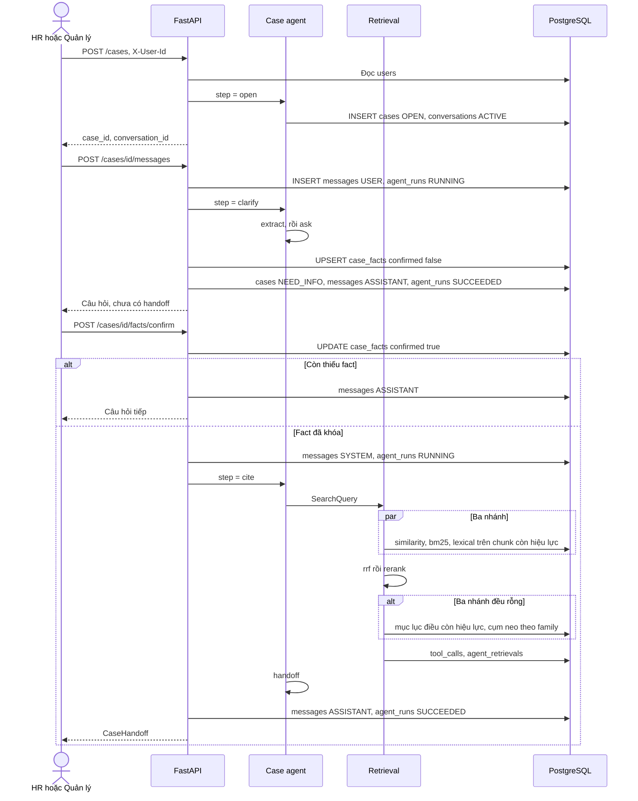

# Checklist case agent — feature 2, 3, 5

Ngày đối chiếu code: 29/09/2026.

Case agent là một LangGraph. Nó gồm mở hồ sơ, chat làm rõ tình tiết, và đối chiếu văn bản. Graph dừng ở message `CaseHandoff`. Feature 6, đề xuất chế tài, không phải node của graph này.

Prefix mọi route: `/api/v1`. Client gửi header `X-User-Id`.

## Checklist đã làm

### Chung

- [x] FastAPI đọc `users` theo `X-User-Id`. User phải active, role `HR` hoặc `MANAGER`.
- [x] Chỉ `cases.created_by` được xem và sửa vụ đó.
- [x] Một graph `src/agents/case_graph.py` với ba bước: `open`, `clarify`, `cite`.
- [x] Message chuẩn `CaseHandoff` trong `src/agents/handoff.py`.
- [x] Nhật ký lượt chạy: `agent_runs`. Nhật ký tìm kiếm: `tool_calls`, `agent_retrievals`.

### Feature 2 — Mở hồ sơ

- [x] `POST /cases` chạy bước `open` của case agent.
- [x] Body: `case_code`, `employee_code`, `employee_name`, `description`, `incident_date`.
- [x] `case_code` trùng trả `409`.
- [x] Ghi `cases` trạng thái `OPEN`, `created_by` là user trong header.
- [x] Ghi `conversations` trạng thái `ACTIVE`, gắn `case_id`, `title` là mã hồ sơ.
- [x] `GET /cases/{id}` đọc header hồ sơ và hội thoại ACTIVE.

### Feature 3 — Chat làm rõ tình tiết

- [x] `POST /cases/{id}/messages` chạy bước `clarify`.
- [x] Ghi tin `USER`, mở `agent_runs` trạng thái `RUNNING`, model `hr-help-rules`.
- [x] Rút fact từ mô tả hồ sơ và các tin `USER`. Fact đã `confirmed` không bị đè.
- [x] Ghi `case_facts` với `confirmed = false` và `source_message_id`.
- [x] Còn thiếu fact thì `cases.status` về `NEED_INFO` và tin `ASSISTANT` là câu hỏi kế tiếp.
- [x] Đủ key nhưng chưa xác nhận thì tin `ASSISTANT` là danh sách chờ xác nhận.
- [x] Lượt chat không gọi retrieval.
- [x] `GET /cases/{id}/facts` trả form tình tiết, không ghi database.
- [x] `POST /cases/{id}/facts/confirm` ghi `confirmed`, `confirmed_by`, `confirmed_at`.
- [x] Bộ fact: nghỉ không phép (`contract_type`, `absence_days`, `notice_form`, `minutes_made`, `explanation_requested`), đi muộn (`contract_type`, `late_days`, `minutes_made`, `explanation_requested`), chung (`contract_type`, `violation_summary`, `minutes_made`, `explanation_requested`).

### Feature 5 — Đối chiếu và trích dẫn

- [x] Chỉ chạy khi confirm đã khóa mọi fact bắt buộc và hồ sơ có `incident_date`.
- [x] Bước graph: `extract` → `retrieve` → `handoff`.
- [x] Sub-graph retrieval: `similarity`, `bm25`, `lexical` song song, rồi `rrf`, rồi `rerank`.
- [x] Ba nhánh đều rỗng thì node `page_index` lấy đầu điều còn hiệu lực theo cụm neo của family.
- [x] Mục lục không khớp thì `CaseHandoff.retrieval = empty` và `passages` để trống.
- [x] Lọc văn bản còn hiệu lực tại `incident_date` trước khi chấm điểm, kể cả bước mục lục.
- [x] Ghi `tool_calls` tên `search_policy` và `agent_retrievals` cho đoạn được giữ. `output.retrieval` là `hybrid`, `page_index`, hoặc `empty`.
- [x] `similarity` dùng cosine trên `document_chunks.embedding` khi query có vector 1536 chiều. Chưa có vector thì nhánh đó rỗng.
- [x] `bm25` chấm Okapi BM25 trên chunk còn hiệu lực.
- [x] `lexical` khớp từ trong nội dung chunk.
- [x] `rerank` giữ thứ tự sau RRF, là chỗ gắn cross-encoder sau.
- [x] Response `facts/confirm` trả `handoff`. Tin `ASSISTANT` báo số đoạn hybrid, số đầu điều từ mục lục, hoặc nói chưa lập căn cứ khi rỗng.

## Kiến trúc từ user tới feature 5



Node trong `src/agents/case_graph.py`:

```text
step = open     → open → dừng
step = clarify  → extract → ask → dừng
                         → dừng nếu fact đã khóa
step = cite     → extract → retrieve → handoff → dừng
```

`retrieve` gọi sub-graph `src/features/cite/model/pipeline.py`:

```text
similarity ─┐
bm25       ─┼→ rrf → rerank ─┬→ hits (hybrid) khi còn đoạn
lexical    ─┘                └→ page_index → hits (page_index) hoặc passages rỗng
```

RRF chờ cả ba nhánh. Một nhánh lỗi thì danh sách nhánh đó rỗng, hai nhánh kia vẫn được gộp. Tối đa 8 đoạn vào `CaseHandoff.passages`. Điểm trên đoạn hybrid là điểm RRF. Đoạn từ mục lục có `origin = page_index` và điểm 0.

`CaseHandoff` gồm `incident_date`, `employee_name`, `description`, `family`, `facts` đã confirmed, `fact_lines`, `passages`, `missing_internal_rule`, `agent_run_id`, `query`, `retrieval`. Message này là đầu ra của feature 5. Feature 6 đọc message đó khi được gắn sau.

## Fallback khi retrieval rỗng

Đã thêm ngày 29/09/2026, ghi trong `src/features/cite/model/page_index.py` và node `page_index` của `pipeline.py`.

Trước bước này, ba nhánh rỗng thì `rerank` trả `hits` rỗng. Handoff vẫn được đóng với `passages` rỗng và `missing_internal_rule = true`. Tin trợ lý vẫn nói đã đối chiếu 0 đoạn.

PageIndex của Vectify dựng cây mục lục rồi để một model chọn node. Cách đó hợp văn bản luật dài, vì similarity dễ trượt cấu trúc điều khoản. Cite của case agent chưa gọi model, nên bước fallback dùng mục lục đã nằm trên `document_chunks`: cột `article`, `section_title`, và `metadata.article_title`. Cụm neo theo family dài hơn danh sách 12 từ của lexical, ví dụ nghỉ không phép có thêm "đơn phương chấm dứt", đi muộn có thêm "thời giờ làm việc", vụ chung có "hình thức kỷ luật". Mỗi điều giữ chunk `chunk_index` nhỏ nhất. Tối đa 8 đầu điều, thứ tự `LAW`, `DECREE`, `INTERNAL_RULE`. `CaseHandoff.retrieval = page_index`.

Mục lục cũng không khớp thì `retrieval = empty`, `passages` để trống, và tin trợ lý nói chưa lập căn cứ. Không lấy N chunk đầu của kho.

Fallback này thêm đoạn khi điều liên quan dùng cụm nằm ngoài 12 từ khóa, hoặc cụm nằm ở tiêu đề điều / tiêu đề mục mà nội dung chunk không chứa từ lexical đang tìm. Kho còn hiệu lực không có các cụm đó thì handoff vẫn trống. Khi có model, có thể đổi cách chọn node trong cùng vị trí `page_index` trên graph.

## Data chảy giữa các bảng

`users` chỉ được đọc. Case agent không tạo tài khoản.

### Feature 2

```text
users.id
  └─ cases.created_by
       └─ conversations.case_id
            conversations.user_id = users.id
```

| Bảng | Chiều | Cột được ghi |
|---|---|---|
| `users` | đọc | — |
| `cases` | ghi | `case_code`, `created_by`, `employee_code`, `employee_name`, `description`, `incident_date`, `status = OPEN` |
| `conversations` | ghi | `user_id`, `case_id`, `title`, `status = ACTIVE` |

### Feature 3

```text
cases
  ├─ conversations.case_id
  │    └─ messages.conversation_id
  │         └─ agent_runs.message_id
  │              agent_runs.output_message_id → messages
  └─ case_facts.case_id
       case_facts.source_message_id → messages
       case_facts.confirmed_by → users
```

| Bảng | Chiều | Khi nào |
|---|---|---|
| `cases` | đọc, sửa `status` | Thiếu fact thì `NEED_INFO`. Hồ sơ đang `ANALYZED` mà fact đổi thì recommendation `DRAFT` cũ thành `SUPERSEDED` |
| `conversations` | đọc | Hội thoại `ACTIVE` mới nhất |
| `messages` | ghi | `USER` khi HR gửi. `ASSISTANT` là câu hỏi hoặc danh sách chờ xác nhận |
| `case_facts` | ghi | Một dòng cho mỗi `case_id` + `fact_key`. Chat để `confirmed = false`. Confirm đặt `confirmed = true`, `confirmed_by`, `confirmed_at` |
| `agent_runs` | ghi | Một run cho lượt chat. `RUNNING` rồi `SUCCEEDED`, hoặc `FAILED` nếu lượt chat lỗi |

`GET /cases/{id}/facts` chỉ đọc `cases`, `conversations`, `messages` role `USER`, và `case_facts`.

### Feature 5

```text
cases.incident_date
  └─ policy_versions.effective_from / effective_to
       └─ documents.policy_version_id
            └─ document_chunks.document_id
                 ├─ agent_retrievals.chunk_id
                 └─ CaseHandoff.passages.chunk_id
agent_runs
  └─ tool_calls.agent_run_id
  └─ agent_retrievals.agent_run_id
```

| Bảng | Chiều | Khi nào |
|---|---|---|
| `messages` | ghi | `SYSTEM` là fact đã chốt. `ASSISTANT` báo số đoạn đã giữ, `metadata.kind = handoff` |
| `agent_runs` | ghi | Run của lượt đối chiếu, `output_message_id` trỏ tin `ASSISTANT` |
| `policies` | đọc | `is_active`, `policy_type`, `code`, `name` |
| `policy_versions` | đọc | `ACTIVE`, còn hiệu lực tại `incident_date` |
| `documents` | đọc | `ingest_status` là `CHUNKED` hoặc `EMBEDDED` |
| `document_chunks` | đọc | Nội dung, điều, khoản, điểm, `section_title`, `metadata.article_title`, embedding nếu có |
| `tool_calls` | ghi | `search_policy`. Input có query, ngày vụ, từ khóa, bốn tên nhánh. Output có số đoạn, `chunk_id`, và `retrieval` |
| `agent_retrievals` | ghi | Một dòng mỗi đoạn được giữ: `chunk_id`, `score`, `rank` |

`recommendations`, `recommendation_citations`, và `case_violations` không được ghi ở feature 5. `GET /cases/{id}/answer` đọc các bảng đề xuất nếu đã có dòng. Case agent không tạo dòng đó.

`missing_internal_rule` trên message là `true` khi không đoạn nào có `policies.policy_type = INTERNAL_RULE`. Cờ này không có cột riêng.
