# HR Help — Feature và sequence diagram

- **Mã dự án:** P-029
- **Sản phẩm:** HR Help
- **Ngày:** 01/10/2026
- **Trạng thái:** Luồng người đã gắn trên kiến trúc `src/` hiện có. HR lập biên bản rồi gửi pháp chế hoặc chuyển thẳng quản lý. Pháp chế duyệt hoặc yêu cầu xử lý lại. Quản lý duyệt lần cuối. Không đổi cây `backend/app/`

Tài liệu này mô tả các feature cần có để biến khung template thành một ứng dụng xử lý kỷ luật lao động dùng được. Mỗi feature có một sequence diagram chi tiết.

Thành phần dùng chung trong các sơ đồ:

| Thành phần | Vai trò trong luồng |
|---|---|
| HR | Mở hồ sơ, chat, lập biên bản. Gửi phiếu `POST /cases/{id}/ticket` hoặc xử lý luôn `POST /cases/{id}/escalate` |
| Pháp chế | Hàng chờ mọi hồ sơ `PENDING_LEGAL` theo vai trò. Duyệt thì sang quản lý. Từ chối thì yêu cầu HR xử lý lại, bắt buộc có ghi chú |
| Quản lý | Hàng chờ `GET /manager/queue`. Duyệt lần cuối bằng `POST /cases/{id}/decisions`. Tạo, sửa, xóa tài khoản HR và pháp chế qua `/manager/users` |
| Web | Ứng dụng Vite React trong `frontend/` |
| FastAPI | Kiểm tra quyền, gọi từng sub-agent, ghi database |
| LangGraph | Case graph, recommend graph, dispatch graph. Mỗi graph một lần gọi |
| PostgreSQL | Hồ sơ, fact, hội thoại, đề xuất, nháp, review, quyết định |
| pgvector | Chunk văn bản và embedding tiền lệ |

## Repo đang có gì

| Lớp | Đã có | Chưa có |
|---|---|---|
| Sản phẩm | Đăng nhập, mở hồ sơ, chat, đối chiếu, đề xuất, đẩy phiếu, duyệt, ban hành, tiền lệ, đóng hồ sơ, dashboard, xuất JSON/Markdown, giao diện `frontend/` | PDF. Access token vẫn sống đến khi hết hạn |
| Agent | Case graph, recommend graph, dispatch graph. Tên ledger: `hr-help-rules`, `hr-help-retrieval`, `hr-help-assessment`, `hr-help-dispatch`. `POST /api/v1/chat` vẫn là graph mẫu, không thuộc luồng hồ sơ | Graph duyệt hoặc graph ký. Người quyết định, agent không duyệt |
| Dữ liệu | Hồ sơ, fact, hội thoại, đề xuất, trích dẫn, nháp, `reviews`, `disciplinary_decisions`, `audit_logs`, `notifications`, `idempotency_keys`, `revoked_tokens`. Migration `0007_manager_notice` | Không xóa lịch sử duyệt, quyết định, hay audit |
| Kho luật | `scripts/seed_hr_from_legal.py` đổ `BLLD_2019`, `ND145_2020`, `ND283_2026` và nội quy `NQCT` vào `policies` → `policy_versions` → `documents` → `document_chunks` (1377 chunk, embedding 1024 chiều, `search_tsv`) | Feature 5 không đọc bốn bảng `legal_*` |

Năm vai trò là `HR`, `MANAGER`, `LEGAL`, `SIGNER`, `ADMIN`. Mức kỷ luật công ty là khiển trách (`WARNING`), cảnh cáo (`REPRIMAND`), kéo dài nâng lương (`WAGE_POSTPONEMENT`), cách chức (`DEMOTION`) và sa thải (`DISMISSAL`). `TERMINATION` còn trong ràng buộc SQL cũ nhưng dịch vụ ban hành không ghi mức đó. Sa thải và chấm dứt hợp đồng là hai căn cứ khác nhau. Agent không tự chọn mức nặng hơn, và không hard-code ngưỡng ngày.

## Feature nên có

Ưu tiên bám pain point: HR và quản lý mất thời gian tra cứu, dễ áp sai mức, quyết định thiếu căn cứ và không nhất quán giữa các vụ giống nhau.

| # | Feature | Vì sao cần | Bám bảng nào |
|---|---|---|---|
| 1 | Đăng nhập và phân quyền | Hồ sơ kỷ luật là dữ liệu nhạy cảm. Người tạo hồ sơ, người được xem, người được duyệt phải khác nhau | `users`, `case_access` |
| 2 | Mở hồ sơ vụ việc | Mọi tư vấn phải gắn một vụ, một nhân viên, một ngày xảy ra | `cases`, `conversations` |
| 3 | Chat làm rõ tình tiết | Luật không áp được nếu thiếu loại hợp đồng, số ngày nghỉ, đã lập biên bản chưa, đã yêu cầu giải trình chưa | `conversations`, `messages`, `case_facts`, `agent_runs` |
| 4 | Kho văn bản theo ngày hiệu lực | Căn cứ là bản đang có hiệu lực vào `incident_date`, không phải bản đang mở hôm nay | `policies`, `policy_versions`, `documents`, `document_chunks` |
| 5 | Đối chiếu và trích dẫn | Đề xuất không có điều, khoản, điểm thì HR không dùng được | `tool_calls`, `agent_retrievals` |
| 6 | Đề xuất chế tài, quy trình, mức rủi ro | Sub-agent tổng hợp fact và đoạn retrieval thành một đánh giá có trích dẫn, rồi chốt mức khi trích dẫn khớp nguyên văn | `recommendations`, `case_violations` |
| 7 | Soạn nháp và đẩy ticket | Sub-agent đọc `ProposalHandoff` của feature 6. Đủ căn cứ thì soạn nháp và đẩy ticket. Chưa đủ thì giữ đề xuất | `case_drafts`, `recommendations` |
| 8 | Pháp chế duyệt | Chỉ hồ sơ feature 7 đã đẩy sang `PENDING_LEGAL`. Người duyệt, agent không tự duyệt | `reviews` |
| 9 | Ban hành quyết định và lưu tiền lệ | Vụ sau tra được vụ trước đã xử thế nào | `disciplinary_decisions` |
| 10 | Tái phạm cùng nhân viên | Mức kỷ luật phụ thuộc việc đã bị xử trước đó | `cases.employee_code`, `case_violations` |
| 11 | Phân tầng căn cứ | Nghị định 283 là xử phạt của cơ quan nhà nước, không phải mức kỷ luật công ty được quyền áp | `policies.policy_type` |
| 12 | Nhật ký agent | Demo Day cần chứng minh agent đã tra gì, gọi tool gì, tốn bao nhiêu token | `agent_runs`, `tool_calls`, `agent_retrievals` |
| 13 | Dashboard vận hành | PRD có ghi chú dashboard đi muộn. Làm sau khi vòng kỷ luật chạy được | đếm từ `cases` |

Nên làm feature 1–9 cho bản dùng được. Feature 10–12 làm cùng lúc nếu còn sức, vì schema đã chờ sẵn. Dashboard đi muộn để sau.

Ranh giới human-in-the-loop giữ nguyên theo PRD: agent phân tích, cảnh báo, soạn nháp và đẩy ticket khi message của feature 6 đủ căn cứ. Pháp chế phê duyệt. Người có thẩm quyền ban hành quyết định và chịu trách nhiệm.

## Luồng xương sống của một vụ

`cases.status` chỉ nhận các giá trị `OPEN`, `NEED_INFO`, `ANALYZED`, `PENDING_LEGAL`, `APPROVED`, `REJECTED`, `DECIDED`, `CLOSED`.

Mở hồ sơ không gọi agent. Chat là cửa vào. Một lượt chat đủ tình tiết và có `incident_date` đi hết case graph → recommend graph → dispatch graph. Feature 6 chỉ đọc `CaseHandoff`. Feature 7 chỉ đọc `ProposalHandoff`. Chưa đủ căn cứ thì hồ sơ ở `ANALYZED`, recommendation giữ `DRAFT`, không có `case_drafts`. Đủ căn cứ thì cùng request trả bản xem trước của bốn nháp, `ticket.disposition = PREVIEW`, và hỏi HR có đẩy cho pháp chế không. Bốn nháp chỉ được ghi, recommendation sang `PENDING_REVIEW` và hồ sơ sang `PENDING_LEGAL` khi HR gửi `POST /api/v1/cases/{id}/ticket` kèm mã pháp chế. HR không gửi thì hồ sơ ở lại `ANALYZED`. Feature 8 chưa có route duyệt, nên chuỗi agent dừng tại hàng chờ đó.

`POST /api/v1/cases/{id}/facts/confirm` là lối sửa tình tiết. Chat không đợi lối này. Khi fact đã khóa, lối confirm cũng gọi feature 5, 6 và 7. Nhánh `SUBMIT` của cả hai lối đều dừng ở bản xem trước và dùng cùng cửa `POST /ticket`. Pháp chế duyệt hoặc từ chối phiếu đó. Hồ sơ `REJECTED` được HR mở lại. Người ký chỉ ban hành khi hồ sơ `APPROVED`. Đóng hồ sơ chỉ đi từ `DECIDED` khi đã có quyết định.

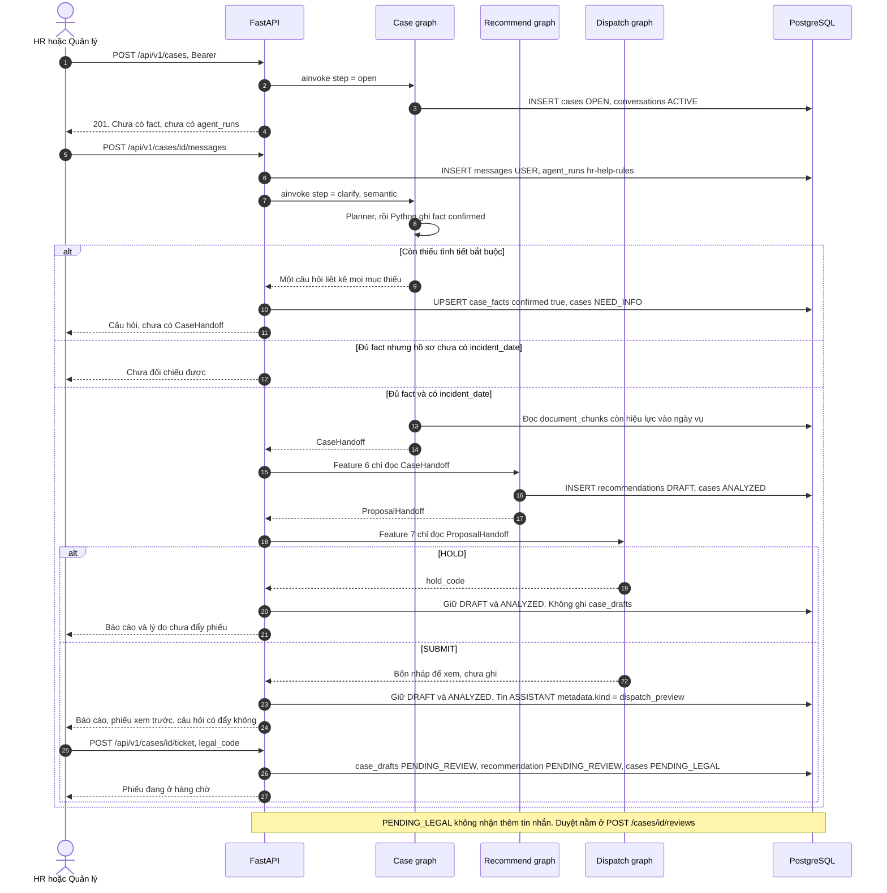

## 1. Đăng nhập và quyền trên hồ sơ

`HR` mở hồ sơ, lập biên bản, rồi gửi phiếu hoặc chuyển thẳng quản lý. `LEGAL` duyệt phiếu hoặc yêu cầu xử lý lại, không sửa fact. Trang pháp chế thấy mọi hồ sơ `PENDING_LEGAL`. `MANAGER` duyệt lần cuối mức đã lưu. `SIGNER` vẫn ban hành trên hàng quyết định, không sửa đề xuất. `ADMIN` quản trị người dùng, văn bản và số liệu, nhưng không duyệt phiếu và không ký thay. Người tạo hồ sơ có đủ quyền trên vụ của mình. `LEGAL` và `SIGNER` không được cấp `EDIT`.

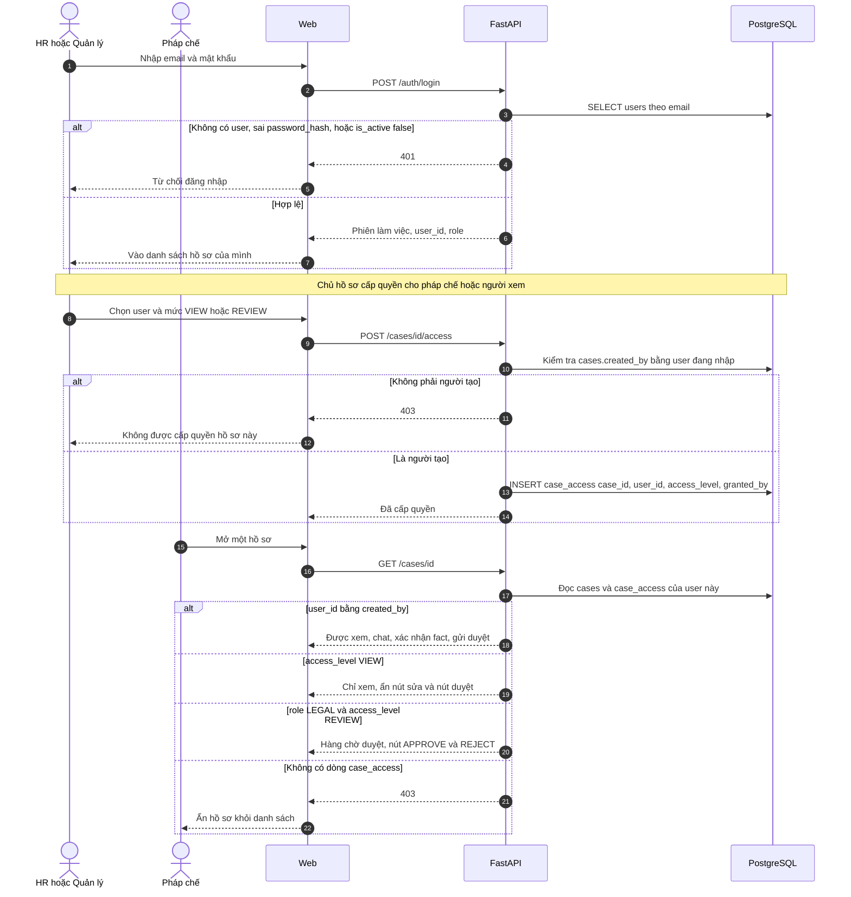

## 2. Mở hồ sơ vụ việc

Mọi tư vấn gắn một vụ, một nhân viên và một ngày xảy ra. `incident_date` ghi trên `cases` là mốc feature 5 dùng để chọn `policy_versions` còn hiệu lực. Kho chữ luật hiện có là `BLLD_2019` (`LAW`, từ 2021-01-01), `ND145_2020` (`DECREE`, 2021-02-01 đến 2026-09-09) và `ND283_2026` (`DECREE`, từ 2026-09-10), nằm trên `policies` → `policy_versions` → `documents` → `document_chunks`. Bước mở hồ sơ chỉ ghi `cases` và `conversations`.

`POST /api/v1/cases` chạy node `open` của case graph rồi dừng. Chưa có tin nhắn, chưa có `agent_runs`, chưa rút fact. Client gửi `Authorization: Bearer` sau `POST /api/v1/auth/login`. Quyền là `case:open`. `users.role` phải là `HR` hoặc `MANAGER`. Token hỏng hoặc user không active thì 401. Role khác thì 403.

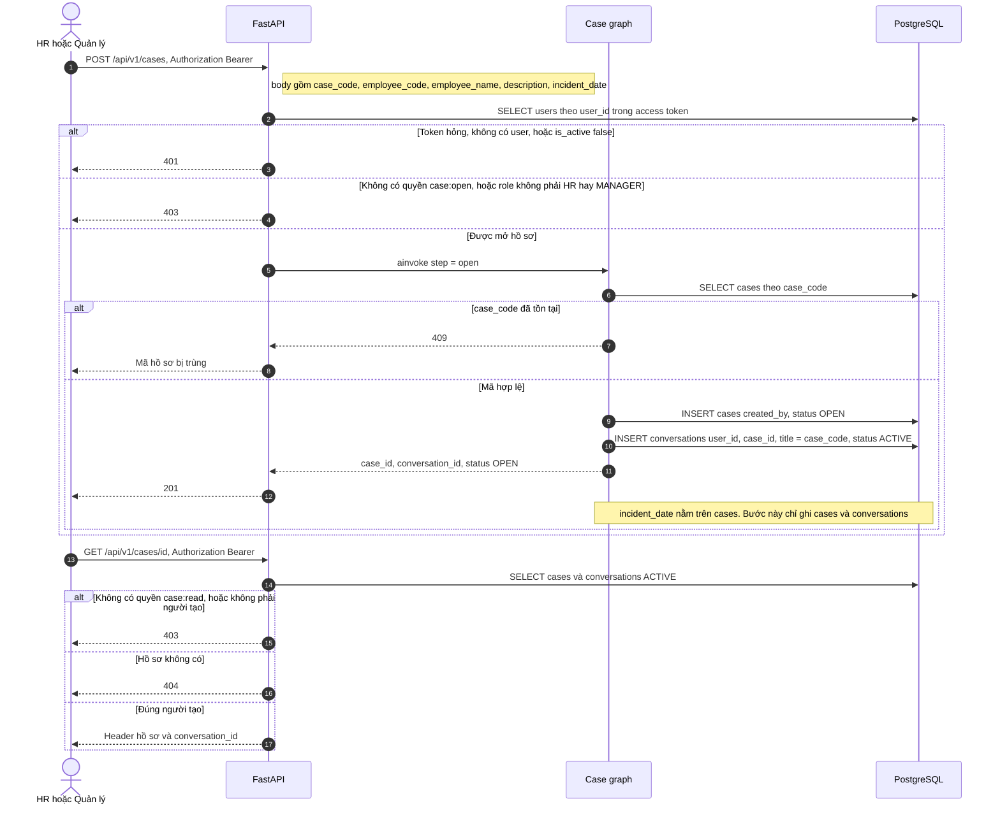

## 3. Chat làm rõ tình tiết

`POST /api/v1/cases/{id}/messages` chạy `step = clarify` với `semantic = true`. Client gửi `Authorization: Bearer`. Quyền là `case:chat`. `users.role` là `HR` hoặc `MANAGER`, và user là `cases.created_by`.

Extract gọi planner Mistral qua `MISTRAL_API_KEY`, `MODEL_NAME` và `FALLBACK_MODEL_NAME`. Python bỏ key lạ, giá trị mơ hồ và độ tin cậy dưới 0.5, rồi ghi fact hợp lệ với `confirmed = true` và `confirmed_by` là người gửi. Câu sau nêu giá trị khác thì thay giá trị đang lưu. Thiếu khóa hoặc planner lỗi sau một lần thử thì dùng bộ đọc regex. Dòng `key: value` vẫn được Python đọc. `agent_runs.model` của lượt chat là `hr-help-rules`.

Thiếu mục bắt buộc thì một câu hỏi liệt kê hết các mục đó, hồ sơ sang `NEED_INFO`, chưa có `CaseHandoff`. Đủ mục nhưng chưa có `incident_date` thì trả lời là chưa đối chiếu được, không retrieve. Đủ mục và có `incident_date` thì cùng graph đi `retrieve` → `handoff`. FastAPI đưa `CaseHandoff` sang feature 6 rồi feature 7 trong cùng request. Không có lần gọi `step = cite` riêng trên lối chat.

`POST /api/v1/cases/{id}/facts/confirm` là lối sửa tình tiết, không phải cổng bắt buộc của chat. Nhánh này dùng `assess` regex, không gọi planner. Fact vẫn thiếu thì hỏi lại và không mở `agent_runs` mới. Fact đã khóa và đã có đề xuất thì trả đề xuất đang lưu. Fact đã khóa mà chưa có đề xuất, hoặc vừa sửa thành đủ, thì chạy `step = cite` rồi feature 6 và 7.

Bộ fact bắt buộc theo loại vụ:

| Loại vụ | `fact_key` |
|---|---|
| Nghỉ không phép `UNAUTHORIZED_ABSENCE` | `contract_type`, `absence_days`, `notice_form`, `minutes_made`, `explanation_requested` |
| Đi muộn `LATE` | `contract_type`, `late_days`, `minutes_made`, `explanation_requested` |
| Chung `GENERAL` | `contract_type`, `violation_summary`, `minutes_made`, `explanation_requested` |

Hồ sơ còn nhận tin khi status là `OPEN`, `NEED_INFO`, `ANALYZED`, hoặc `REJECTED`. Status sau đó trả 409.

Lượt `clarify` đọc và ghi hội thoại với phiếu fact. Cửa đọc của đối chiếu là `document_chunks`, và cửa đó chỉ mở ở feature 5 sau khi fact bắt buộc đã khóa. `legal_documents`, `legal_chunks`, `legal_chunk_references` và `legal_chunk_embeddings` không tham gia lượt chat.

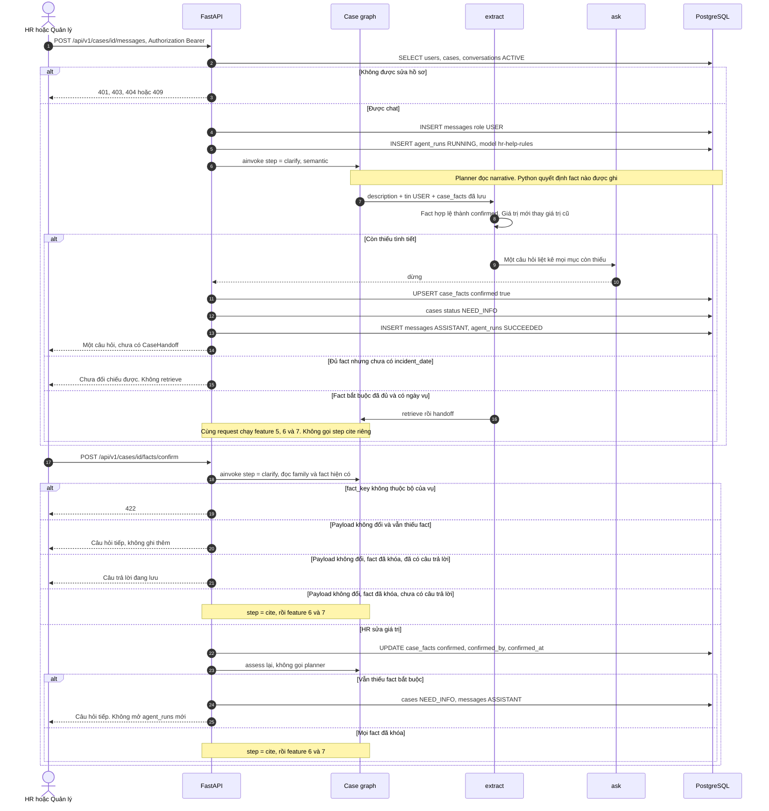

`GET /api/v1/cases/{id}/facts` chỉ đọc form tình tiết. Nó chạy `extract` để chiếu giá trị đang đọc được từ mô tả và tin `USER`, không ghi database.

Graph của một lượt chat:

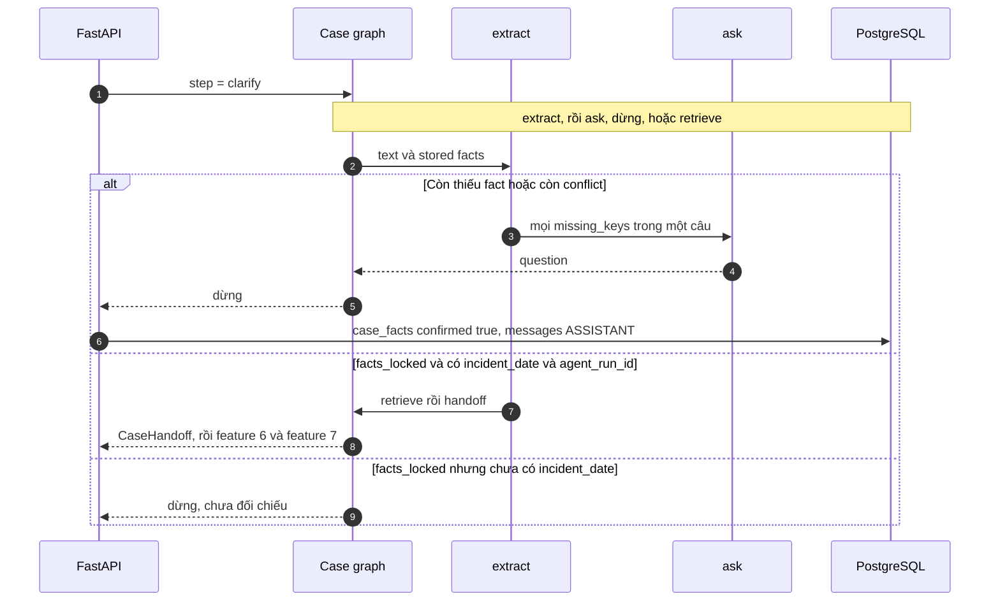

## 4. Nạp văn bản và khóa theo ngày hiệu lực

Ba văn bản luật đã nằm trên chuỗi HR: `scripts/seed_hr_from_legal.py` ghi `policies`, `policy_versions`, `documents` (`EMBEDDED`) và `document_chunks` (embedding `mistral-embed` 1024 chiều, `search_tsv`). Sơ đồ dưới đây là API tải file về sau, cho nội quy và văn bản mới. Mỗi chính sách (`LAW`, `DECREE`, `CIRCULAR`, `INTERNAL_RULE`, `PRECEDENT`) có nhiều phiên bản. Hai phiên bản của cùng một chính sách không được chồng ngày hiệu lực. Ràng buộc này đã nằm trong `policy_versions`.

Nội quy công ty (mã NQCT, hiệu lực từ 2026-01-01) đã nằm trong kho. Hồ sơ có ngày xảy ra từ ngày đó trở đi mới đối chiếu được nội quy này.


## 5. Đối chiếu và trích dẫn

Có hai cửa vào, cùng một node `retrieve` và cùng một `CaseHandoff`.

Chat đủ fact và có `incident_date` thì case graph đang ở `step = clarify` tự đi `retrieve` → `handoff`. Không có lần `ainvoke` thứ hai với `step = cite`. `agent_run_id` của lượt chat được đưa vào `SearchQuery`.

`POST /api/v1/cases/{id}/facts/confirm` khi fact đã khóa và hồ sơ có `incident_date` thì mở `agent_runs` mới, model `hr-help-rules`, ghi một tin `SYSTEM` các fact đã khóa, rồi `ainvoke` với `step = cite`: `extract` → `retrieve` → `handoff`. Hồ sơ chưa có `incident_date` thì 422.

Cả hai cửa dừng case graph ở `CaseHandoff`. FastAPI đưa message đó sang feature 6 trong cùng request. Response HTTP cho HR được trả sau feature 7. Nhánh `SUBMIT` của response đó là bản xem trước, chưa ghi phiếu.

`retrieve` dựng `SearchQuery` từ `cases.description` và `fact_lines`, rồi gọi retrieval graph. Cả ba nhánh và bước mục lục dùng một cửa đọc:

`policies.is_active` → `policy_versions` trạng thái `ACTIVE`, `effective_from` ≤ `incident_date` và `effective_to` tính cả ngày đó (`NULL` nghĩa là còn mở) → `documents.ingest_status` là `CHUNKED` hoặc `EMBEDDED` → `document_chunks`.

Ngày vụ 2026-03-01 gặp `BLLD_2019`, `ND145_2020` và nội quy `NQCT`. Ngày vụ từ 2026-09-10 gặp `BLLD_2019`, `ND283_2026` và `NQCT`. Ngày vụ trước 2026-01-01 không gặp `NQCT`. Script `scripts/seed_hr_from_legal.py` ghi `documents.ingest_status = EMBEDDED`. Mỗi chunk có `content`, `article`, `clause`, `point`, `section` (`ARTICLE`, `CLAUSE` hoặc `POINT`), `section_title` là breadcrumb dạng `TEXT`, và `metadata` giữ `article_title` cùng `legal_chunk_id`. `embedding` là `mistral-embed` 1024 chiều. `search_tsv` là `tsvector` sinh sẵn từ `section_title` và `content`, config `simple`, index GIN, migration `0004_document_chunks_tsv`.

`similarity` lấy cosine trên `document_chunks.embedding`. Query chưa có vector thì nhánh này embed `SearchQuery.text`. Vector khác 1024 chiều, thiếu `MISTRAL_API_KEY`, hoặc embed lỗi thì nhánh đó rỗng. `bm25` gọi `ts_rank` trên `search_tsv` của mọi chunk còn hiệu lực và giữ tối đa 8 đoạn. `lexical` là `ILIKE` trên `content`, trần 40 dòng, rồi giữ tối đa 8. Một nhánh lỗi thì kênh đó rỗng, hai nhánh kia vẫn được gộp. `rrf` rồi `rerank` giữ tối đa 8 đoạn, `retrieval = hybrid`. Cả ba rỗng thì `page_index` lấy đầu điều theo cụm neo của family, khớp `content`, `section_title` hoặc `metadata.article_title`. Mục lục cũng không khớp thì `passages` rỗng và `retrieval = empty`.

`missing_internal_rule` trên message là `true` khi không đoạn nào được giữ có `policy_type = INTERNAL_RULE`. `NQCT` là nội quy trong kho, hiệu lực từ 2026-01-01. Cờ này đúng khi lượt retrieval không giữ được đoạn nội quy, kể cả khi kho có `NQCT` nhưng ngày vụ nằm trước ngày hiệu lực hoặc đoạn đó không vào tám đoạn cuối.

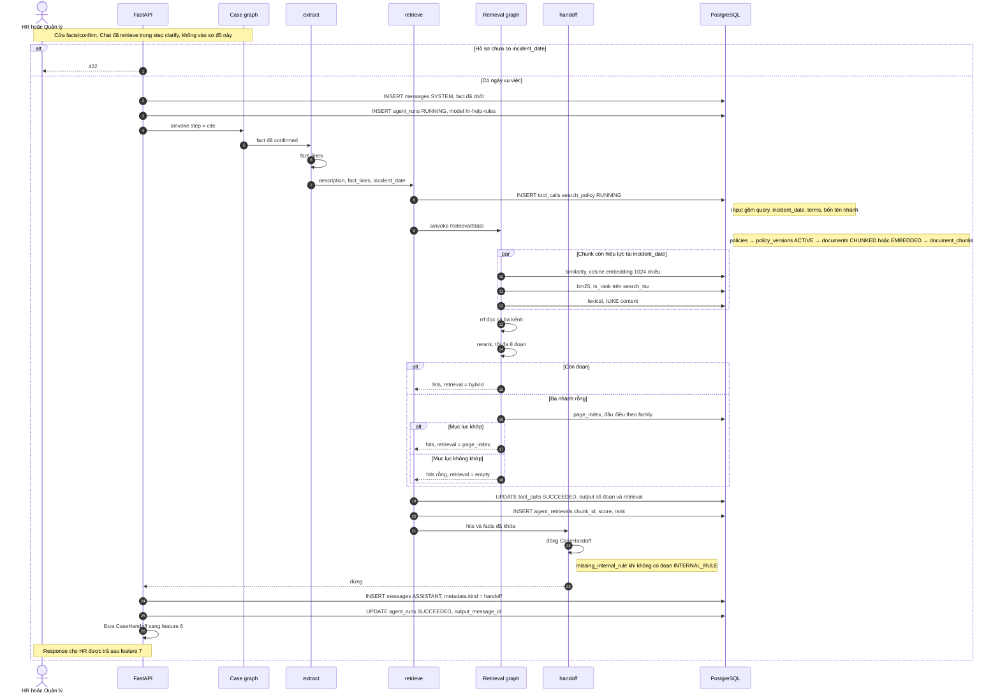

## 6. Đề xuất chế tài, quy trình, mức rủi ro

Sub-agent này nhận `CaseHandoff` của feature 5. Đầu vào retrieval là `passages` đã lọc theo `incident_date`. Agent không tra thêm văn bản. Mô hình tổng hợp đọc fact đã khóa và các đoạn đó, rồi trả một đánh giá có cấu trúc. Python chỉ giữ mức khi câu trích nằm nguyên văn trong đoạn được nêu, đoạn nội quy có tên mức đó, và có đoạn luật hoặc nghị định hướng dẫn đi kèm. Fact không có trong hồ sơ không được suy ra. Nhiều mức cùng được chứng minh thì chưa chọn.

Chuẩn là `AppliedStandard` trên câu trả lời và trên `ProposalHandoff`:

| Trường | Ý nghĩa |
|---|---|
| `sanction_type` | Đúng một mức đã được trích dẫn đủ, hoặc trống khi đánh giá chưa chốt |
| `process_steps` | Một quy trình: biên bản, giải trình, thời hiệu, người ký |
| `risk_level` | `LOW`, `MEDIUM`, `HIGH`, hoặc `CRITICAL` |
| `aligned` | `true` chỉ khi đã chốt một mức công ty |
| `layers` | Mỗi lớp một vai trò: `basis`, `level` hoặc `open`, `compare`, `excluded` |

| Nguồn trong retrieval | Lớp | Vai trò trong chuẩn |
|---|---|---|
| Luật, nghị định hướng dẫn như Nghị định 145 | `legal_basis` | Căn cứ pháp lý. Điều kiện trong đoạn phải khớp fact. Fact thiếu thì điều kiện là `UNKNOWN` |
| Nội quy còn hiệu lực | `internal_rule` | Mức công ty, chỉ khi đoạn được trích có đúng tên mức và đúng hành vi |
| Tiền lệ | `precedent` | Đối chiếu. Không nâng mức |
| Nghị định xử phạt, gồm Nghị định 283 | `inspection_risk` | Cảnh báo. Không vào `sanction_type` |

Graph là `precedent` rồi `recommend`. `recommend` tách `passages` thành bốn lớp. Python chặn model trước khi gọi nếu retrieval chỉ là mục lục, kho trống, hợp đồng thử việc, không có luật áp được, biên bản hoặc yêu cầu giải trình chưa xong, hoặc không có nội quy. Các cửa đó để `sanction_type` trống và rủi ro `HIGH`. Kho trống khi không còn lớp áp được thì rủi ro `CRITICAL`.

Model là Mistral qua `MISTRAL_API_KEY`, `MODEL_NAME` và `FALLBACK_MODEL_NAME`, temperature 0. Không có khóa, gọi lỗi, hoặc đánh giá `NEED_MORE_FACTS` thì mức trống và rủi ro `HIGH`. `MULTIPLE_SUPPORTED` để trống mức, rủi ro `MEDIUM`. Trích dẫn không phải nguyên văn trong chunk được nêu thì Python bỏ mức. Chuẩn không bao giờ nhận `TERMINATION`. Một mức đã được chứng minh vẫn chưa đủ để đẩy phiếu: feature 7 còn xét rủi ro, nội quy và thủ tục.

Kết quả ghi vào `recommendations`: nhận định, `sanction_type`, `process_steps`, `risk_level`. Mỗi citation giữ `quote`, điều, khoản, điểm và `chunk_id`.

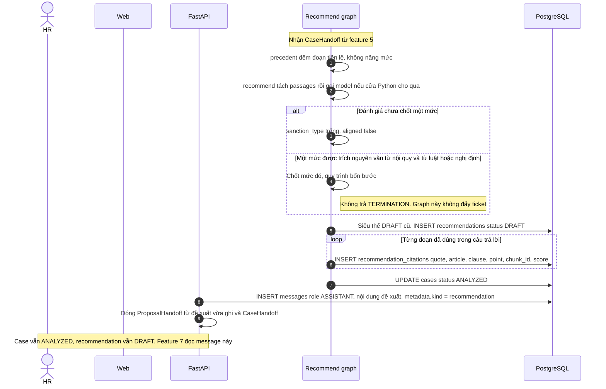

Feature 6 dừng tại `ProposalHandoff`. Message này là đầu vào duy nhất của feature 7. Feature 6 không tạo `case_drafts`, không ghi `reviews`, và không đổi hồ sơ sang `PENDING_LEGAL`.

Biên bản HR đọc trên màn hình là biểu mẫu có cấu trúc, không phải đoạn Markdown. Module `src/features/assessment/` đọc recommendation, tình tiết và citation đã lưu rồi trả JSON. Nó không gọi model lần hai, không bịa citation, không tự xác nhận và không gửi phiếu. Bộ tình tiết bắt buộc lấy theo mô tả vụ việc: nghỉ không phép thắng đi muộn. Bản nháp đang hỏi sai nhóm thì lần HR mở biên bản được lập lại một lần theo nhóm đó. Thiếu tình tiết bắt buộc thì chưa xác nhận được và phiếu không mở. Khi đã đủ căn cứ, sub-agent dispatch vẫn soạn phiếu xem trước như trước. Nút gửi pháp chế và “HR xử lý luôn” bật sau khi HR xác nhận biên bản, kể cả khi `ticket.disposition` là `HOLD` vì mức chưa khóa hoặc rủi ro còn cao. Chat không tự gửi. Mức `TERMINATION` vẫn không mở nút. Chưa xác nhận biên bản thì phiếu `HOLD` giữ nút đóng.

Mỗi lần lập, sửa hoặc xác nhận thêm một dòng `assessment_versions`. Bản cũ chuyển `SUPERSEDED` nếu đang là nháp. Xác nhận không ghi đè nội dung bản trước. Migration `0009_assessment_form`.

```text
GET    /api/v1/cases/{id}/assessment
POST   /api/v1/cases/{id}/assessment/generate
PATCH  /api/v1/cases/{id}/assessment
POST   /api/v1/cases/{id}/assessment/save
POST   /api/v1/cases/{id}/assessment/confirm
POST   /api/v1/cases/{id}/assessment/reanalyze
```

## 7. Soạn nháp và đẩy ticket

Sub-agent dispatch đứng sau feature 6. Case graph dừng ở `CaseHandoff`. Recommend graph dừng ở đề xuất đã ghi. Người gọi đóng `ProposalHandoff` rồi gọi dispatch graph. Dispatch graph không phải node của hai graph kia.

Cả chat và `facts/confirm` gọi dispatch ngay sau khi feature 6 ghi recommendation, trong cùng request. Chat chỉ tới đây khi case graph trả `CaseHandoff`. Hồ sơ không còn `ANALYZED` thì không gọi graph. `agent_runs.model` của lượt này là `hr-help-dispatch`. Nhánh `HOLD` kết thúc trong request đó. Nhánh `SUBMIT` chưa ghi nháp. `POST /api/v1/cases/{id}/ticket` gọi graph lần nữa, với cùng đề xuất cộng `legal_code`, rồi mới ghi.

Đầu vào duy nhất là `state['proposal']` kiểu `ProposalHandoff`. Sai kiểu thì graph ném `TypeError`. Lượt đó đánh `agent_runs` thành `FAILED`, hồ sơ giữ `ANALYZED`, recommendation giữ `DRAFT`. Graph không mở session, không đọc `messages`, không đọc `case_facts`, không tra `document_chunks`, không gọi model. Cột token để trống.

Feature 6 đã có các cột đề xuất và bốn lớp trích dẫn. `ProposalHandoff` đóng gói đúng các trường đó, cộng phần định danh mà feature 6 đã nhận từ `CaseHandoff`:

| Trường | Nội dung |
|---|---|
| `recommendation_id`, `case_id`, `agent_run_id` | Dòng `recommendations` vừa ghi, trạng thái vẫn `DRAFT` |
| `incident_date`, `employee_name` | Ngày vụ và tên trên hồ sơ đã khóa |
| `family` | `UNAUTHORIZED_ABSENCE`, `LATE`, hoặc `GENERAL` |
| `facts`, `fact_lines` | Chỉ fact đã confirmed |
| `rationale`, `sanction_type`, `process_steps`, `risk_level` | Cột trên `recommendations`. `sanction_type` để trống khi feature 6 chưa chốt mức |
| `missing_internal_rule` | `true` khi không có lớp nội quy |
| `message` | Cột `recommendations.recommendation`, câu HR đọc |
| `legal_basis`, `internal_rule`, `precedent`, `inspection_risk` | Citation đã phân tầng. Mỗi đoạn có `citation_id`, `chunk_id`, `policy_type`, `policy_code`, `policy_name`, `quote`, `article`, `clause`, `point`, `score` |
| `legal_code` | Email tài khoản pháp chế đang hoạt động. Bản xem trước để trống. Khác `employee.code` |

`process_steps` gồm bốn bước `MINUTES`, `EXPLANATION_REQUEST`, `TIME_LIMIT`, `SIGNER`. Mỗi bước có `code`, `label`, `done`.

FastAPI chỉ gọi graph khi hồ sơ đang `ANALYZED` và recommendation đang `DRAFT`. Lượt chat hoặc confirm chạy gate một lần. `POST /ticket` chạy lại graph khi HR đã chọn mã pháp chế và recommendation vẫn là `DRAFT`. Recommendation đã sang `PENDING_REVIEW` thì không gọi graph nữa.

Node `gate` đọc message và trả một trong hai hướng. `hold_code` lấy điều kiện đầu tiên khớp:

| Thứ tự | Điều kiện trên message | `hold_code` |
|---|---|---|
| 1 | `sanction_type` là `TERMINATION` | `TERMINATION` |
| 2 | `sanction_type` trống, hoặc không thuộc `WARNING`, `REPRIMAND`, `WAGE_POSTPONEMENT`, `DEMOTION`, `DISMISSAL` | `OPEN_SANCTION` |
| 3 | `risk_level` là `HIGH` hoặc `CRITICAL` | `RISK_HIGH` |
| 4 | `missing_internal_rule` là `true` | `MISSING_INTERNAL_RULE` |
| 5 | `MINUTES` hoặc `EXPLANATION_REQUEST` có `done = false` | `PROCEDURE_OPEN` |

Khớp một dòng thì `disposition = HOLD`. Không khớp dòng nào thì `disposition = SUBMIT`. Node `draft` chỉ chạy ở nhánh `SUBMIT`. Node này chép `sanction_type` từ message vào nháp, không chọn lại mức, không lấy mức từ `precedent` hay `inspection_risk`.

Nhánh giữ lại không ghi `case_drafts`, không ghi `reviews`, không đổi `recommendations.status`, không đổi `cases.status`. FastAPI ghi một tin `ASSISTANT` với `metadata.kind = dispatch_hold` và `metadata.hold_code`. Nội dung tin đó là `rationale` khi rationale có chữ, nếu không thì là câu của `hold_code`. Báo cáo trên `GET /answer` đưa `ticket.disposition = HOLD`, `ticket.hold_code` và câu ngắn của mã đó. Hồ sơ vẫn `ANALYZED`.

Nhánh đẩy ticket soạn đúng bốn nháp trong bộ nhớ, theo thứ tự `MINUTES`, `EXPLANATION_REQUEST`, `DECISION`, `TICKET`. `title` cắt còn tối đa 255 ký tự. `employee_name` trống thì tiêu đề không gắn tên. Lượt chat và `facts/confirm` chưa ghi `case_drafts`. Hồ sơ giữ `ANALYZED`, recommendation giữ `DRAFT`. Tin `ASSISTANT` có `metadata.kind = dispatch_preview` và câu hỏi HR xem phiếu rồi chọn có đẩy hay không. `GET /answer` và lượt chat trả bốn nháp `status = PREVIEW` (chưa có dòng trong `case_drafts`) cùng `ticket.disposition = PREVIEW`, `ticket.queue = READY`. `legal.code` trên phiếu xem trước là `null`.

- `MINUTES`: biên bản từ `fact_lines` và các bước đã `done`. Không bịa giờ họp hay người lập biên bản khi fact không có.
- `EXPLANATION_REQUEST`: ghi nhận đã yêu cầu giải trình. Không bịa hạn trả lời khi fact không có.
- `DECISION`: mức và nhận định, trích `legal_basis` và `internal_rule`. Nội dung ghi rõ đây là bản thảo, chưa có `decision_code`, chưa có người ký. `inspection_risk` nằm ở khối cảnh báo. `precedent` chỉ để đối chiếu.
- `TICKET`: phiếu chuyển pháp chế. Nội dung là JSON với `employee` (`name`, `code`), `case` (`case_id`, `incident_date`, `family`), `facts`, `legal` (`code`), `violation` (`summary`, `sanction_type`), `risk`, `process_steps`, và `citations` (`policy_type`, `policy_code`, `policy_name`, `quote`, `article`, `clause`, `point`, `chunk_id`).

HR đồng ý thì `POST /api/v1/cases/{id}/ticket` với body `legal_code` là email của một tài khoản pháp chế đang hoạt động. `GET /api/v1/legal-officers` liệt kê các email đó. Quyền là `case:chat`. Email trống hoặc không đúng dạng trả 422. Email không thuộc pháp chế trả 404. Hồ sơ không còn `ANALYZED` hoặc recommendation không còn `DRAFT` thì trả 409 và không ghi nháp. Gate `HOLD` cũng trả 409 khi biên bản chưa `CONFIRMED`, hoặc khi mức đã lưu là `TERMINATION`. Biên bản đã `CONFIRMED` thì HR vẫn gửi được: FastAPI soạn bốn nháp từ đề xuất đã lưu, không chọn mức mới, rồi `save_submission`. Khi gate là `SUBMIT`, FastAPI dựng lại `ProposalHandoff` từ recommendation và fact đã confirmed, gắn `legal_code`, gọi dispatch graph, rồi `save_submission`. `created_by` là `cases.created_by`, không phải user pháp chế và không phải agent. Bốn dòng `case_drafts` để `status = PENDING_REVIEW`, cùng `recommendation_id`. Recommendation chuyển `PENDING_REVIEW`. Hồ sơ chuyển `PENDING_LEGAL`. JSON của `TICKET` có `legal.code` bằng mã HR vừa nhập. Tin `ASSISTANT` có `metadata.kind = dispatch_submit`. `GET /answer` khi đó trả `ticket.disposition = SUBMIT`, `ticket.queue = PENDING_LEGAL`. HR không gửi thì hồ sơ ở lại `ANALYZED`.

Thiếu một loại nháp, trùng loại, recommendation không còn `DRAFT`, hoặc hồ sơ không còn `ANALYZED` thì không ghi `case_drafts`. Nếu flush lỗi, savepoint hoàn tác bốn nháp và hai lần đổi status. `agent_runs` thành `FAILED`. Transaction bên ngoài vẫn commit recommendation `DRAFT` và hồ sơ `ANALYZED`. `TypeError` vì message sai kiểu đi cùng đường đó.

Sub-agent không cấp `case_access`. Khi HR gửi phiếu, mọi tài khoản `LEGAL` đang hoạt động nhận thông báo và thấy hồ sơ trên trang pháp chế. Không cần cấp `REVIEW` trước.

Nháp `DECISION` chỉ là bản thảo cho feature 9. Dispatch graph không ghi `disciplinary_decisions`, không ghi `reviews`, không đặt `APPROVED`, `DECIDED` hay `CLOSED`.

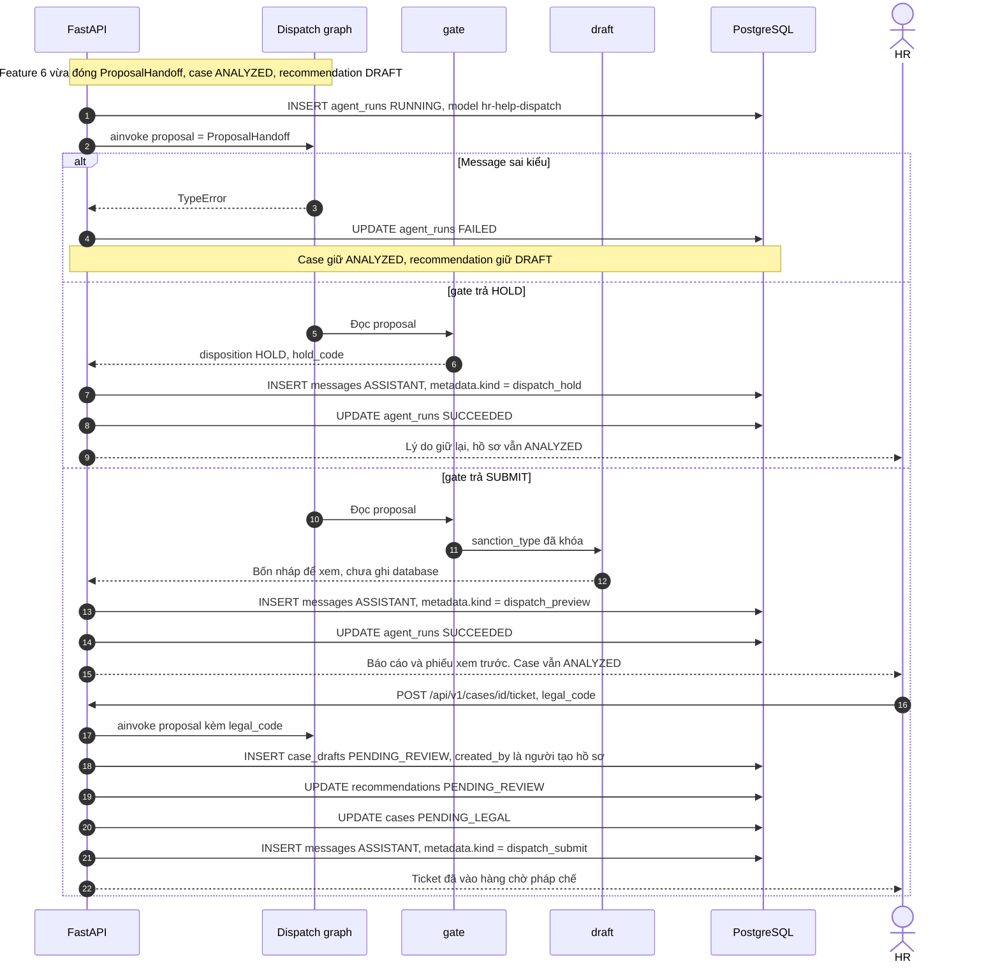

## 8. Pháp chế duyệt

Feature 8 là quyết định của người. Không có graph duyệt. Chuỗi agent dừng ở bản xem trước của feature 7. Phiếu chỉ vào hàng chờ khi HR gọi `POST /api/v1/cases/{id}/ticket`.

Điều kiện đẩy phiếu, trong một transaction: hồ sơ `ANALYZED`, recommendation `DRAFT`, cổng dispatch `SUBMIT`. Cùng lúc ghi bốn `case_drafts`, recommendation sang `PENDING_REVIEW`, hồ sơ sang `PENDING_LEGAL`, một dòng `audit_logs` `LEGAL_TICKET_SUBMITTED`, và thông báo cho mọi tài khoản `LEGAL`. Header `Idempotency-Key` trùng thân request thì trả kết quả cũ. Hai request đồng thời khóa dòng `cases` bằng `FOR UPDATE`.

HR có thể bỏ qua pháp chế bằng `POST /api/v1/cases/{id}/escalate` khi cổng vẫn `SUBMIT`. Bốn nháp và recommendation sang `APPROVED`, hồ sơ sang `APPROVED`, audit `HR_ESCALATED`, và thông báo `MANAGER_REVIEW_REQUESTED` cho quản lý. Pháp chế không nhận phiếu đó.

Hàng chờ của pháp chế là `GET /api/v1/legal/reviews/queue`. Chỉ role `LEGAL`, và là mọi hồ sơ `PENDING_LEGAL`. `ADMIN` có permission `legal:review` trên token nhưng service từ chối vì role không phải `LEGAL`.

`GET /api/v1/cases/{id}/review-pack` đọc báo cáo và nháp đã lưu. Không chạy lại agent.

`POST /api/v1/cases/{id}/reviews` nhận đúng:

```json
{ "decision": "APPROVE", "comment": "..." }
```

hoặc `REJECT`. `REJECT` bắt buộc có `comment`. Field thừa, kể cả `sanction_type`, bị từ chối. `reviews.decision` lưu `APPROVE` hoặc `REJECT`, đúng check constraint hiện có. Cùng transaction:

- `APPROVE`: recommendation, bốn nháp và hồ sơ sang `APPROVED`. Audit `LEGAL_APPROVED`.
- `REJECT`: recommendation, bốn nháp và hồ sơ sang `REJECTED`. Audit `LEGAL_REJECTED`.

API này không sửa `sanction_type`, `case_facts`, hay citation. Hồ sơ `PENDING_LEGAL`, `APPROVED`, `DECIDED`, `CLOSED` không nhận thêm tình tiết. Chat và confirm trả 409 `CASE_NOT_EDITABLE`.

`POST /api/v1/cases/{id}/reopen` dành cho HR hoặc quản lý có `EDIT`. `REJECTED` chuyển sang `NEED_INFO` hoặc `ANALYZED`. Dòng `reviews` giữ nguyên. Khi đích là `ANALYZED`, recommendation `REJECTED` thành `SUPERSEDED` và một bản sao `DRAFT` được tạo cùng trích dẫn, để HR gửi phiếu hoặc chuyển quản lý mà không cần đánh giá lại.

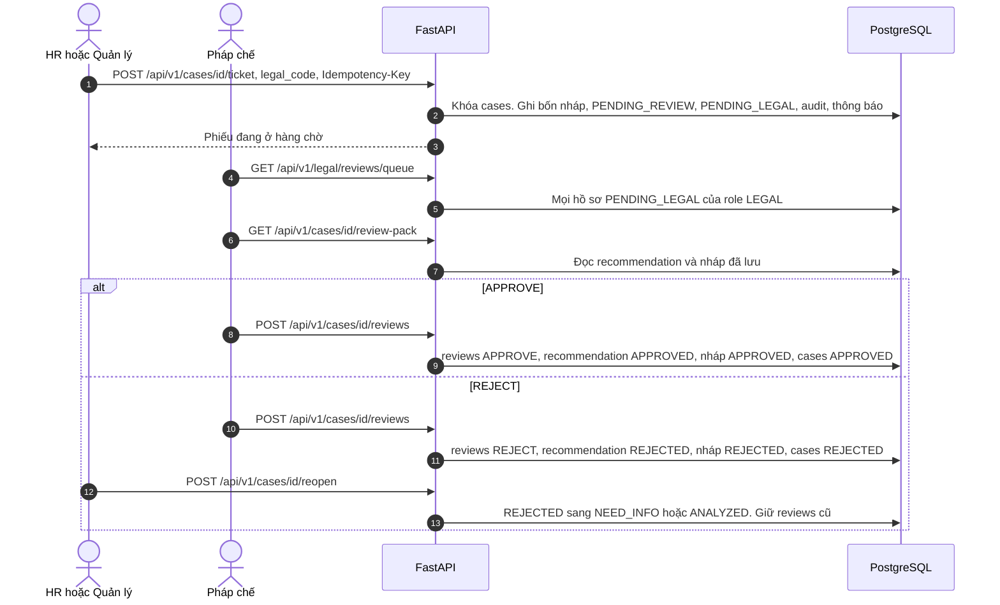

## 9. Ban hành và tiền lệ

Mỗi hồ sơ chỉ có một quyết định. Người ban hành là người dùng thật (`issued_by`), không phải agent. Muốn vụ này thành tiền lệ thì bắt buộc có `precedent_summary`, rồi embed đoạn tóm tắt đó để vụ sau tìm theo nghĩa.

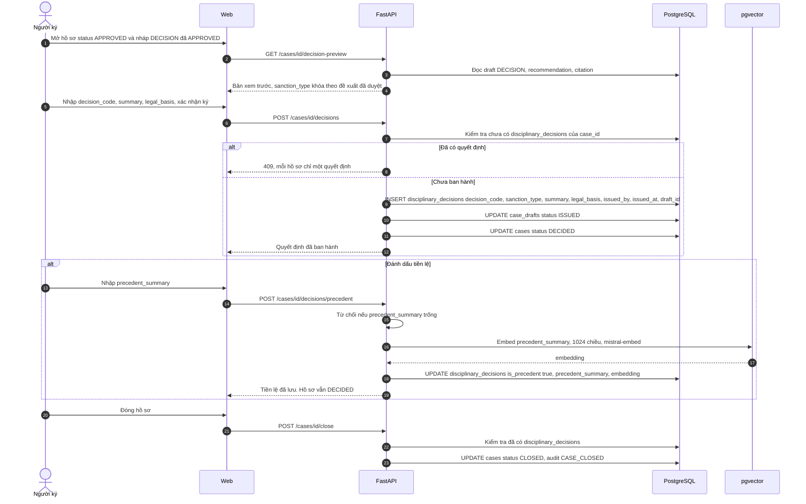

Client không gửi `sanction_type`. Server lấy mức từ recommendation `APPROVED`. Mức phải thuộc `WARNING`, `REPRIMAND`, `WAGE_POSTPONEMENT`, `DEMOTION`, `DISMISSAL`. Mỗi hồ sơ một quyết định. `Idempotency-Key` chặn ký hai lần và đánh dấu tiền lệ hai lần. Chỉ quyết định đã ban hành (`DECIDED` hoặc `CLOSED`) mới thành tiền lệ. Nháp, phiếu đang chờ và đề xuất bị từ chối không được embed. Thiếu `MISTRAL_API_KEY` thì trả 503, không bịa vector.

Đóng hồ sơ chỉ đi `DECIDED` → `CLOSED`, và chỉ khi đã có quyết định. `ADMIN` đóng được mọi hồ sơ đã quyết. HR hoặc quản lý cần `EDIT`. Người ký cần ít nhất `VIEW`. Vụ sau, feature 5 đọc đúng các dòng `is_precedent = true`.

## 10. Tái phạm

`POST /api/v1/cases/{id}/recidivism` đếm trên `cases`, `case_violations` và `disciplinary_decisions` theo `employee_code` và loại vi phạm. Không dùng độ tương tự embedding. Kết quả ghi fact `prior_sanction_count` với `confirmed = false`. Fact đã được HR xác nhận thì không bị ghi đè. Chỉ fact đã xác nhận đi vào `CaseHandoff`. Service không tự nâng mức.

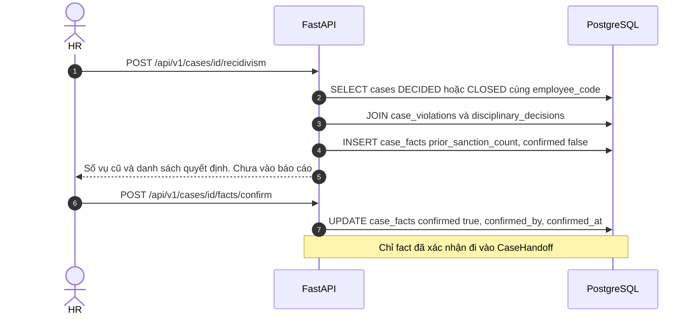

## 11. Phân tầng căn cứ trong câu trả lời

Feature 6 đã gộp các nguồn thành một mức. Mục này chỉ xếp citation ra giao diện thành ba nhóm:

- Luật và nghị định hướng dẫn kỷ luật lao động: căn cứ để công ty xử lý.
- Nội quy nội bộ đang hiệu lực đúng ngày: mức cụ thể công ty được phép dùng.
- Nghị định xử phạt hành chính: cảnh báo việc công ty có thể bị phạt nếu làm sai thủ tục. Đây không phải menu chế tài cho HR chọn.

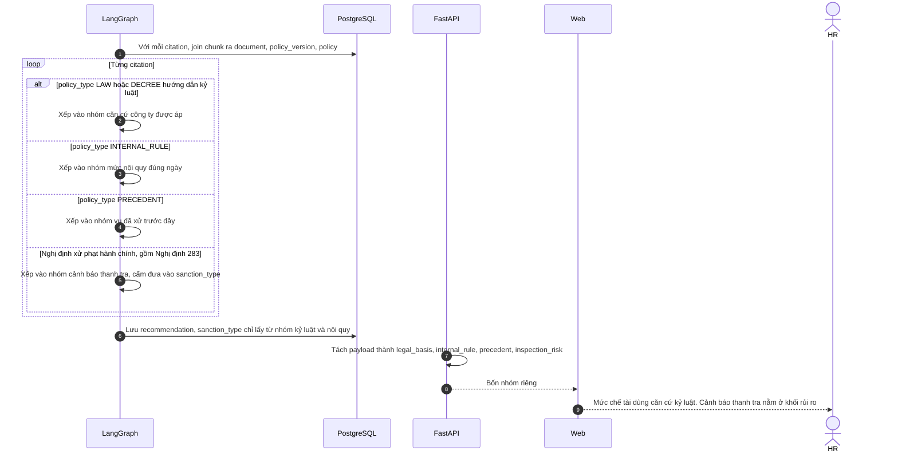

## 12. Nhật ký agent

Mỗi lượt chat ghi một `agent_run` gắn hội thoại và tin nhắn. Tool tra cứu ghi `tool_calls`. Chunk đã lấy ghi `agent_retrievals`, gồm điểm similarity. Token vào và token ra nằm trên `agent_runs` để chấm Demo Day và để pháp chế xem agent đã dựa vào đoạn nào.

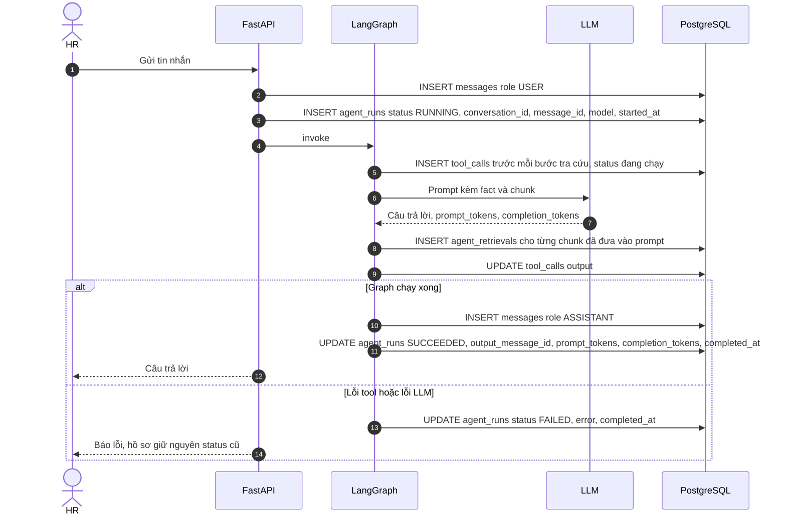

## 13. Dashboard vận hành

Đã có bốn route, mọi số liệu lọc theo hồ sơ user được xem. `ADMIN` thấy toàn bộ. HR và quản lý thấy hồ sơ mình tạo hoặc được cấp quyền.

- `GET /api/v1/dashboard/summary` đếm theo trạng thái và họ vụ, tỷ lệ từ chối đề xuất, tỷ lệ duyệt của pháp chế, tỷ lệ agent lỗi, tỷ lệ retrieval rỗng.
- `GET /api/v1/dashboard/cases` tách theo trạng thái và họ vụ.
- `GET /api/v1/dashboard/processing-time` lấy mốc từ audit: mở hồ sơ, có đề xuất, đẩy phiếu, duyệt, ban hành.
- `GET /api/v1/dashboard/sanctions` nhóm `disciplinary_decisions.sanction_type`.

Đi muộn trong ghi chú PRD vẫn là fact đầu vào (`late_days`), không phải màn hình riêng.

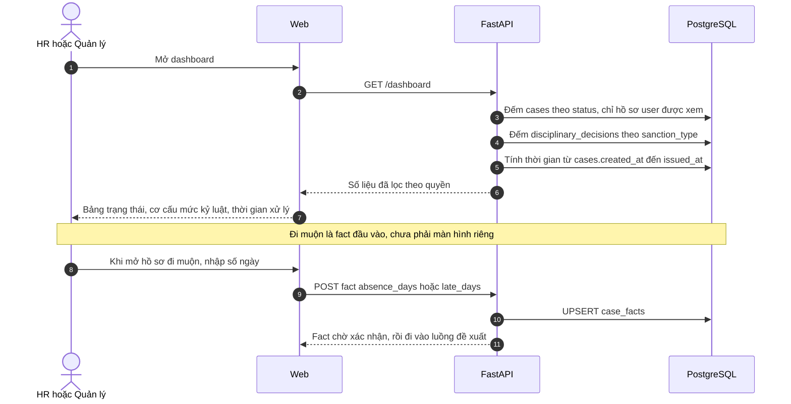

## Đã gắn trên kiến trúc hiện tại

Code vẫn là modular monolith dưới `src/`. Mỗi feature giữ `controller` gọi service. Không thêm microservice, không thêm hàng đợi, không tạo cây `backend/app/`.

| Việc | Nằm ở |
|---|---|
| Đăng nhập, refresh, logout, `/me` | `src/common/auth.py`, `src/core/security/` |
| Máy trạng thái, khóa dòng | `src/common/workflow.py` |
| Quyền hồ sơ | `src/common/access.py` |
| Audit, thông báo, idempotency | `src/common/audit.py`, `notify.py`, `idempotency.py` |
| Mở, sửa, cấp quyền, mở lại | `src/features/opencase/` |
| Chat, fact, case graph | `src/features/clarify/` |
| Retrieval | `src/features/cite/` |
| Đề xuất và đẩy phiếu | `src/features/answer/` |
| Biên bản dạng biểu mẫu | `src/features/assessment/` |
| Duyệt pháp chế | `src/features/legal_review/` |
| Ký, tiền lệ, đóng | `src/features/decision/` |
| Tái phạm, dòng thời gian, dashboard, xuất, kho văn bản, thông báo | `src/features/recidivism/`, `timeline/`, `dashboard/`, `export/`, `knowledge/`, `notification/` |
| Sống và sẵn sàng | `GET /health`, `GET /ready` trong `src/main.py` |

Máy trạng thái:

```text
OPEN -> NEED_INFO | ANALYZED
NEED_INFO -> NEED_INFO | ANALYZED
ANALYZED -> NEED_INFO | PENDING_LEGAL
PENDING_LEGAL -> APPROVED | REJECTED
REJECTED -> NEED_INFO | ANALYZED
APPROVED -> DECIDED
DECIDED -> CLOSED
```

Chuyển sai trả 409 `INVALID_CASE_TRANSITION`. Mọi chuyển trạng thái quan trọng ghi `audit_logs`. Không có API sửa hoặc xóa audit.

Lỗi trả cả `detail` cũ và khối `error` gồm `code`, `message`, `details`, `request_id`. Header phản hồi có `X-Request-ID`. Thân thành công của API cũ vẫn phẳng, không bọc `data` / `meta`.

`POST /ticket`, `/reviews`, `/decisions`, `/decisions/precedent` và `/close` nhận `Idempotency-Key`. Cùng người, cùng route, cùng key, cùng nội dung thì trả kết quả đã lưu. Cùng key mà nội dung khác thì 409 `IDEMPOTENCY_CONFLICT`.

### API

```text
POST   /api/v1/auth/login
POST   /api/v1/auth/refresh
POST   /api/v1/auth/logout
GET    /api/v1/auth/me
POST   /api/v1/auth/register          chỉ HR, MANAGER, LEGAL

POST   /api/v1/cases
GET    /api/v1/cases
GET    /api/v1/cases/{id}
PATCH  /api/v1/cases/{id}
POST   /api/v1/cases/{id}/access
GET    /api/v1/cases/{id}/access
POST   /api/v1/cases/{id}/messages
GET    /api/v1/cases/{id}/messages
GET    /api/v1/cases/{id}/facts
POST   /api/v1/cases/{id}/facts/confirm
GET    /api/v1/cases/{id}/answer
GET    /api/v1/cases/{id}/assessment
POST   /api/v1/cases/{id}/assessment/generate
PATCH  /api/v1/cases/{id}/assessment
POST   /api/v1/cases/{id}/assessment/save
POST   /api/v1/cases/{id}/assessment/confirm
POST   /api/v1/cases/{id}/assessment/reanalyze
GET    /api/v1/cases/{id}/timeline
POST   /api/v1/cases/{id}/ticket
POST   /api/v1/cases/{id}/reopen
POST   /api/v1/cases/{id}/recidivism

GET    /api/v1/legal/reviews/queue
GET    /api/v1/cases/{id}/review-pack
POST   /api/v1/cases/{id}/reviews

GET    /api/v1/cases/{id}/decision-preview
POST   /api/v1/cases/{id}/decisions
POST   /api/v1/cases/{id}/decisions/precedent
POST   /api/v1/cases/{id}/close

POST   /api/v1/policies/{id}/versions
GET    /api/v1/policies/{id}/versions
GET    /api/v1/documents/{id}
POST   /api/v1/documents/{id}/retry

GET    /api/v1/notifications
POST   /api/v1/notifications/{id}/read

GET    /api/v1/dashboard/summary
GET    /api/v1/dashboard/cases
GET    /api/v1/dashboard/processing-time
GET    /api/v1/dashboard/sanctions

GET    /api/v1/cases/{id}/export/assessment
GET    /api/v1/cases/{id}/export/ticket
GET    /api/v1/cases/{id}/export/decision

GET    /health
GET    /ready
```

Xuất hồ sơ đọc dữ liệu đã lưu, định dạng `json` hoặc `markdown`. Không gọi lại agent.

### Chạy local

```text
alembic upgrade head
python -m scripts.seed_demo_users
make run
```

`make run` mở API tại `http://127.0.0.1:8000`. Frontend: trong `frontend/` chạy `npm install` rồi `npm run dev`, mở `http://127.0.0.1:5173`. Vite chuyển `/api` sang cổng 8000.

Seed người dùng không đổi mật khẩu tài khoản đã có và không nạp lại kho luật. Tài khoản mới dùng mật khẩu demo `Demo-hr-2026`:

```text
hr.demo@vinuni.edu.vn       HR
manager.demo@vinuni.edu.vn  MANAGER
legal.demo@vinuni.edu.vn    LEGAL
signer.demo@vinuni.edu.vn   SIGNER
admin.demo@vinuni.edu.vn    ADMIN
```

Kho `BLLD_2019`, `ND145_2020`, `ND283_2026`, `NQCT` giữ nguyên.

### Giới hạn đã biết

- Logout chỉ thu hồi refresh token. Access token còn dùng được đến khi hết hạn.
- Đăng ký công khai không tạo `SIGNER` hay `ADMIN`.
- Chưa xuất PDF.
- Hàng chờ pháp chế là mọi hồ sơ `PENDING_LEGAL` của role `LEGAL`. Admin không duyệt và không ký. Quản lý duyệt lần cuối qua `GET /api/v1/manager/queue` rồi `POST /cases/{id}/decisions`. Người ký vẫn ban hành trên `/decisions`. Token cũ không có `decision:issue` cho đến khi quản lý đăng nhập lại.
- Embed tiền lệ và nạp văn bản cần `MISTRAL_API_KEY`. Embedding lỗi thì văn bản sang `FAILED` và retry chỉ embed chunk chưa có vector.
- Retrieval vẫn chỉ đọc `policies`, `policy_versions`, `documents`, `document_chunks`.
- Nghị định xử phạt hành chính, gồm Nghị định 283, là `INSPECTION_RISK`. Nó không ghi `sanction_type`.
