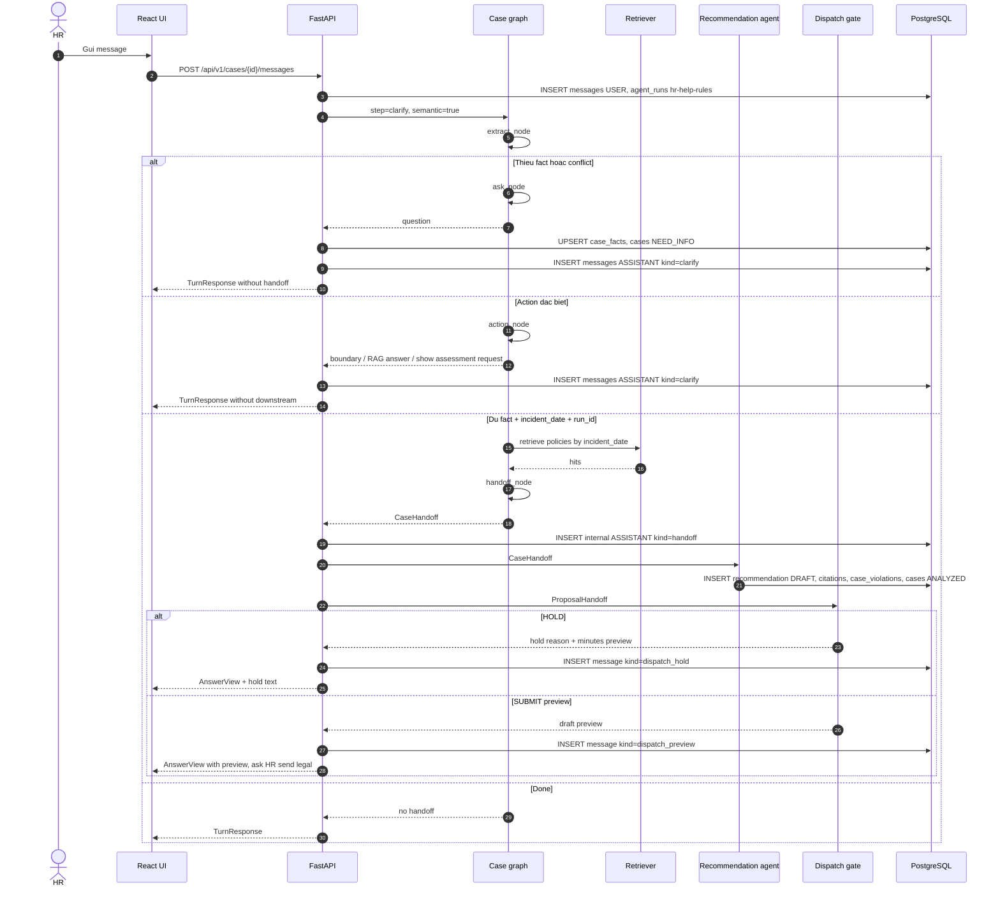

# HR Help - Feature Flow

- **Ma du an:** P-029
- **San pham:** HR Help
- **Ngay cap nhat:** 03/10/2026
- **Trang thai:** Bam theo code hien tai trong `src/` va `frontend/src/`.

Tai lieu nay mo ta flow chuc nang he thong, entry API, graph/sub-agent, file can doc khi review code. Agent chi phan tich, tra cuu, tong hop va soan nhap. Cac buoc duyet, ky, dong ho so van la hanh dong cua nguoi dung co quyen.

## Tong quan nghiep vu

HR Help xu ly mot ho so ky luat lao dong theo chuoi:

1. Mo ho so.
2. Chat lam ro tinh tiet.
3. Extract fact va quyet dinh edge trong graph.
4. Neu du fact va co `incident_date`, retrieve van ban con hieu luc.
5. Handoff sang agent tong hop danh gia.
6. Dispatch gate quyet dinh hold hay tao preview bien ban/phieu.
7. HR gui phieu cho phap che hoac chuyen thang quan ly.
8. Phap che duyet/tu choi.
9. Quan ly/nguoi ky ban hanh quyet dinh.
10. Xuat bien ban, phieu, quyet dinh thanh JSON/Markdown/DOCX.

`HANDOFF` la payload noi bo giua cac agent. Frontend khong hien thi raw payload nay tren layout; UI chi hien thi message nguoi dung doc duoc, report, draft, timeline da loc.

## Trang thai ho so

`cases.status` dang duoc frontend va backend su dung:

| Status | Y nghia |
|---|---|
| `OPEN` | Ho so moi, con cho HR bo sung tinh tiet |
| `NEED_INFO` | Thieu fact, co conflict, hoac can HR xac nhan them |
| `ANALYZED` | Da co recommendation dang `DRAFT`, HR doc bao cao/preview |
| `PENDING_LEGAL` | HR da gui phieu sang phap che |
| `REJECTED` | Phap che yeu cau HR xu ly lai |
| `APPROVED` | Da duoc phap che duyet, hoac HR chuyen thang quan ly |
| `DECIDED` | Da ban hanh quyet dinh ky luat |
| `CLOSED` | Da dong ho so |

Chat chi nhan ho so con mutable: `OPEN`, `NEED_INFO`, `ANALYZED`, `REJECTED`.

## Vai tro va ranh gioi

| Vai tro | Duoc lam |
|---|---|
| `HR` | Mo ho so, chat, xac nhan fact, doc bao cao, gui phieu phap che, chuyen thang quan ly, mo lai ho so bi tu choi |
| `MANAGER` | Co the mo ho so theo quyen, xem hang cho quan ly, ban hanh neu co permission |
| `LEGAL` | Xem hang cho `PENDING_LEGAL`, doc review pack, approve/reject. Khong sua fact, muc, citation |
| `SIGNER` | Ban hanh quyet dinh tu de xuat da duyet |
| `ADMIN` | Quan tri he thong/nguoi dung theo permission |

Boundary quan trong:

- Agent khong approve, reject, sign, close, delete, bypass legal.
- Agent khong tu ban hanh quyet dinh ky luat.
- Muc ky luat trong dispatch/draft duoc copy tu recommendation, khong tinh lai.
- Nghi dinh/xu phat hanh chinh chi la tang can cu rui ro, khong phai muc ky luat cong ty.

## API Entry Map

| Chuc nang | API | File vao chinh |
|---|---|---|
| Login | `POST /api/v1/auth/login` | `src/common/auth.py` |
| Mo ho so | `POST /api/v1/cases` | `src/features/opencase/controller.py` -> `model/cases.py` |
| Doc/sua/list ho so | `GET/PATCH /api/v1/cases...` | `src/features/opencase/controller.py` |
| Chat lam ro | `POST /api/v1/cases/{case_id}/messages` | `src/features/clarify/controller.py` -> `model/turns.py` |
| Doc messages | `GET /api/v1/cases/{case_id}/messages` | `src/features/clarify/controller.py` |
| Doc/xac nhan fact | `GET/POST /api/v1/cases/{case_id}/facts...` | `src/features/clarify/controller.py` |
| Doc answer | `GET /api/v1/cases/{case_id}/answer` | `src/features/answer/controller.py` |
| Gui phieu phap che | `POST /api/v1/cases/{case_id}/ticket` | `src/features/answer/controller.py` -> `model/send.py` |
| Chuyen thang quan ly | `POST /api/v1/cases/{case_id}/escalate` | `src/features/answer/controller.py` -> `model/send.py` |
| Hang cho phap che | `GET /api/v1/legal/reviews/queue` | `src/features/legal_review/controller.py` |
| Goi duyet phap che | `GET /api/v1/cases/{case_id}/review-pack` | `src/features/legal_review/controller.py` |
| Phap che duyet/tu choi | `POST /api/v1/cases/{case_id}/reviews` | `src/features/legal_review/controller.py` |
| Hang cho quan ly | `GET /api/v1/manager/queue` | `src/features/decision/controller.py` |
| Preview quyet dinh | `GET /api/v1/cases/{case_id}/decision-preview` | `src/features/decision/controller.py` |
| Ban hanh quyet dinh | `POST /api/v1/cases/{case_id}/decisions` | `src/features/decision/controller.py` |
| Dong ho so | `POST /api/v1/cases/{case_id}/close` | `src/features/decision/controller.py` |
| Timeline | `GET /api/v1/cases/{case_id}/timeline` | `src/features/timeline/controller.py` |
| Export | `GET /api/v1/cases/{case_id}/export/{kind}` | `src/features/export/controller.py` |
| MCP-style case tools | `GET /api/v1/cases/case-tools`, `POST /api/v1/cases/{case_id}/case-tools/call` | `src/features/export/controller.py`, `src/features/answer/model/case_tools.py` |

## Multi-Agent Architecture

### Agent 1: Case Graph

File chinh:

- `src/agents/case_graph.py`
- `src/features/clarify/model/graph.py`
- `src/features/clarify/model/turns.py`
- `src/features/clarify/model/planner.py`
- `src/features/clarify/model/prompt.py`
- `src/features/clarify/model/policy.py`
- `src/features/clarify/model/assess.py`

Graph hien tai:

```text
START
  -> open -> END
  -> extract
       -> ask -> END
       -> action -> END
       -> retrieve -> handoff -> END
       -> done -> END
```

Entry routing:

- Neu `state.step == "open"` thi vao node `open`.
- Cac case con lai vao `extract`.

`open` co di qua LangGraph de giu cung contract, nhung khong goi LLM. Route `POST /api/v1/cases` tao `cases` va `conversations`.

### Extract node

`extract_node` co hai che do:

| Che do | Dieu kien | Cach xu ly |
|---|---|---|
| Regex/rule projection | `step == "cite"` hoac khong bat `semantic` | Goi `assess(...)` |
| Semantic planner | Chat thuong co `semantic=true` | Goi LLM planner qua `plan_turn(...)`, roi Python validate bang `apply_decision(...)` |

LLM planner khong duoc chon edge truc tiep. LLM chi tra structured intent/fact:

- `family`
- `extracted_facts`
- `corrections`
- `confirmation_updates`
- `requested_action`
- `user_intent`
- `ambiguities`

Python moi la noi quyet dinh edge bang `route_after_extract`.

### Edge sau extract

Logic trong `src/features/clarify/model/graph.py`:

| Edge | Dieu kien |
|---|---|
| `ask` | Co conflict, hoac fact chua locked |
| `action` | `requested_action` thuoc `answer_policy_question`, `show_assessment`, `unsupported` |
| `retrieve` | Fact locked va co `incident_date` + `agent_run_id`, hoac `step == "cite"`, hoac `advance=true` |
| `done` | Khong du dieu kien retrieve, nhung cung khong can ask/action |

Nghiep vu da cover prompt tu nhien:

- Hoi luat/chinh sach/quy dinh -> `answer_policy_question` -> `action`.
- Xem assessment hien tai -> `show_assessment` -> `action`.
- Duyet, ky, dong ho so, bo qua phap che, xoa, bypass -> `unsupported` -> `action`, tra boundary an toan, khong chay tiep multi-agent.
- Lap bien ban, tao ticket preview, gui legal -> neu chua du fact thi `ask`; neu du fact thi `retrieve` -> downstream.

### Action node

File: `src/agents/case_graph.py`

`action_node` khong chay downstream multi-agent. No dung cho prompt dac biet:

| Action | Xu ly |
|---|---|
| `answer_policy_question` | Retrieve cac passage con hieu luc theo `incident_date`, neu rong thi tra thong diep chua co cau tra loi/can cu; neu co hit thi goi Policy QA Agent de synthesize cau tra loi tieng Viet co dan nguon `[1]`, `[2]`; neu LLM loi/chua cau hinh thi fallback sang tom tat passage |
| `show_assessment` | De `turns.py` doc answer hien tai neu co |
| `unsupported` | Tra thong diep an toan: agent khong duyet/ky/dong/bo qua quy trinh |

## Main Chat Flow

Entry: `POST /api/v1/cases/{case_id}/messages`

File doc flow:

1. `src/features/clarify/controller.py`
2. `src/features/clarify/model/turns.py`
3. `src/agents/case_graph.py`
4. `src/features/clarify/model/graph.py`
5. Neu retrieve: `src/features/cite/model/search.py`, `src/features/cite/model/graph.py`
6. Neu co handoff: `src/features/clarify/model/multi_agent.py`

Sequence:



## Confirm Facts Flow

Entry: `POST /api/v1/cases/{case_id}/facts/confirm`

Khac voi chat:

- Khong bat semantic planner.
- Dung `assess`/rule projection de tinh lai fact.
- Neu fact chua locked -> hoi tiep.
- Neu fact locked va chua co answer, hoac fact vua doi -> chay `_cite(...)`.
- `_cite(...)` tao agent run `hr-help-retrieval`, lay `CaseHandoff`, roi goi downstream nhu chat.

File doc:

- `src/features/clarify/model/turns.py`: `_confirm`, `_cite`, `_unchanged`
- `src/features/clarify/model/store.py`

## Retrieve And Handoff

Retrieve chi duoc chay khi:

- Fact bat buoc da locked.
- `case.incident_date` co gia tri.
- Co `agent_run_id` de ghi retrieval/audit.

File:

- `src/features/cite/model/search.py`
- `src/features/cite/model/query.py`
- `src/features/cite/model/graph.py`
- `src/agents/handoff.py`

Ket qua la `CaseHandoff`, gom:

- `case_id`, `incident_date`, employee info
- `family`
- locked `facts`
- `fact_lines`
- retrieved `passages`
- flag nhu `missing_internal_rule`
- `agent_run_id`

`CaseHandoff` la data contract cho agent 2. No khong phai noi dung hien thi UI.

## Agent 2: Recommendation Assessment

File:

- `src/features/clarify/model/multi_agent.py`
- `src/features/answer/model/answers.py`
- `src/features/answer/model/agent.py`
- `src/features/answer/model/draft.py`
- `src/features/answer/model/store.py`

Input: chi doc `CaseHandoff`.

Output:

- Insert `recommendations` status `DRAFT`.
- Insert citations theo recommendation.
- Link `case_violations`.
- Set `cases.status = ANALYZED`.
- Tra `AnswerView`.

Agent 2 tong hop fact + message + retrieval evidence de tao:

- `message` / report
- `rationale`
- `sanction_type`
- `risk_level`
- `process_steps`
- legal/internal/precedent/inspection layers

Neu chua du can cu, recommendation van duoc luu dang draft nhung dispatch gate co the HOLD.

## Agent 3: Dispatch Gate

File:

- `src/features/clarify/model/multi_agent.py`
- `src/features/answer/model/dispatch.py`
- `src/features/answer/model/proposal.py`
- `src/features/answer/model/send.py`
- `src/features/answer/model/release.py`

Input: `ProposalHandoff` duoc tao tu `CaseHandoff + AnswerView`.

Dispatch gate doc proposal, khong retrieve lai, khong chon muc moi.

Hold conditions:

| Hold code | Khi nao |
|---|---|
| `TERMINATION` | Message mang muc cham dut hop dong, khong phai muc ky luat cong ty |
| `OPEN_SANCTION` | Muc chua duoc khoa |
| `RISK_HIGH` | Rui ro `HIGH` hoac `CRITICAL` |
| `MISSING_INTERNAL_RULE` | Chua co noi quy con hieu luc |
| `PROCEDURE_OPEN` | Chua co bien ban hoac yeu cau giai trinh |

Neu `HOLD`:

- Khong gui phap che tu dong.
- UI hien ly do/bien ban review neu co.
- HR can bo sung/xac nhan/xu ly tiep.

Neu `SUBMIT`:

- Tao preview draft: `MINUTES`, `EXPLANATION_REQUEST`, `DECISION`, `TICKET`.
- Chua insert `case_drafts` vao DB o buoc preview.
- Tra message hoi HR co day cho phap che khong.

## Ticket, Legal, Manager

### HR gui phieu phap che

Entry: `POST /api/v1/cases/{case_id}/ticket`

File:

- `src/features/answer/controller.py`
- `src/features/answer/model/send.py`
- `src/features/answer/model/release.py`

Dieu kien:

- Actor la `HR` hoac `MANAGER`.
- Co quyen `EDIT` tren case.
- Case dang `ANALYZED`.
- Recommendation dang `DRAFT`.
- Co legal officer active theo email.
- Dispatch khong bi hold, tru truong hop HR da confirm assessment version hop le theo logic trong `send.py`.

Ket qua:

- Insert `case_drafts`.
- Recommendation sang `PENDING_REVIEW`.
- Case sang `PENDING_LEGAL`.
- Notify legal.
- Message kind `dispatch_submit`.

### HR chuyen thang quan ly

Entry: `POST /api/v1/cases/{case_id}/escalate`

Dieu kien gan giong ticket, nhung:

- Actor phai la `HR`.
- Khong tao phieu phap che.
- Goi `save_direct_approval`.
- Case sang `APPROVED`.
- Notify managers.

### Phap che duyet

Entry:

- `GET /api/v1/legal/reviews/queue`
- `GET /api/v1/cases/{case_id}/review-pack`
- `POST /api/v1/cases/{case_id}/reviews`

File:

- `src/features/legal_review/controller.py`
- `src/features/legal_review/model/service.py`

Phap che khong sua fact, muc, citation. `APPROVE` dua ho so sang hang quan ly. `REJECT` tra ho so ve HR voi comment bat buoc.

### Quan ly/nguoi ky ban hanh

Entry:

- `GET /api/v1/manager/queue`
- `GET /api/v1/cases/{case_id}/decision-preview`
- `POST /api/v1/cases/{case_id}/decisions`
- `POST /api/v1/cases/{case_id}/decisions/precedent`
- `POST /api/v1/cases/{case_id}/close`

File:

- `src/features/decision/controller.py`
- `src/features/decision/model/service.py`

Client khong duoc chon muc khac voi recommendation da duyet. Sau khi ban hanh, co the mark precedent va dong ho so.

## Export Va MCP-style Tools

Entry:

- `GET /api/v1/cases/{case_id}/export/assessment?format=json|markdown|docx`
- `GET /api/v1/cases/{case_id}/export/ticket?format=json|markdown|docx`
- `GET /api/v1/cases/{case_id}/export/decision?format=json|markdown|docx`
- `GET /api/v1/cases/case-tools`
- `POST /api/v1/cases/{case_id}/case-tools/call`

File:

- `src/features/export/controller.py`
- `src/features/export/model.py`
- `src/features/answer/model/case_tools.py`

Tools hien co:

| Tool | Chuc nang |
|---|---|
| `create_violation_minutes_form` | Tao form/bien ban vi pham noi quy cong ty tu case + answer |
| `create_legal_ticket_form` | Tao phieu gui phap che |
| `export_case_document_word` | Xuat assessment/ticket/decision ra DOCX |

DOCX duoc ghi vao `/tmp/hr_case_exports`.

## Frontend Flow

File chinh:

- `frontend/src/services/api.ts`
- `frontend/src/features/case-management/CaseWorkspace.tsx`
- `frontend/src/features/conversation/*`
- `frontend/src/features/assessment/*`
- `frontend/src/features/legal-review/*`
- `frontend/src/features/decision/*`
- `frontend/src/features/timeline/TimelinePanel.tsx`
- `frontend/src/lib/workflow.ts`
- `frontend/src/lib/report.ts`
- `frontend/src/lib/session.ts`

Nguyen tac UI:

- `CaseWorkspace` la container goi API, sync facts/answer/messages/handoff.
- `workflow.ts` chi ve progress dua tren status/ticket, khong tu suy luan muc.
- `report.ts` nhan dien raw `HANDOFF` va loc khoi layout.
- `session.ts`, `CaseWorkspace`, `TimelinePanel`, `AssessmentPanel`, `LegalCasePage` deu khong render raw handoff.
- `ReviewMinutes` hien bien ban/review draft va co nut xuat Word.

Frontend API mapping:

| UI | API |
|---|---|
| Case list/detail | `/cases`, `/cases/{id}` |
| Chat | `/cases/{id}/messages` |
| Fact form | `/cases/{id}/facts` |
| Assessment panel | `/cases/{id}/answer` |
| Send legal | `/cases/{id}/ticket` |
| Legal queue | `/legal/reviews/queue`, `/cases/{id}/review-pack`, `/cases/{id}/reviews` |
| Manager/decision | `/manager/queue`, `/cases/{id}/decision-preview`, `/cases/{id}/decisions` |
| Timeline | `/cases/{id}/timeline` |
| Export Word | `/cases/{id}/export/assessment?format=docx` |

## File Review Checklist

Neu can doc/review flow multi-agent, doc theo thu tu nay:

1. `src/main.py` - router registration.
2. `src/features/opencase/controller.py` - entry mo/doc ho so.
3. `src/features/clarify/controller.py` - entry chat/fact.
4. `src/features/clarify/model/turns.py` - orchestration mot turn.
5. `src/agents/case_graph.py` - LangGraph case graph.
6. `src/features/clarify/model/graph.py` - extract/ask/route_after_extract.
7. `src/features/clarify/model/prompt.py` va `decision.py` - semantic planner contract.
8. `src/features/cite/model/search.py` va `graph.py` - retrieval/handoff.
9. `src/features/clarify/model/multi_agent.py` - parent workflow agent 2/3.
10. `src/features/answer/model/answers.py` - publish recommendation.
11. `src/features/answer/model/dispatch.py` - gate HOLD/SUBMIT.
12. `src/features/answer/model/send.py` - HR gui legal/chuyen manager.
13. `src/features/legal_review/model/service.py` - legal approve/reject.
14. `src/features/decision/model/service.py` - issue decision/close.
15. `src/features/export/model.py` va `src/features/answer/model/case_tools.py` - export/tool call.
16. `frontend/src/features/case-management/CaseWorkspace.tsx` va `frontend/src/lib/workflow.ts` - UI orchestration.

## Ket luan hien tai

Flow chuc nang he thong da ro hon sau refactor:

- Entry graph dau tien co `open` va `extract`; `extract` moi phan nhanh `ask/action/retrieve/done`.
- Prompt tu nhien duoc cover bang `requested_action`, nhung Python van validate edge.
- Action dac biet khong chay tiep multi-agent.
- `retrieve -> handoff -> recommendation -> dispatch` chi chay khi du fact va co ngay vu viec.
- Neu tong hop chua du dieu kien gui phieu thi HOLD, giu o `ANALYZED`, HR/doc bo sung tiep.
- Neu du dieu kien thi tao preview, HR moi quyet dinh gui phap che hoac chuyen thang quan ly.
- Phap che va nguoi ky la human-in-the-loop, khong phai agent.
- Export DOCX va MCP-style tools da co entry rieng.
