# HR Help — Feature và sequence diagram

- **Mã dự án:** P-029
- **Sản phẩm:** HR Help
- **Ngày:** 26/09/2026
- **Trạng thái:** Bản brainstorm bám PRD, Project Brief và schema hiện có

Tài liệu này mô tả các feature cần có để biến khung template thành một ứng dụng xử lý kỷ luật lao động dùng được. Mỗi feature có một sequence diagram chi tiết.

Thành phần dùng chung trong các sơ đồ:

| Thành phần | Vai trò trong luồng |
|---|---|
| HR / Quản lý | Mở hồ sơ, chat, xác nhận fact, đọc đề xuất và lý do giữ lại |
| Pháp chế | Đọc ticket đã đẩy, trên hồ sơ được cấp quyền `REVIEW`, duyệt hoặc từ chối |
| Người ký | Ban hành quyết định. Là người dùng thật, không phải agent |
| Web | Giao diện |
| FastAPI | Kiểm tra quyền, gọi từng sub-agent, ghi database |
| LangGraph | Trích fact, hỏi lại, tra cứu, viết đề xuất, rồi giữ hồ sơ hoặc đẩy ticket |
| PostgreSQL | Hồ sơ, fact, hội thoại, đề xuất, nháp, review, quyết định |
| pgvector | Chunk văn bản và embedding tiền lệ |

## Repo đang có gì

| Lớp | Đã có | Chưa có |
|---|---|---|
| Sản phẩm | PRD: HR nhập tình huống, agent hỏi thêm, đối chiếu luật và nội quy, đề xuất quy trình, pháp chế duyệt, người ban hành quyết định | Giao diện, đăng nhập, màn hình hồ sơ |
| Agent | LangGraph 2 node `analyze` → `respond`, một API `POST /chat` | Làm rõ tình tiết, RAG, trích dẫn, đề xuất, nháp văn bản |
| Dữ liệu | 20 bảng: user, hồ sơ, fact, hội thoại, chính sách theo phiên bản, chunk, đề xuất, trích dẫn, nháp, review, quyết định, tiền lệ | API và service ghi vào các bảng này |
| Kho luật | `scripts/seed_hr_from_legal.py` đổ Bộ luật Lao động, Nghị định 145/2020 và Nghị định 283/2026 vào `policies` → `policy_versions` → `documents` → `document_chunks` (1289 chunk, embedding 1024 chiều, `search_tsv`) | Nội quy công ty. Feature 5 không đọc bốn bảng `legal_*` |

Ba vai trò trong schema là `HR`, `MANAGER`, `LEGAL`. Mức chế tài là khiển trách (`WARNING`), cảnh cáo (`REPRIMAND`), kéo dài nâng lương (`WAGE_POSTPONEMENT`), cách chức (`DEMOTION`), sa thải (`DISMISSAL`) và chấm dứt hợp đồng (`TERMINATION`). Sa thải và chấm dứt hợp đồng là hai căn cứ khác nhau. Agent phải tách chúng.

## Feature nên có

Ưu tiên bám pain point: HR và quản lý mất thời gian tra cứu, dễ áp sai mức, quyết định thiếu căn cứ và không nhất quán giữa các vụ giống nhau.

| # | Feature | Vì sao cần | Bám bảng nào |
|---|---|---|---|
| 1 | Đăng nhập và phân quyền | Hồ sơ kỷ luật là dữ liệu nhạy cảm. Người tạo hồ sơ, người được xem, người được duyệt phải khác nhau | `users`, `case_access` |
| 2 | Mở hồ sơ vụ việc | Mọi tư vấn phải gắn một vụ, một nhân viên, một ngày xảy ra | `cases`, `conversations` |
| 3 | Chat làm rõ tình tiết | Luật không áp được nếu thiếu loại hợp đồng, số ngày nghỉ, đã lập biên bản chưa, đã yêu cầu giải trình chưa | `conversations`, `messages`, `case_facts`, `agent_runs` |
| 4 | Kho văn bản theo ngày hiệu lực | Căn cứ là bản đang có hiệu lực vào `incident_date`, không phải bản đang mở hôm nay | `policies`, `policy_versions`, `documents`, `document_chunks` |
| 5 | Đối chiếu và trích dẫn | Đề xuất không có điều, khoản, điểm thì HR không dùng được | `tool_calls`, `agent_retrievals` |
| 6 | Đề xuất chế tài, quy trình, mức rủi ro | Sub-agent tổng hợp fact và đoạn retrieval thành một đánh giá có trích dẫn, rồi chốt mức khi trích dẫn khớp nguyên văn | `recommendations`, `case_violations` |
| 7 | Soạn nháp và đẩy ticket | Sub-agent đọc `ProposalHandoff` của feature 6. Đủ căn cứ thì soạn nháp và đẩy ticket. Chưa đủ thì giữ đề xuất | `case_drafts`, `recommendations` |
| 8 | Pháp chế duyệt | Chỉ hồ sơ feature 7 đã đẩy sang `PENDING_LEGAL`. Người duyệt, agent không tự duyệt | `reviews` |
| 9 | Ban hành quyết định và lưu tiền lệ | Vụ sau tra được vụ trước đã xử thế nào | `disciplinary_decisions` |
| 10 | Tái phạm cùng nhân viên | Mức kỷ luật phụ thuộc việc đã bị xử trước đó | `cases.employee_code`, `case_violations` |
| 11 | Phân tầng căn cứ | Nghị định 283 là xử phạt của cơ quan nhà nước, không phải mức kỷ luật công ty được quyền áp | `policies.policy_type` |
| 12 | Nhật ký agent | Demo Day cần chứng minh agent đã tra gì, gọi tool gì, tốn bao nhiêu token | `agent_runs`, `tool_calls`, `agent_retrievals` |
| 13 | Dashboard vận hành | PRD có ghi chú dashboard đi muộn. Làm sau khi vòng kỷ luật chạy được | đếm từ `cases` |

Nên làm feature 1–9 cho bản dùng được. Feature 10–12 làm cùng lúc nếu còn sức, vì schema đã chờ sẵn. Dashboard đi muộn để sau.

Ranh giới human-in-the-loop giữ nguyên theo PRD: agent phân tích, cảnh báo, soạn nháp và đẩy ticket khi message của feature 6 đủ căn cứ. Pháp chế phê duyệt. Người có thẩm quyền ban hành quyết định và chịu trách nhiệm.

## Luồng xương sống của một vụ

`cases.status` chỉ nhận các giá trị `OPEN`, `NEED_INFO`, `ANALYZED`, `PENDING_LEGAL`, `APPROVED`, `REJECTED`, `DECIDED`, `CLOSED`.

Feature 6 đóng `ProposalHandoff` sau khi ghi đề xuất. Feature 7 đọc message đó. Chưa đủ căn cứ thì hồ sơ dừng ở `ANALYZED`, recommendation giữ `DRAFT`, không có ticket. Đủ căn cứ thì sub-agent đẩy ticket và hồ sơ sang `PENDING_LEGAL`.

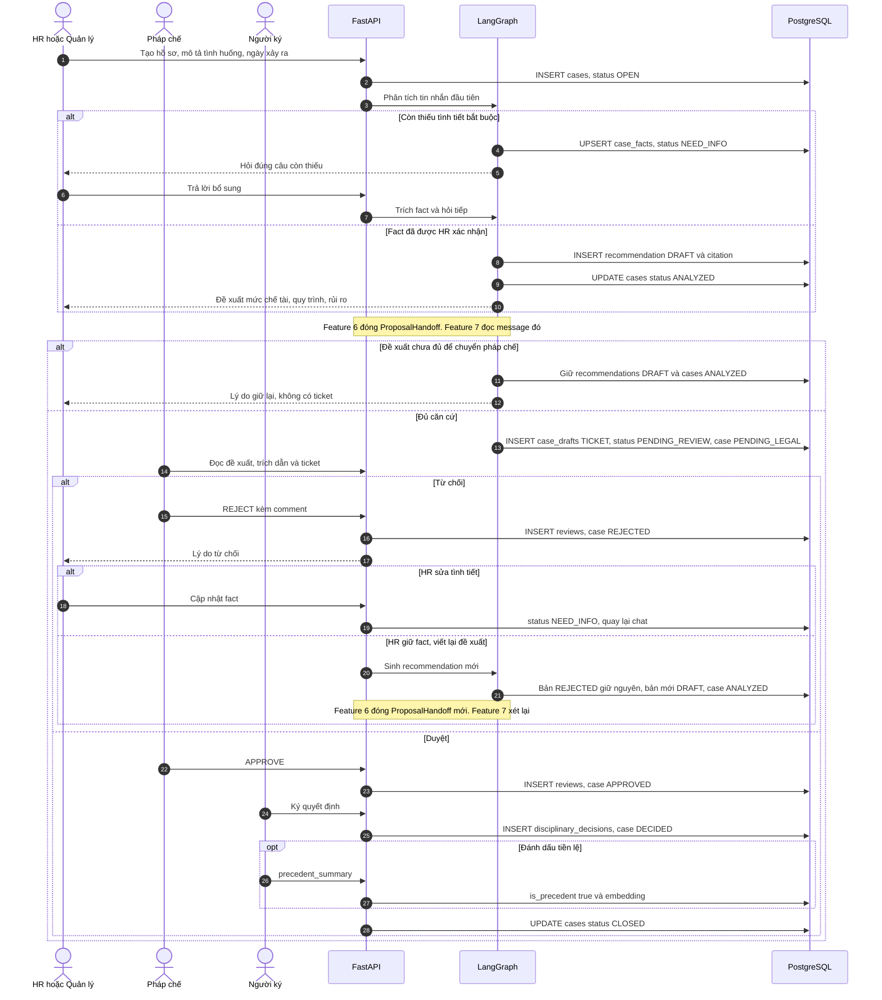

## 1. Đăng nhập và quyền trên hồ sơ

`HR` và `MANAGER` mở hồ sơ và chat. `LEGAL` không soạn quyết định thay HR. Pháp chế chỉ vào vụ khi được cấp quyền `REVIEW`. Người tạo hồ sơ luôn thấy vụ của mình qua `cases.created_by`. Người khác cần một dòng trong `case_access` với mức `VIEW` hoặc `REVIEW`.

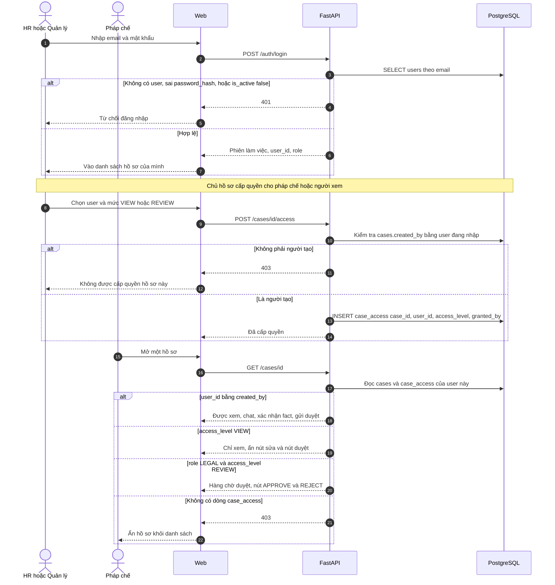

## 2. Mở hồ sơ vụ việc

Mọi tư vấn gắn một vụ, một nhân viên và một ngày xảy ra. `incident_date` ghi trên `cases` là mốc feature 5 dùng để chọn `policy_versions` còn hiệu lực. Kho chữ luật hiện có là `BLLD_2019` (`LAW`, từ 2021-01-01), `ND145_2020` (`DECREE`, 2021-02-01 đến 2026-09-09) và `ND283_2026` (`DECREE`, từ 2026-09-10), nằm trên `policies` → `policy_versions` → `documents` → `document_chunks`. Bước mở hồ sơ chỉ ghi `cases` và `conversations`.

`POST /api/v1/cases` chạy node `open` của case graph rồi dừng. Chưa có tin nhắn, chưa có `agent_runs`, chưa rút fact. Client gửi header `X-User-Id`. User phải đang active, role `HR` hoặc `MANAGER`.

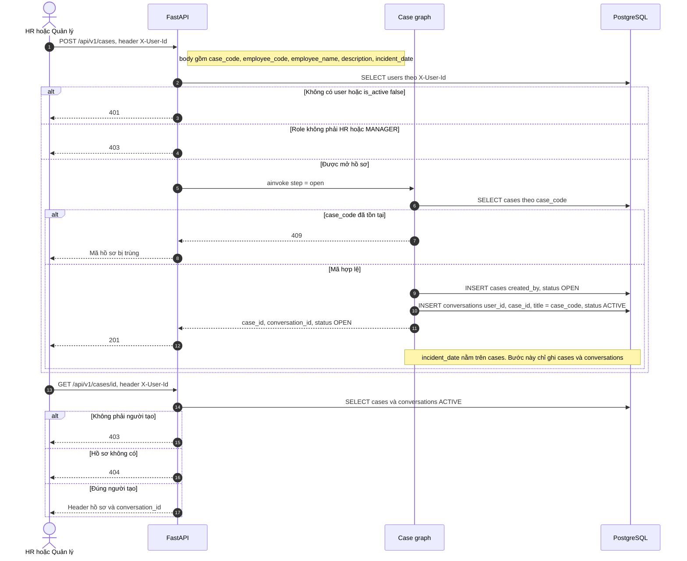

## 3. Chat làm rõ tình tiết

`POST /api/v1/cases/{id}/messages` chỉ chạy `step = clarify`. Graph đi `extract`, rồi `ask` hoặc dừng. Lượt chat này không vào retrieval và không đề xuất mức.

`case_facts` là phiếu tình tiết hiện tại của hồ sơ, một dòng cho mỗi `fact_key`. Fact đã `confirmed` không bị câu sau đè. Fact chưa xác nhận thì được thay bằng giá trị mới rút từ `cases.description` và các tin `USER`. Chat ghi `confirmed = false` cùng `source_message_id`. HR xác nhận ở `POST /api/v1/cases/{id}/facts/confirm` thì dòng đó thành `confirmed = true`, có `confirmed_by` và `confirmed_at`.

Bộ fact bắt buộc theo loại vụ:

| Loại vụ | `fact_key` |
|---|---|
| Nghỉ không phép `UNAUTHORIZED_ABSENCE` | `contract_type`, `absence_days`, `notice_form`, `minutes_made`, `explanation_requested` |
| Đi muộn `LATE` | `contract_type`, `late_days`, `minutes_made`, `explanation_requested` |
| Chung `GENERAL` | `contract_type`, `violation_summary`, `minutes_made`, `explanation_requested` |

Hồ sơ còn nhận tin khi status là `OPEN`, `NEED_INFO`, `ANALYZED`, hoặc `REJECTED`. Status sau đó trả 409.

Lượt `clarify` đọc và ghi hội thoại với phiếu fact. Cửa đọc của đối chiếu là `document_chunks`, và cửa đó chỉ mở ở feature 5 sau khi fact bắt buộc đã khóa. `legal_documents`, `legal_chunks`, `legal_chunk_references` và `legal_chunk_embeddings` không tham gia lượt chat.

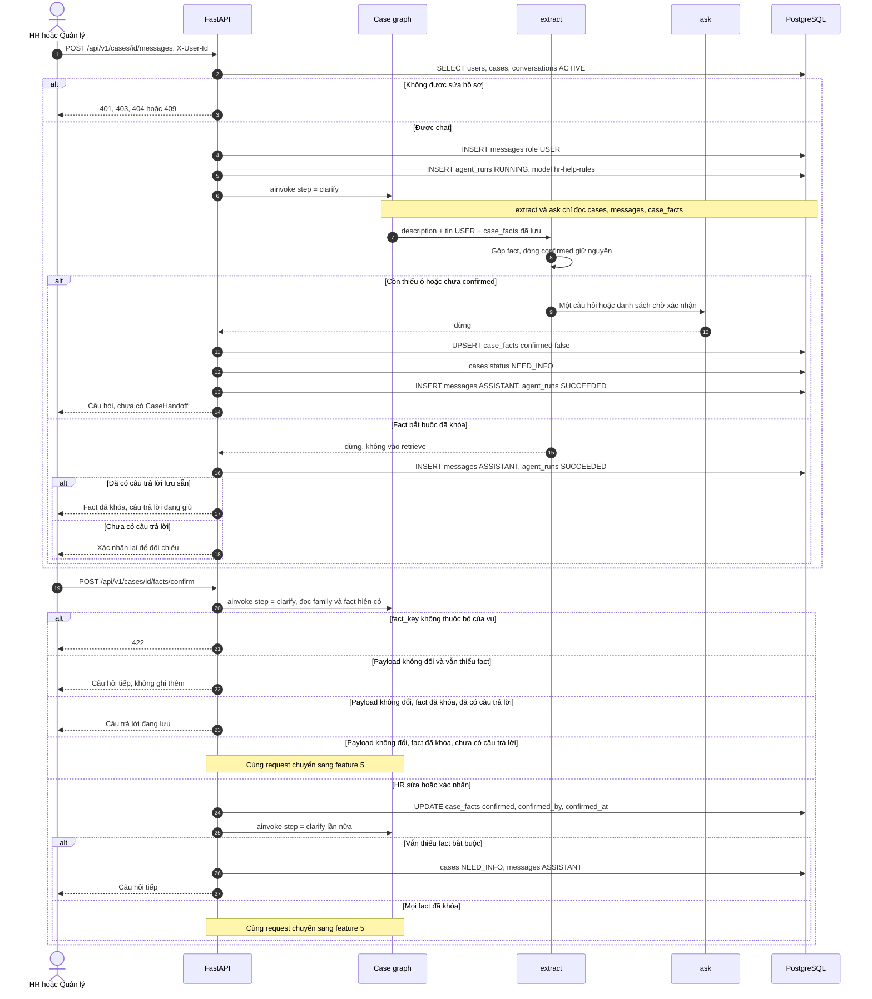

`GET /api/v1/cases/{id}/facts` chỉ đọc form tình tiết. Nó chạy `extract` để chiếu giá trị đang đọc được từ mô tả và tin `USER`, không ghi database.

Graph của một lượt chat:

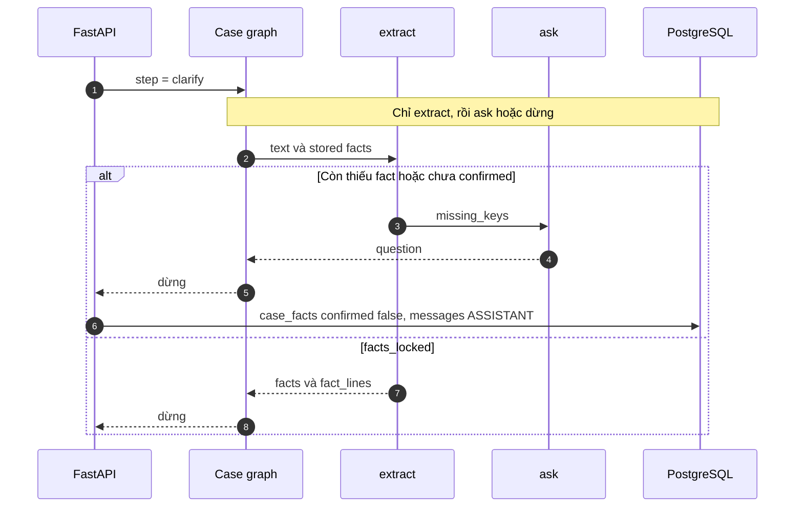

## 4. Nạp văn bản và khóa theo ngày hiệu lực

Ba văn bản luật đã nằm trên chuỗi HR: `scripts/seed_hr_from_legal.py` ghi `policies`, `policy_versions`, `documents` (`EMBEDDED`) và `document_chunks` (embedding `mistral-embed` 1024 chiều, `search_tsv`). Sơ đồ dưới đây là API tải file về sau, cho nội quy và văn bản mới. Mỗi chính sách (`LAW`, `DECREE`, `CIRCULAR`, `INTERNAL_RULE`, `PRECEDENT`) có nhiều phiên bản. Hai phiên bản của cùng một chính sách không được chồng ngày hiệu lực. Ràng buộc này đã nằm trong `policy_versions`.

Nội quy công ty chưa có trong kho. Không có nội quy thì agent chỉ trích luật, chưa trả lời được mức công ty được phép dùng.

## 5. Đối chiếu và trích dẫn

Nhánh này chạy trong cùng request `POST /api/v1/cases/{id}/facts/confirm` sau khi mọi fact bắt buộc đã `confirmed` và hồ sơ có `incident_date`. Case graph nhận `step = cite`, đi `extract` → `retrieve` → `handoff`, rồi dừng ở `CaseHandoff`. Feature 6 đọc message đó khi được gắn.

`retrieve` dựng `SearchQuery` từ `cases.description` và `fact_lines`, rồi gọi retrieval graph. Cả ba nhánh và bước mục lục dùng một cửa đọc:

`policies.is_active` → `policy_versions` trạng thái `ACTIVE`, `effective_from` ≤ `incident_date` và `effective_to` tính cả ngày đó (`NULL` nghĩa là còn mở) → `documents.ingest_status` là `CHUNKED` hoặc `EMBEDDED` → `document_chunks`.

Ngày vụ 2026-03-01 gặp `BLLD_2019` và `ND145_2020`. Ngày vụ từ 2026-09-10 gặp `BLLD_2019` và `ND283_2026`. Script `scripts/seed_hr_from_legal.py` ghi `documents.ingest_status = EMBEDDED`. Mỗi chunk có `content`, `article`, `clause`, `point`, `section` (`ARTICLE`, `CLAUSE` hoặc `POINT`), `section_title` là breadcrumb dạng `TEXT`, và `metadata` giữ `article_title` cùng `legal_chunk_id`. `embedding` là `mistral-embed` 1024 chiều. `search_tsv` là `tsvector` sinh sẵn từ `section_title` và `content`, config `simple`, index GIN, migration `0004_document_chunks_tsv`.

`similarity` lấy cosine trên `document_chunks.embedding`. Query chưa có vector thì nhánh này embed `SearchQuery.text`. Vector khác 1024 chiều, thiếu `MISTRAL_API_KEY`, hoặc embed lỗi thì nhánh đó rỗng. `bm25` gọi `ts_rank` trên `search_tsv` của mọi chunk còn hiệu lực và giữ tối đa 8 đoạn. `lexical` là `ILIKE` trên `content`, trần 40 dòng, rồi giữ tối đa 8. Một nhánh lỗi thì kênh đó rỗng, hai nhánh kia vẫn được gộp. `rrf` rồi `rerank` giữ tối đa 8 đoạn, `retrieval = hybrid`. Cả ba rỗng thì `page_index` lấy đầu điều theo cụm neo của family, khớp `content`, `section_title` hoặc `metadata.article_title`. Mục lục cũng không khớp thì `passages` rỗng và `retrieval = empty`.

`missing_internal_rule` trên message là `true` khi không đoạn nào có `policy_type = INTERNAL_RULE`. Bản đổ hiện có luật và nghị định, chưa có nội quy, nên cờ này đúng với kho đang nạp.

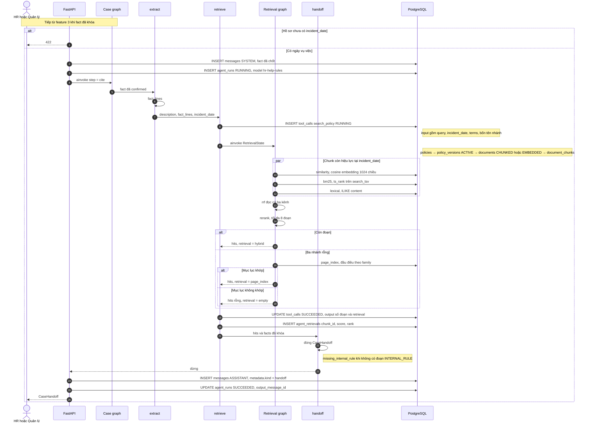

## 6. Đề xuất chế tài, quy trình, mức rủi ro

Sub-agent này nhận `CaseHandoff` của feature 5. Đầu vào retrieval là `passages` đã lọc theo `incident_date`. Agent không tra thêm văn bản. Mô hình tổng hợp đọc fact đã khóa và các đoạn đó, rồi trả một đánh giá có cấu trúc. Python chỉ giữ mức khi câu trích nằm nguyên văn trong đoạn được nêu, đoạn nội quy có tên mức đó, và có đoạn luật hoặc nghị định hướng dẫn đi kèm. Fact không có trong hồ sơ không được suy ra. Nhiều mức cùng được chứng minh thì chưa chọn.

Chuẩn là `AppliedStandard` trên câu trả lời và trên `ProposalHandoff`:

| Trường | Ý nghĩa |
|---|---|
| `sanction_type` | Đúng một mức đã được trích dẫn đủ, hoặc trống khi đánh giá chưa chốt |
| `process_steps` | Một quy trình: biên bản, giải trình, thời hiệu, người ký |
| `risk_level` | `LOW`, `MEDIUM`, `HIGH`, hoặc `CRITICAL` |
| `aligned` | `true` chỉ khi đã chốt một mức công ty |
| `layers` | Mỗi lớp một vai trò: `basis`, `level` hoặc `open`, `compare`, `excluded` |

| Nguồn trong retrieval | Lớp | Vai trò trong chuẩn |
|---|---|---|
| Luật, nghị định hướng dẫn như Nghị định 145 | `legal_basis` | Căn cứ pháp lý. Điều kiện trong đoạn phải khớp fact. Fact thiếu thì điều kiện là `UNKNOWN` |
| Nội quy còn hiệu lực | `internal_rule` | Mức công ty, chỉ khi đoạn được trích có đúng tên mức và đúng hành vi |
| Tiền lệ | `precedent` | Đối chiếu. Không nâng mức |
| Nghị định xử phạt, gồm Nghị định 283 | `inspection_risk` | Cảnh báo. Không vào `sanction_type` |

Không có mô hình, hoặc trích dẫn không khớp nguyên văn, thì `sanction_type` để trống và rủi ro `HIGH`. Trạng thái `NEED_MORE_FACTS` cũng để trống mức. `MULTIPLE_SUPPORTED` để trống mức, rủi ro `MEDIUM`, feature 7 giữ hồ sơ. Khi còn đúng một mức đã được chứng minh, feature 7 đẩy ticket, hồ sơ sang `PENDING_LEGAL` để pháp chế xem ở feature 8. Chuẩn không bao giờ nhận `TERMINATION`. Agent không chọn mức nặng hơn khi văn bản còn để ngỏ.

Kết quả ghi vào `recommendations`: nhận định, `sanction_type`, `process_steps`, `risk_level`. Mỗi citation giữ `quote`, điều, khoản, điểm và `chunk_id`.

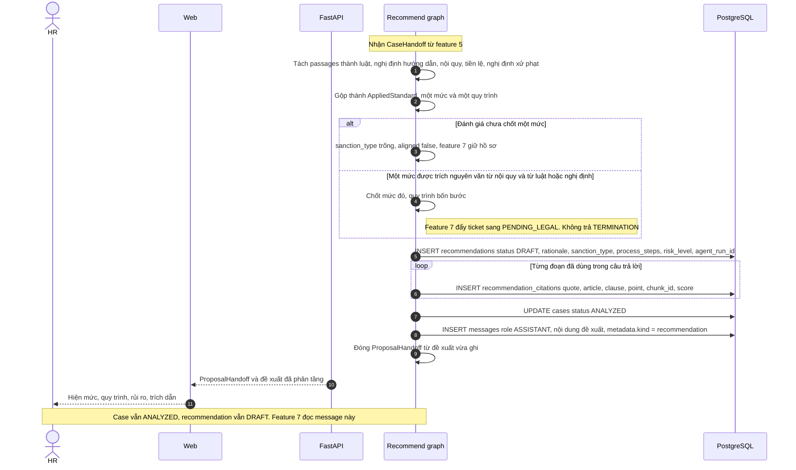

Feature 6 dừng tại `ProposalHandoff`. Message này là đầu vào duy nhất của feature 7. Feature 6 không tạo `case_drafts`, không ghi `reviews`, và không đổi hồ sơ sang `PENDING_LEGAL`.

## 7. Soạn nháp và đẩy ticket

Sub-agent dispatch đứng sau feature 6. Case graph dừng ở `CaseHandoff`. Recommend graph dừng ở đề xuất đã ghi. Người gọi đóng `ProposalHandoff` rồi gọi dispatch graph. Dispatch graph không phải node của hai graph kia.

Luồng xác nhận fact gọi dispatch một lần, ngay sau khi feature 6 ghi recommendation, trong cùng request. Chat chỉ chạy tới đây khi case graph trả `CaseHandoff`. `agent_runs.model` của lượt này là `hr-help-dispatch`.

Đầu vào duy nhất là `state['proposal']` kiểu `ProposalHandoff`. Sai kiểu thì graph ném `TypeError`. Lượt đó đánh `agent_runs` thành `FAILED`, hồ sơ giữ `ANALYZED`, recommendation giữ `DRAFT`. Graph không mở session, không đọc `messages`, không đọc `case_facts`, không tra `document_chunks`, không gọi model. Cột token để trống.

Feature 6 đã có các cột đề xuất và bốn lớp trích dẫn. `ProposalHandoff` đóng gói đúng các trường đó, cộng phần định danh mà feature 6 đã nhận từ `CaseHandoff`:

| Trường | Nội dung |
|---|---|
| `recommendation_id`, `case_id`, `agent_run_id` | Dòng `recommendations` vừa ghi, trạng thái vẫn `DRAFT` |
| `incident_date`, `employee_name` | Ngày vụ và tên trên hồ sơ đã khóa |
| `family` | `UNAUTHORIZED_ABSENCE`, `LATE`, hoặc `GENERAL` |
| `facts`, `fact_lines` | Chỉ fact đã confirmed |
| `rationale`, `sanction_type`, `process_steps`, `risk_level` | Cột trên `recommendations`. `sanction_type` để trống khi feature 6 chưa chốt mức |
| `missing_internal_rule` | `true` khi không có lớp nội quy |
| `message` | Cột `recommendations.recommendation`, câu HR đọc |
| `legal_basis`, `internal_rule`, `precedent`, `inspection_risk` | Citation đã phân tầng. Mỗi đoạn có `citation_id`, `chunk_id`, `policy_type`, `policy_code`, `policy_name`, `quote`, `article`, `clause`, `point`, `score` |

`process_steps` gồm bốn bước `MINUTES`, `EXPLANATION_REQUEST`, `TIME_LIMIT`, `SIGNER`. Mỗi bước có `code`, `label`, `done`.

FastAPI chỉ gọi graph khi hồ sơ đang `ANALYZED` và recommendation trên message đang `DRAFT`. Một `recommendation_id` chỉ dispatch một lần. Lần sau thấy dòng đó không còn `DRAFT` thì không gọi graph.

Node `gate` đọc message và trả một trong hai hướng. `hold_code` lấy điều kiện đầu tiên khớp:

| Thứ tự | Điều kiện trên message | `hold_code` |
|---|---|---|
| 1 | `sanction_type` là `TERMINATION` | `TERMINATION` |
| 2 | `sanction_type` trống, hoặc không thuộc `WARNING`, `REPRIMAND`, `WAGE_POSTPONEMENT`, `DEMOTION`, `DISMISSAL` | `OPEN_SANCTION` |
| 3 | `risk_level` là `HIGH` hoặc `CRITICAL` | `RISK_HIGH` |
| 4 | `missing_internal_rule` là `true` | `MISSING_INTERNAL_RULE` |
| 5 | `MINUTES` hoặc `EXPLANATION_REQUEST` có `done = false` | `PROCEDURE_OPEN` |

Khớp một dòng thì `disposition = HOLD`. Không khớp dòng nào thì `disposition = SUBMIT`. Node `draft` chỉ chạy ở nhánh `SUBMIT`. Node này chép `sanction_type` từ message vào nháp, không chọn lại mức, không lấy mức từ `precedent` hay `inspection_risk`.

Nhánh giữ lại không ghi `case_drafts`, không ghi `reviews`, không đổi `recommendations.status`, không đổi `cases.status`. FastAPI ghi một tin `ASSISTANT` với `metadata.kind = dispatch_hold` và `metadata.hold_code`. Câu HR đọc là `rationale` trên message. Hồ sơ vẫn `ANALYZED`.

Nhánh đẩy ticket soạn đúng bốn nháp, theo thứ tự `MINUTES`, `EXPLANATION_REQUEST`, `DECISION`, `TICKET`. `title` cắt còn tối đa 255 ký tự. `employee_name` trống thì tiêu đề không gắn tên.

- `MINUTES`: biên bản từ `fact_lines` và các bước đã `done`. Không bịa giờ họp hay người lập biên bản khi fact không có.
- `EXPLANATION_REQUEST`: ghi nhận đã yêu cầu giải trình. Không bịa hạn trả lời khi fact không có.
- `DECISION`: mức và nhận định, trích `legal_basis` và `internal_rule`. Nội dung ghi rõ đây là bản thảo, chưa có `decision_code`, chưa có người ký. `inspection_risk` nằm ở khối cảnh báo. `precedent` chỉ để đối chiếu.
- `TICKET`: phiếu chuyển pháp chế. Gồm nhân viên, ngày vụ, family, fact đã khóa, mức, nhận định, rủi ro, bốn bước thủ tục, và từng citation kèm điều, khoản, điểm, `chunk_id`.

FastAPI ghi trong cùng transaction. `created_by` là `cases.created_by`, không phải user pháp chế và không phải agent. Bốn dòng `case_drafts` để `status = PENDING_REVIEW`, cùng `recommendation_id`. Recommendation chuyển `PENDING_REVIEW`. Hồ sơ chuyển `PENDING_LEGAL`. Tin `ASSISTANT` có `metadata.kind = dispatch_submit`. Thiếu một loại nháp, hoặc trùng loại, thì rollback, `agent_runs` thành `FAILED`, hồ sơ giữ `ANALYZED`, recommendation giữ `DRAFT`.

Sub-agent không cấp `case_access`. Pháp chế chỉ thấy ticket sau khi người tạo hồ sơ đã cấp `REVIEW` ở feature 1. Ticket đã đẩy mà chưa có dòng quyền thì hồ sơ vẫn `PENDING_LEGAL`, hàng chờ của pháp chế trống.

Nháp `DECISION` chỉ là bản thảo cho feature 9. Dispatch graph không ghi `disciplinary_decisions`, không ghi `reviews`, không đặt `APPROVED`, `DECIDED` hay `CLOSED`.

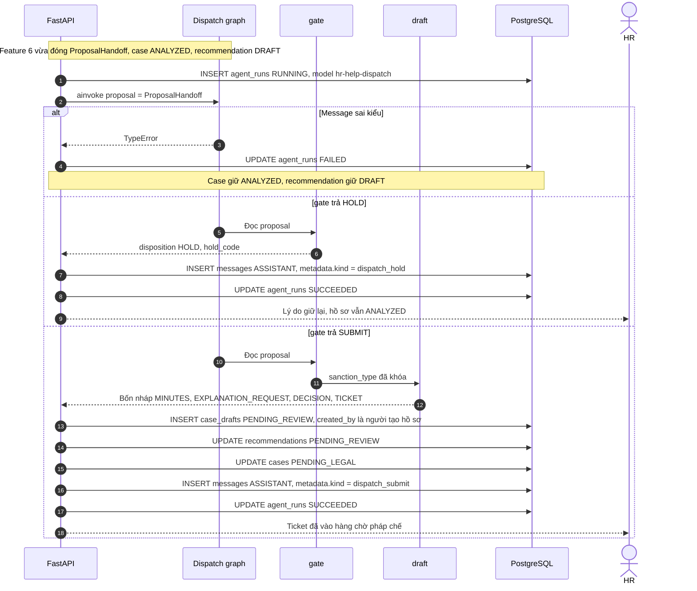

## 8. Pháp chế duyệt

Feature 8 là người, không phải graph. Hàng chờ chỉ chứa hồ sơ feature 7 đã đẩy: `cases.status = PENDING_LEGAL` và có `case_drafts` loại `TICKET` trạng thái `PENDING_REVIEW`. User mở hàng chờ phải có role `LEGAL` và một dòng `case_access.access_level = REVIEW` trên hồ sơ đó. Sub-agent không tự duyệt và không tự từ chối.

Gói xem xét lấy từ ticket, recommendation `PENDING_REVIEW`, và `recommendation_citations` đã phân tầng. Gói không gồm fact chưa confirmed và không gồm hội thoại. `inspection_risk` hiện ở khối cảnh báo. `precedent` hiện ở khối đối chiếu. Mức trên gói là `sanction_type` của recommendation, đã khóa từ lúc đẩy ticket.

`POST /cases/id/reviews` nhận `APPROVE` hoặc `REJECT`, và `comment`. Cột `reviews.comment` cho phép trống. `draft_id` của dòng review trỏ vào nháp `TICKET`. Bốn nháp cùng `recommendation_id` đổi status cùng lúc. Trong lúc hồ sơ còn `PENDING_LEGAL`, sửa fact trả `409`.

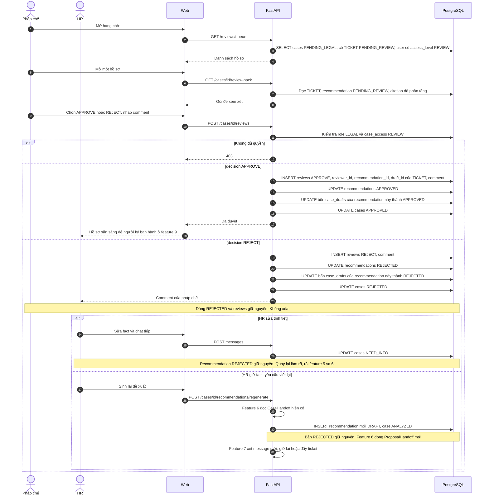

Từ chối không xóa đề xuất và không xóa ticket. Dòng `reviews` là dấu vết quyết định và comment. Feature 6 khi ghi bản mới chỉ chuyển các dòng đang `DRAFT` sang `SUPERSEDED`. Dòng `REJECTED` giữ status đó. Bản mới có `recommendation_id` khác. Feature 7 chỉ nhận `ProposalHandoff` của bản mới: chưa đủ căn cứ thì giữ ở `ANALYZED`, đủ căn cứ thì đẩy ticket mới. Comment từ chối nằm trên `reviews` để người đọc. Feature 6 vẫn chỉ đọc `CaseHandoff`, nên comment không đổi mức kỷ luật.

`APPROVE` không ghi `disciplinary_decisions`. Người ký ban hành từ nháp `DECISION` đã `APPROVED` ở feature 9.

## 9. Ban hành và tiền lệ

Mỗi hồ sơ chỉ có một quyết định. Người ban hành là người dùng thật (`issued_by`), không phải agent. Muốn vụ này thành tiền lệ thì bắt buộc có `precedent_summary`, rồi embed đoạn tóm tắt đó để vụ sau tìm theo nghĩa.

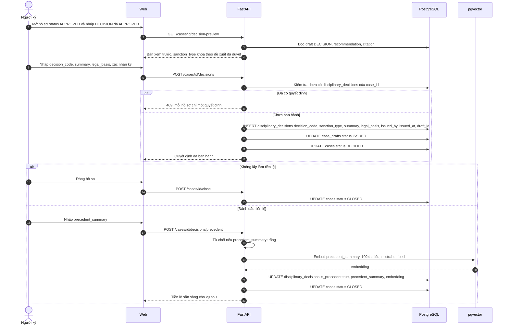

Vụ sau, feature 5 đọc đúng các dòng `is_precedent = true`.

## 10. Tái phạm

Trước khi chốt mức, agent liệt kê các vụ `DECIDED` hoặc `CLOSED` cùng `employee_code`, cùng `violation_type`, còn trong thời hạn tái phạm theo điều khoản đã trích. Kết quả hiện thành một fact, ví dụ `prior_sanction_count`, để HR xác nhận trước khi nó đi vào đề xuất. Không tự nâng mức chỉ vì embedding thấy vụ na ná.

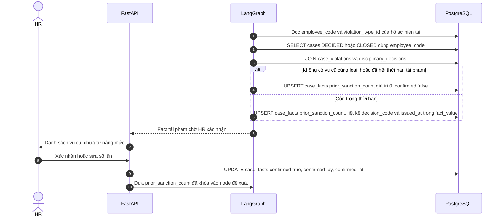

## 11. Phân tầng căn cứ trong câu trả lời

Feature 6 đã gộp các nguồn thành một mức. Mục này chỉ xếp citation ra giao diện thành ba nhóm:

- Luật và nghị định hướng dẫn kỷ luật lao động: căn cứ để công ty xử lý.
- Nội quy nội bộ đang hiệu lực đúng ngày: mức cụ thể công ty được phép dùng.
- Nghị định xử phạt hành chính: cảnh báo việc công ty có thể bị phạt nếu làm sai thủ tục. Đây không phải menu chế tài cho HR chọn.

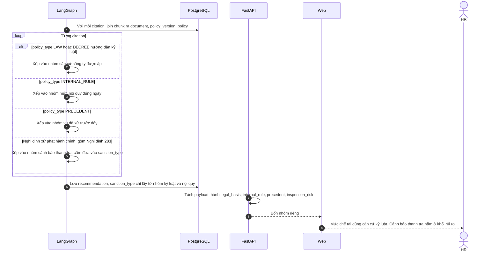

## 12. Nhật ký agent

Mỗi lượt chat ghi một `agent_run` gắn hội thoại và tin nhắn. Tool tra cứu ghi `tool_calls`. Chunk đã lấy ghi `agent_retrievals`, gồm điểm similarity. Token vào và token ra nằm trên `agent_runs` để chấm Demo Day và để pháp chế xem agent đã dựa vào đoạn nào.

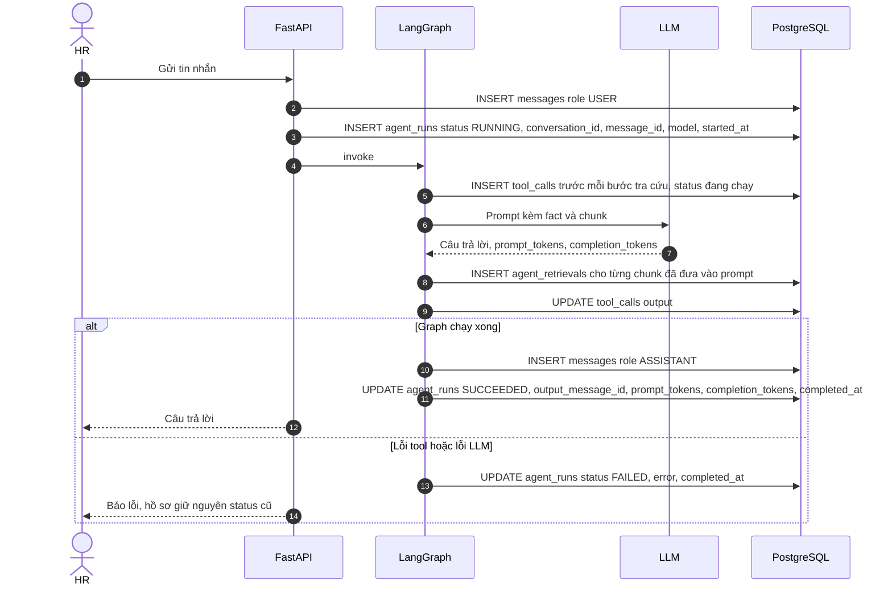

## 13. Dashboard vận hành

Làm sau khi feature 1–9 chạy. Màn này đếm hồ sơ theo trạng thái, theo mức chế tài, và thời gian từ `OPEN` đến `DECIDED`. Dashboard đi muộn trong ghi chú PRD là một nguồn fact đầu vào (số ngày đi muộn của một nhân viên), chưa phải sản phẩm riêng.

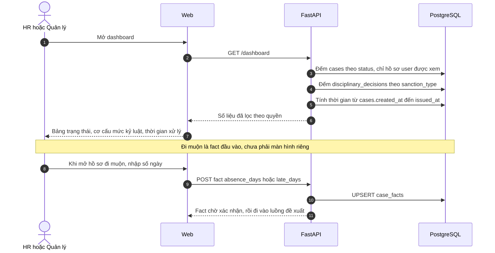

## Thứ tự làm

1. Đăng nhập, mở hồ sơ, chat lưu `messages` và `case_facts`.
2. Nạp Bộ luật Lao động và Nghị định 145, cắt theo điều khoản, lọc theo `incident_date`.
3. Node đề xuất kèm citation, chưa cần nháp.
4. Sub-agent feature 7 đọc `ProposalHandoff`, giữ lại hoặc đẩy ticket, rồi pháp chế duyệt hoặc từ chối.
5. Ban hành quyết định và bật tiền lệ.
6. Thêm nội quy công ty, tái phạm, và tách Nghị định 283 sang lớp cảnh báo.

Bản đó đủ cho Demo Day. Agent phân tích, cảnh báo, soạn nháp, và chỉ đẩy ticket khi đề xuất đủ căn cứ. Người phê duyệt và người ký quyết định chịu trách nhiệm.
