# HR Help — Feature và sequence diagram

- **Mã dự án:** P-029
- **Sản phẩm:** HR Help
- **Ngày:** 26/09/2026
- **Trạng thái:** Bản brainstorm bám PRD, Project Brief và schema hiện có

Tài liệu này mô tả các feature cần có để biến khung template thành một ứng dụng xử lý kỷ luật lao động dùng được. Mỗi feature có một sequence diagram chi tiết.

Thành phần dùng chung trong các sơ đồ:

| Thành phần | Vai trò trong luồng |
|---|---|
| HR / Quản lý | Mở hồ sơ, chat, xác nhận fact, chọn nháp, gửi duyệt |
| Pháp chế | Đọc hồ sơ được cấp quyền `REVIEW`, duyệt hoặc từ chối |
| Người ký | Ban hành quyết định. Là người dùng thật, không phải agent |
| Web | Giao diện |
| FastAPI | Kiểm tra quyền, gọi agent, ghi database |
| LangGraph | Trích fact, hỏi lại, tra cứu, viết đề xuất và nháp |
| PostgreSQL | Hồ sơ, fact, hội thoại, đề xuất, nháp, review, quyết định |
| pgvector | Chunk văn bản và embedding tiền lệ |

## Repo đang có gì

| Lớp | Đã có | Chưa có |
|---|---|---|
| Sản phẩm | PRD: HR nhập tình huống, agent hỏi thêm, đối chiếu luật và nội quy, đề xuất quy trình, pháp chế duyệt, người ban hành quyết định | Giao diện, đăng nhập, màn hình hồ sơ |
| Agent | LangGraph 2 node `analyze` → `respond`, một API `POST /chat` | Làm rõ tình tiết, RAG, trích dẫn, đề xuất, nháp văn bản |
| Dữ liệu | 20 bảng: user, hồ sơ, fact, hội thoại, chính sách theo phiên bản, chunk, đề xuất, trích dẫn, nháp, review, quyết định, tiền lệ | API và service ghi vào các bảng này |
| Kho luật | Bộ luật Lao động hợp nhất, Nghị định 145/2020, Nghị định 283/2026 (file trong `data/`) | Nội quy công ty, pipeline nạp tài liệu, lọc đúng ngày xảy ra việc |

Ba vai trò trong schema là `HR`, `MANAGER`, `LEGAL`. Mức chế tài là khiển trách (`WARNING`), cảnh cáo (`REPRIMAND`), kéo dài nâng lương (`WAGE_POSTPONEMENT`), cách chức (`DEMOTION`), sa thải (`DISMISSAL`) và chấm dứt hợp đồng (`TERMINATION`). Sa thải và chấm dứt hợp đồng là hai căn cứ khác nhau. Agent phải tách chúng.

## Feature nên có

Ưu tiên bám pain point: HR và quản lý mất thời gian tra cứu, dễ áp sai mức, quyết định thiếu căn cứ và không nhất quán giữa các vụ giống nhau.

| # | Feature | Vì sao cần | Bám bảng nào |
|---|---|---|---|
| 1 | Đăng nhập và phân quyền | Hồ sơ kỷ luật là dữ liệu nhạy cảm. Người tạo hồ sơ, người được xem, người được duyệt phải khác nhau | `users`, `case_access` |
| 2 | Mở hồ sơ vụ việc | Mọi tư vấn phải gắn một vụ, một nhân viên, một ngày xảy ra | `cases` |
| 3 | Chat làm rõ tình tiết | Luật không áp được nếu thiếu loại hợp đồng, số ngày nghỉ, đã lập biên bản chưa, đã yêu cầu giải trình chưa | `conversations`, `messages`, `case_facts` |
| 4 | Kho văn bản theo ngày hiệu lực | Căn cứ là bản đang có hiệu lực vào `incident_date`, không phải bản đang mở hôm nay | `policies`, `policy_versions`, `documents`, `document_chunks` |
| 5 | Đối chiếu và trích dẫn | Đề xuất không có điều, khoản, điểm thì HR không dùng được | `recommendation_citations` |
| 6 | Đề xuất chế tài, quy trình, mức rủi ro | Đây là đầu ra cốt lõi của PRD | `recommendations`, `case_violations` |
| 7 | Soạn nháp | Biên bản, yêu cầu giải trình, quyết định, ticket. HR chọn có soạn hay chỉ lưu lời tư vấn | `case_drafts` |
| 8 | Pháp chế duyệt | Người kết luận vẫn là người. Agent không tự ban hành | `reviews` |
| 9 | Ban hành quyết định và lưu tiền lệ | Vụ sau tra được vụ trước đã xử thế nào | `disciplinary_decisions` |
| 10 | Tái phạm cùng nhân viên | Mức kỷ luật phụ thuộc việc đã bị xử trước đó | `cases.employee_code`, `case_violations` |
| 11 | Phân tầng căn cứ | Nghị định 283 là xử phạt của cơ quan nhà nước, không phải mức kỷ luật công ty được quyền áp | `policies.policy_type` |
| 12 | Nhật ký agent | Demo Day cần chứng minh agent đã tra gì, gọi tool gì, tốn bao nhiêu token | `agent_runs`, `tool_calls`, `agent_retrievals` |
| 13 | Dashboard vận hành | PRD có ghi chú dashboard đi muộn. Làm sau khi vòng kỷ luật chạy được | đếm từ `cases` |

Nên làm feature 1–9 cho bản dùng được. Feature 10–12 làm cùng lúc nếu còn sức, vì schema đã chờ sẵn. Dashboard đi muộn để sau.

Ranh giới human-in-the-loop giữ nguyên theo PRD: agent phân tích, cảnh báo và soạn nháp. Pháp chế phê duyệt. Người có thẩm quyền ban hành quyết định và chịu trách nhiệm.

## Luồng xương sống của một vụ

`cases.status` chỉ nhận các giá trị `OPEN`, `NEED_INFO`, `ANALYZED`, `PENDING_LEGAL`, `APPROVED`, `REJECTED`, `DECIDED`, `CLOSED`.

Nếu HR chỉ muốn hỏi cho biết và không tạo ticket, hội thoại vẫn lưu, hồ sơ dừng ở `ANALYZED`. Không đẩy sang pháp chế.

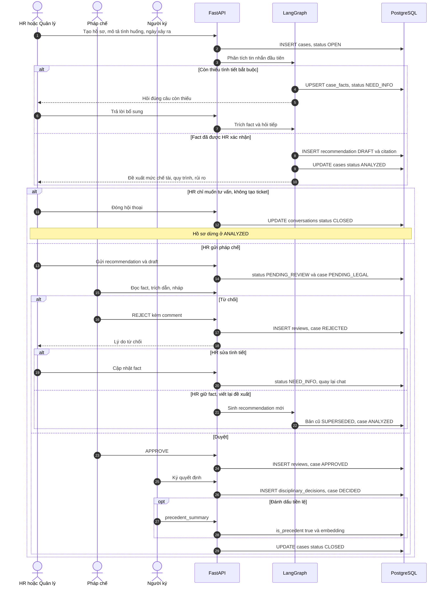

## 1. Đăng nhập và quyền trên hồ sơ

`HR` và `MANAGER` mở hồ sơ và chat. `LEGAL` không soạn quyết định thay HR. Pháp chế chỉ vào vụ khi được cấp quyền `REVIEW`. Người tạo hồ sơ luôn thấy vụ của mình qua `cases.created_by`. Người khác cần một dòng trong `case_access` với mức `VIEW` hoặc `REVIEW`.

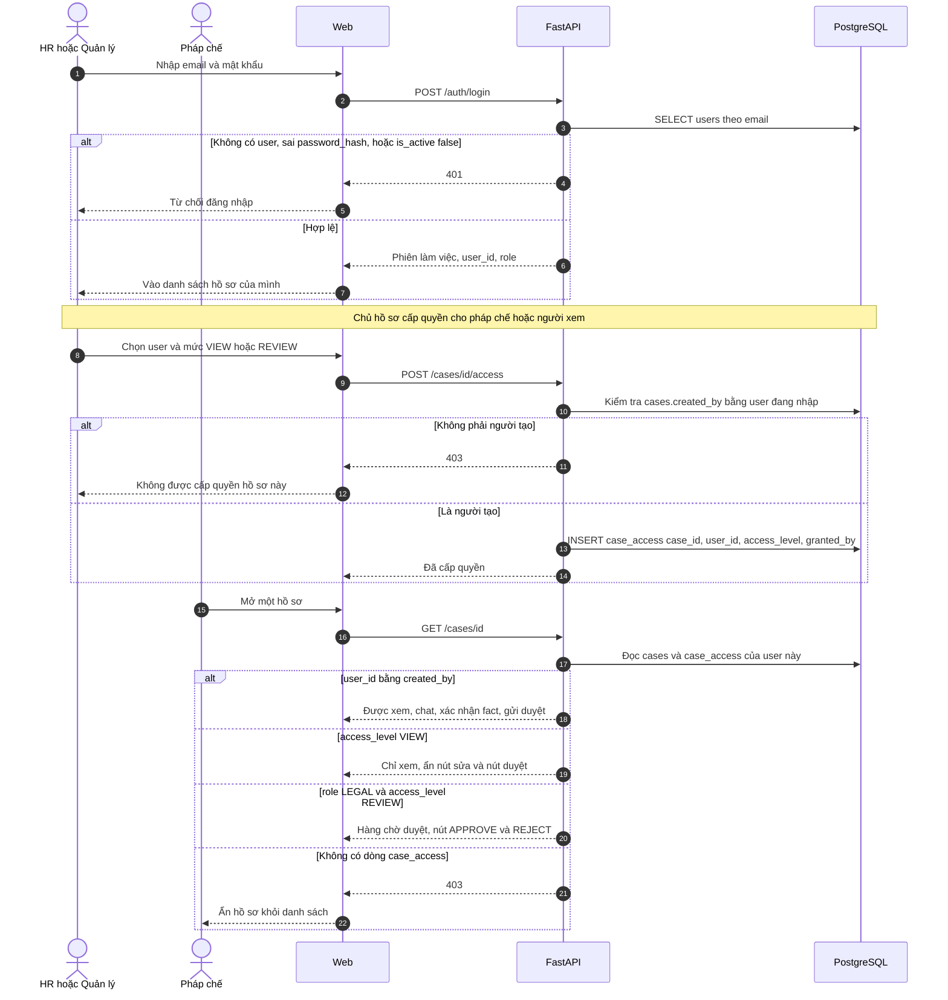

## 2. Mở hồ sơ vụ việc

Mọi tư vấn gắn một vụ, một nhân viên và một ngày xảy ra. `incident_date` là mốc để feature 5 chọn phiên bản văn bản còn hiệu lực.

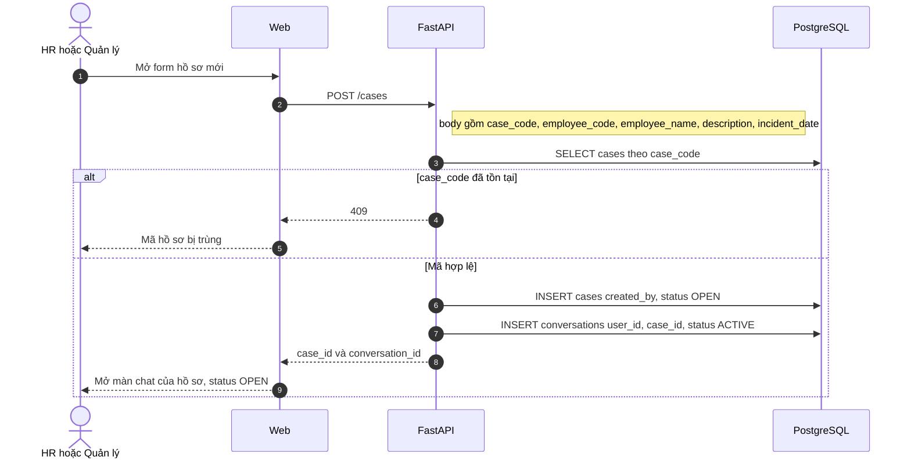

## 3. Chat làm rõ tình tiết

Agent không nhảy tới một mức chế tài khi chưa biết loại hợp đồng, đã báo vắng bằng hình thức nào, đã lập biên bản chưa, đã gửi yêu cầu giải trình chưa.

Fact bắt buộc cố định theo loại việc, lưu ở `case_facts` với `fact_key`. Ví dụ nghỉ không phép: `contract_type`, `absence_days`, `notice_form`, `minutes_made`, `explanation_requested`. HR xác nhận thì `confirmed = true`. Chỉ fact đã xác nhận mới được đưa vào đề xuất.

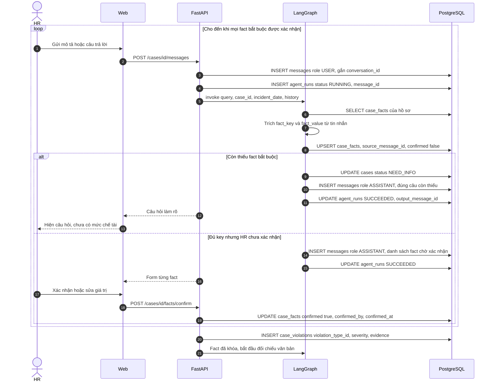

Bên trong LangGraph, một lượt chat đi qua các node sau. Node tra cứu và node đề xuất chỉ chạy sau khi fact đã khóa.

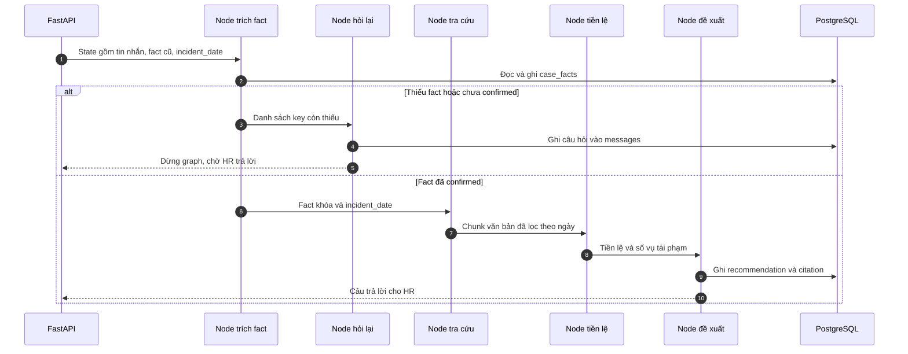

## 4. Nạp văn bản và khóa theo ngày hiệu lực

Ba file trong `data/` mới là bản Markdown thô. Chưa có bước cắt điều khoản, gắn phiên bản, hay embed. Mỗi chính sách (`LAW`, `DECREE`, `CIRCULAR`, `INTERNAL_RULE`, `PRECEDENT`) có nhiều phiên bản. Hai phiên bản của cùng một chính sách không được chồng ngày hiệu lực. Ràng buộc này đã nằm trong `policy_versions`.

Nội quy công ty chưa có trong kho. Không có nội quy thì agent chỉ trích luật, chưa trả lời được mức công ty được phép dùng.

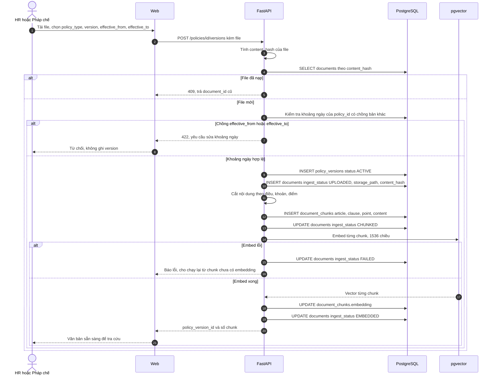

## 5. Đối chiếu và trích dẫn

Truy vấn lọc trước theo ngày: chỉ lấy phiên bản có `effective_from <= incident_date` và `effective_to` trống hoặc `effective_to >= incident_date`. Sau đó mới xếp theo độ giống nội dung.

Nghị định 283 chỉ được gắn như căn cứ cảnh báo thanh tra. Nó không đi vào mức kỷ luật nội bộ. Cách tách này làm ở feature 11.

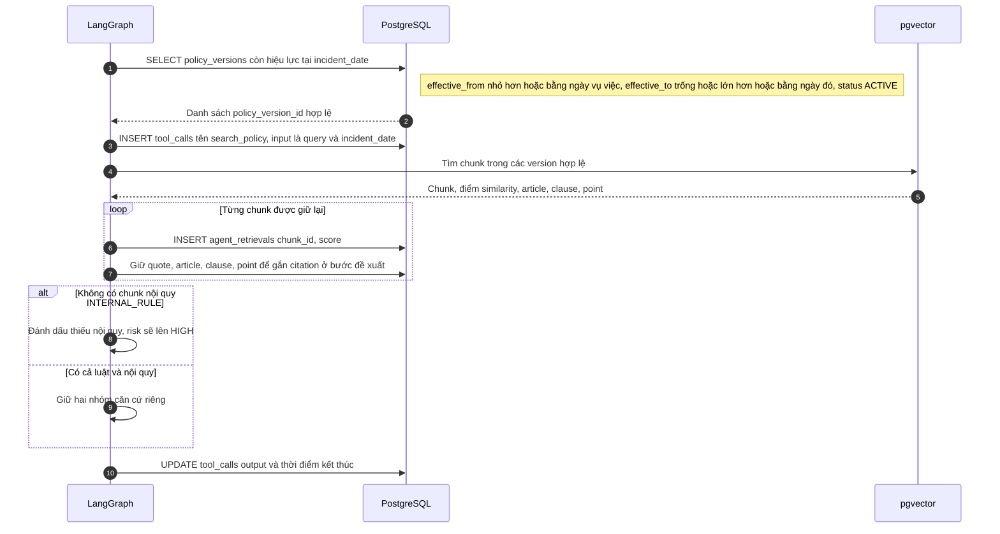

## 6. Đề xuất chế tài, quy trình, mức rủi ro

Kết quả gồm bốn phần, đúng cột trên `recommendations`: nhận định, mức chế tài, các bước thủ tục (`process_steps`), mức rủi ro `LOW`, `MEDIUM`, `HIGH`, `CRITICAL`. Mỗi câu viện dẫn ghi `quote`, điều, khoản, điểm và `chunk_id`.

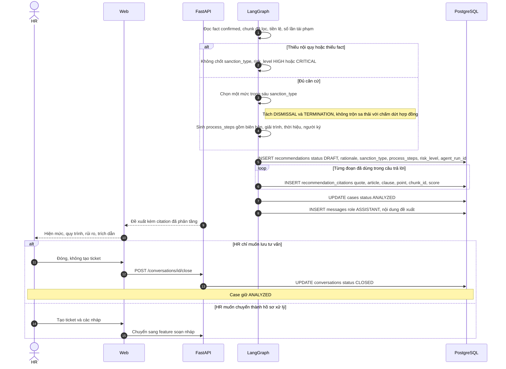

## 7. Soạn nháp

Bốn loại nháp đã có trong schema: `MINUTES` (biên bản), `EXPLANATION_REQUEST` (yêu cầu giải trình), `DECISION` (quyết định), `TICKET` (phiếu chuyển pháp chế). Nháp quyết định chỉ là bản thảo. Ban hành thật nằm ở feature 9.

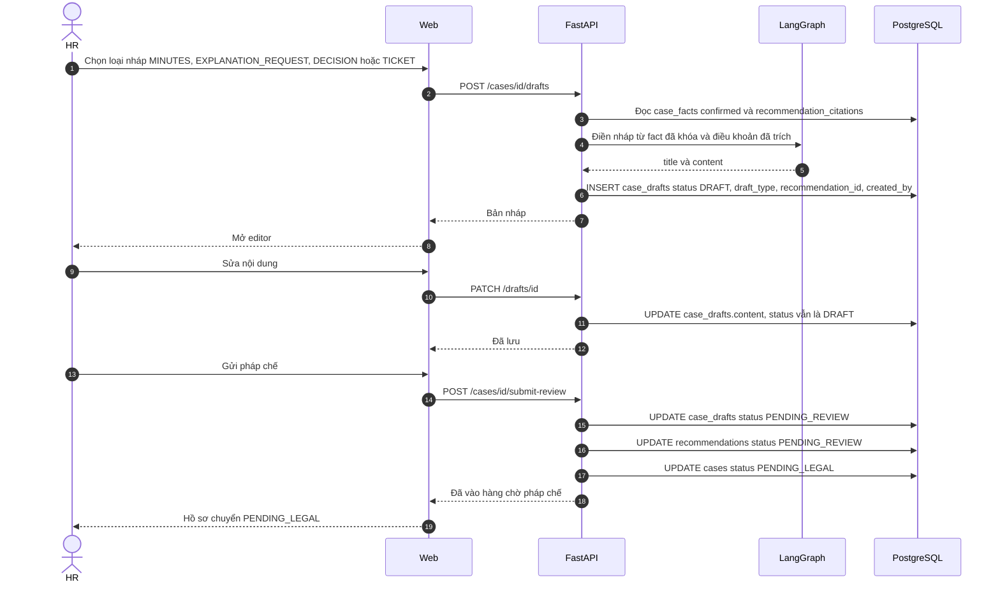

## 8. Pháp chế duyệt

Một review gắn được cả đề xuất lẫn nháp. Quyết định chỉ có `APPROVE` hoặc `REJECT`, kèm comment. Từ chối không xóa đề xuất cũ. Đề xuất cũ chuyển `SUPERSEDED` khi agent sinh bản mới, để còn dấu vết vì sao bản trước bị loại.

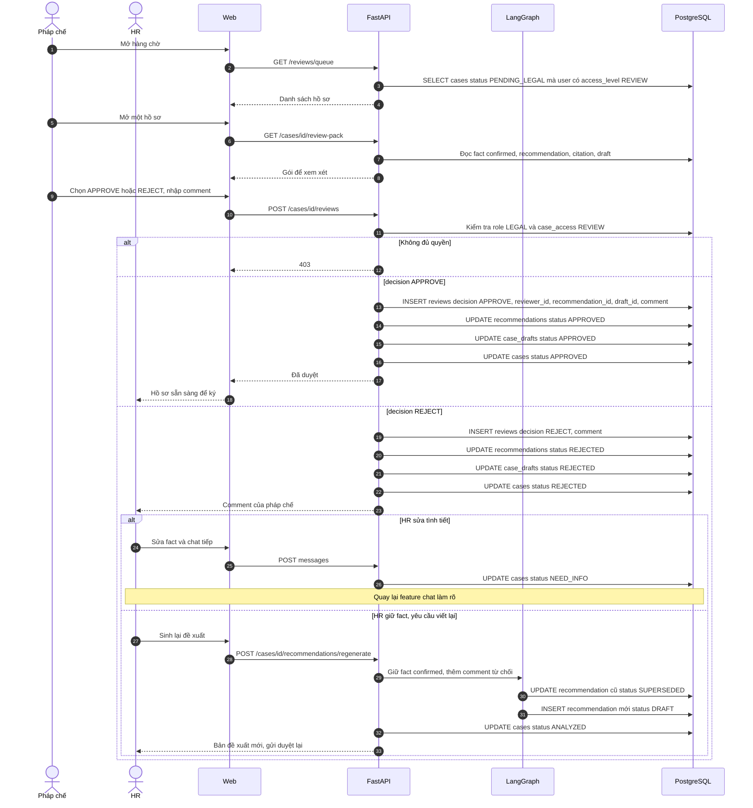

## 9. Ban hành và tiền lệ

Mỗi hồ sơ chỉ có một quyết định. Người ban hành là người dùng thật (`issued_by`), không phải agent. Muốn vụ này thành tiền lệ thì bắt buộc có `precedent_summary`, rồi embed đoạn tóm tắt đó để vụ sau tìm theo nghĩa.

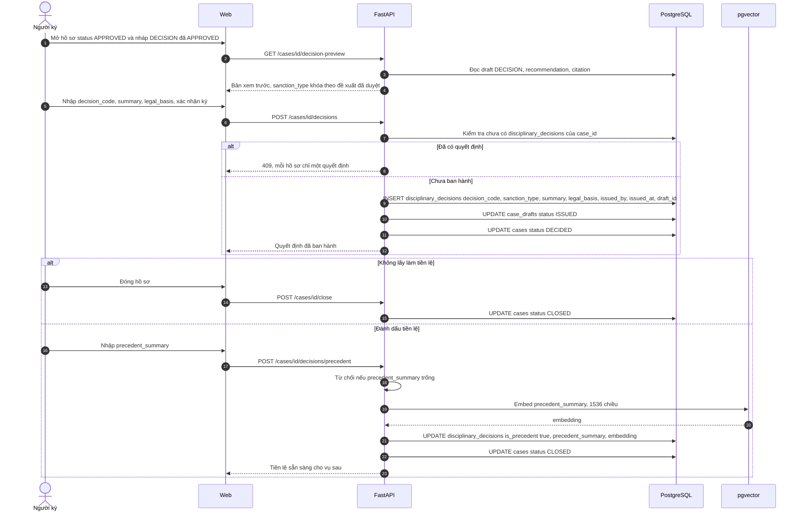

Vụ sau, feature 5 đọc đúng các dòng `is_precedent = true`.

## 10. Tái phạm

Trước khi chốt mức, agent liệt kê các vụ `DECIDED` hoặc `CLOSED` cùng `employee_code`, cùng `violation_type`, còn trong thời hạn tái phạm theo điều khoản đã trích. Kết quả hiện thành một fact, ví dụ `prior_sanction_count`, để HR xác nhận trước khi nó đi vào đề xuất. Không tự nâng mức chỉ vì embedding thấy vụ na ná.

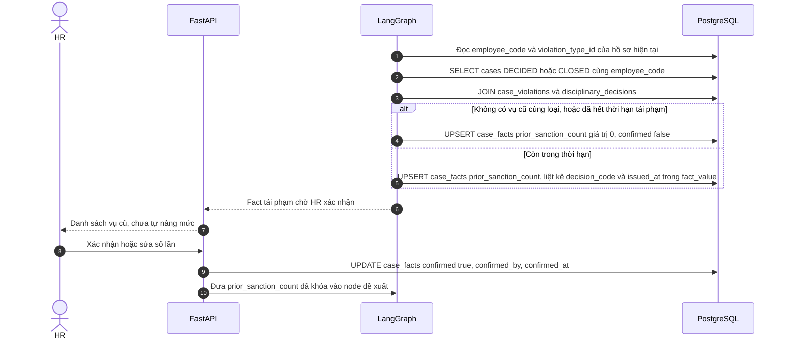

## 11. Phân tầng căn cứ trong câu trả lời

Mỗi citation mang `policy_type` ra giao diện thành ba nhóm:

- Luật và nghị định hướng dẫn kỷ luật lao động: căn cứ để công ty xử lý.
- Nội quy nội bộ đang hiệu lực đúng ngày: mức cụ thể công ty được phép dùng.
- Nghị định xử phạt hành chính: cảnh báo việc công ty có thể bị phạt nếu làm sai thủ tục. Đây không phải menu chế tài cho HR chọn.

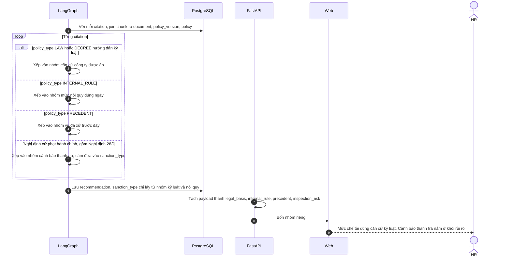

## 12. Nhật ký agent

Mỗi lượt chat ghi một `agent_run` gắn hội thoại và tin nhắn. Tool tra cứu ghi `tool_calls`. Chunk đã lấy ghi `agent_retrievals`, gồm điểm similarity. Token vào và token ra nằm trên `agent_runs` để chấm Demo Day và để pháp chế xem agent đã dựa vào đoạn nào.

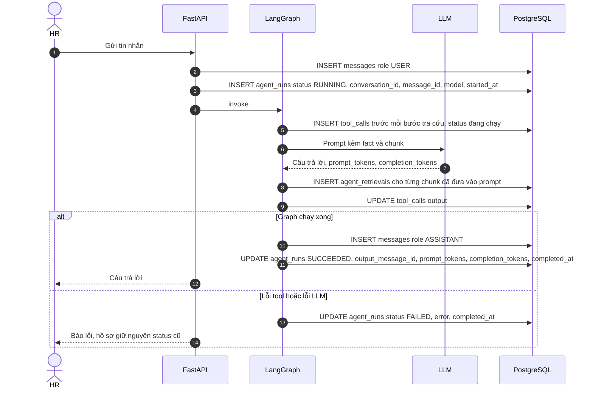

## 13. Dashboard vận hành

Làm sau khi feature 1–9 chạy. Màn này đếm hồ sơ theo trạng thái, theo mức chế tài, và thời gian từ `OPEN` đến `DECIDED`. Dashboard đi muộn trong ghi chú PRD là một nguồn fact đầu vào (số ngày đi muộn của một nhân viên), chưa phải sản phẩm riêng.

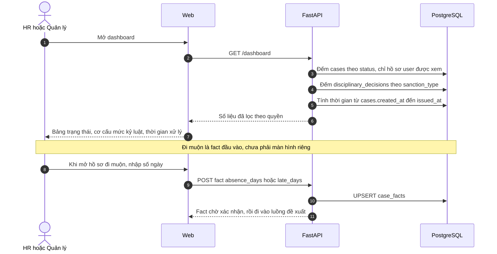

## Thứ tự làm

1. Đăng nhập, mở hồ sơ, chat lưu `messages` và `case_facts`.
2. Nạp Bộ luật Lao động và Nghị định 145, cắt theo điều khoản, lọc theo `incident_date`.
3. Node đề xuất kèm citation, chưa cần nháp.
4. Nháp biên bản và yêu cầu giải trình, hàng chờ pháp chế, duyệt hoặc từ chối.
5. Ban hành quyết định và bật tiền lệ.
6. Thêm nội quy công ty, tái phạm, và tách Nghị định 283 sang lớp cảnh báo.

Bản đó đủ cho Demo Day. Agent phân tích, cảnh báo, soạn nháp. Người phê duyệt và người ký quyết định chịu trách nhiệm.
