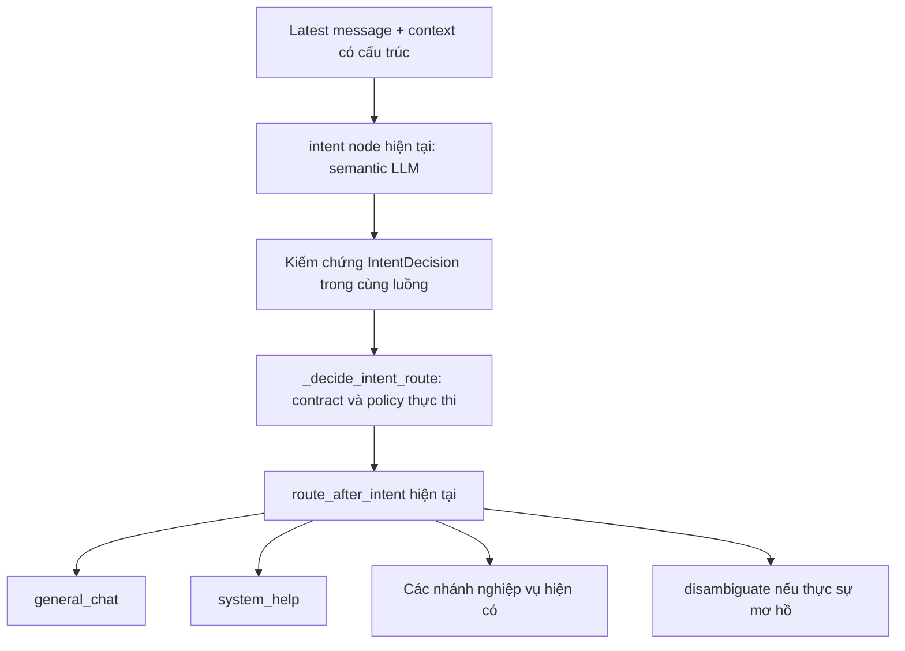

# Nghiên cứu độ tin cậy của intent orchestrator

> Đã triển khai phiên bản `intent-router-v5-rule-recheck-social-help`. Xem [hành vi thực tế và kết quả kiểm thử](orchestrator-social-implementation.md). Nội dung dưới lưu lại thiết kế/nghiên cứu trước triển khai.

Ngày nghiên cứu: 16/10/2026. Phạm vi: đọc mã hiện tại, nghiên cứu nguồn sơ cấp, chạy kiểm tra local không gọi model bên ngoài. Đây là kết quả nghiên cứu và thiết kế đề xuất; chưa sửa runtime.

**Thiết kế được người dùng lựa chọn:** giữ regex/keyword detector. Mỗi lượt có rule match sẽ qua một lần semantic recheck, kể cả khi ứng viên rule trùng route ban đầu. Rule không được sửa `IntentDecision` hoặc tự chuyển node. LLM xét lại câu gốc, ngữ cảnh, quyết định ban đầu và các ứng viên có bằng chứng; chưa phân xử được thì dùng `disambiguate` để hỏi người dùng. Chi tiết hợp đồng trong [phương án recheck](orchestrator-rule-recheck-design.md). Lựa chọn này thay thế đề xuất chỉ giữ keyword làm dữ liệu chẩn đoán; vẫn bỏ quyền override của keyword.

## 1. Kết luận

Thiết kế hiện tại **chưa bảo đảm điều hướng đúng 100%**, và đã có phản ví dụ tái hiện được ngay tại Python policy. Không có cơ sở để hứa rằng chỉ thêm route card, đổi model, bật structured output hoặc thêm một model kiểm tra sẽ hiểu đúng mọi câu tự nhiên.

Hướng nên triển khai là: **LLM phân loại ngữ nghĩa → Python kiểm chứng contract/quyền/trạng thái → conditional edge hiện có → node chuyên trách → kiểm chứng kết quả thực thi**. Giữ nguyên graph và bổ sung hai nhánh sau `route_after_intent` như yêu cầu.

Điểm cần thay đổi trong solution cũ: giữ kiến trúc và cơ chế thực thi, nhưng không giữ nguyên các heuristic từ khóa đang lấn quyền phân loại ngữ nghĩa. Cần tách rõ semantic classification, validation và authorization. Đây không phải ba tên gọi cho cùng một việc.

## 2. Vì sao ChatGPT/Claude có vẻ hiểu đúng?

Một sản phẩm chat trả lời hợp lý không chứng minh nó đang dùng đúng một graph hoặc bộ nhãn giống ứng dụng này. Không thể suy ra kiến trúc nội bộ đầy đủ của ChatGPT/Claude từ hành vi bên ngoài. Những nguồn dưới đây mô tả cơ chế API và thực hành xây dựng agent công khai, không phải bản thiết kế nội bộ toàn bộ sản phẩm.

Tài liệu Anthropic mô tả một nền tảng gồm LLM với tools, retrieval, memory, và workflow routing đưa câu hỏi tới tác vụ chuyên biệt. Đây là cơ sở để áp dụng mô hình semantic router đang có, không phải lý do buộc phải thay framework. [Building effective agents](https://www.anthropic.com/engineering/building-effective-agents).

Tài liệu OpenAI hướng dẫn mô tả rõ chức năng, khi dùng/không dùng, cấu trúc tham số và các trường hợp ranh giới; code ứng dụng thực thi lời gọi do model đề xuất. Card description của dự án phục vụ vai trò tương tự, nhưng mô tả tốt vẫn cần đo trên tình huống thực tế. [Function calling](https://developers.openai.com/api/docs/guides/function-calling).

Anthropic cũng ghi nhận agent có thể chọn sai tool hoặc hiểu sai cách dùng; họ dùng đánh giá và điều chỉnh mô tả để cải thiện. Vì vậy không nên lấy việc một model nói chuyện trôi chảy làm bằng chứng rằng router của ứng dụng sẽ đúng mọi lần. [Writing effective tools](https://www.anthropic.com/engineering/writing-tools-for-agents).

Với ứng dụng này, chất lượng quan sát được phụ thuộc đồng thời vào model, taxonomy các nhánh, instruction, ngữ cảnh, schema, policy, trạng thái và xử lý lỗi. Đây là suy luận thiết kế từ cơ chế công khai và mã nguồn, không phải tuyên bố về một “bí quyết 100%” của nhà cung cấp.

## 3. Python policy thực tế đang làm gì?

Luồng đang chạy:

```text
route_turn(): model sinh IntentDecision
  → enrich_intent_decision(): OR signals của model với heuristic từ khóa
  → intent_node gọi _decide_intent_route(): áp thứ tự ưu tiên để chọn selected_route
  → route_after_intent(): chuyển selected_route thành node LangGraph
  → node chạy nghiệp vụ
```

`route_after_intent()` là tên conditional edge. Phần policy chọn route nằm chủ yếu trong `_decide_intent_route()`, và được gọi ngay bên trong `intent_node`; không phải một graph node mới.

Ba loại policy cần phân biệt:

| Loại | Câu hỏi nó giải quyết | Cách xử lý nên có |
| --- | --- | --- |
| Kiểm chứng contract | Route có trong enum? Action có tương thích route? Output có mâu thuẫn? | Accept hoặc yêu cầu kiểm tra/làm rõ; không diễn giải lại bằng từ khóa thô |
| Quyền và workflow | Actor được làm gì? Case đang ở trạng thái nào? Điều kiện thực hiện đã đủ chưa? | Kiểm tra server, giữ yêu cầu gốc; chặn thao tác không được phép hoặc yêu cầu bổ sung |
| Đối chiếu từ khóa | Có chữ “hiện nay”, “phê duyệt”, “luật” không? | Sinh ứng viên và kích hoạt semantic recheck; không tự đổi ý định đã phân loại |

Hai loại đầu vẫn cần ngay cả với model tốt nhất. Loại thứ ba hiện đang có quyền ghi đè route quá rộng và gây lỗi. Dữ liệu đầu ra có cấu trúc chỉ giúp kiểm chứng hình dạng, không chứng minh ý nghĩa: OpenAI nêu rõ Structured Outputs vẫn có thể chứa sai sót. Code hiện còn dùng `method="json_mode"` và Pydantic parsing, không nên gọi đó là bảo đảm strict-schema từ provider. [Structured outputs](https://developers.openai.com/api/docs/guides/structured-outputs).

Lưu ý có hai điểm OR heuristic: `enrich_intent_decision()` và `_decide_intent_route()` qua `_merge_signals()`. Chỉ sửa conditional edge hoặc chỉ bỏ một lần merge vẫn chưa loại hết nguồn ghi đè.

## 4. Phản ví dụ đã chạy local

Phương pháp: gọi `_decide_intent_route()` với `IntentDecision(route=CASE_QA, confidence=0.99)` được cung cấp sẵn, không gọi LLM, không kết nối DB, không sửa hồ sơ. Đây là kiểm tra policy khi giả định model đã nhận ra câu hỏi đọc dữ liệu case; không phải đo độ chính xác thực tế của model.

| Câu thử tổng hợp | Route đưa vào | Route cuối quan sát được | Rule |
| --- | --- | --- | --- |
| Hồ sơ này đang chờ phê duyệt ở đâu? | `case_qa` | `unsupported` | `prohibited_action_priority` |
| Hồ sơ này hiện nay đang ở bước nào? | `case_qa` | `external_research` | `external_public_latest_priority` |
| Hồ sơ này có mức kỷ luật đang lưu là gì? | `case_qa` | `policy_qa` | `internal_policy_priority` |
| Hồ sơ này đang ở bước nào? | `case_qa` | `case_qa` | `case_memory_priority` |

Ba câu đầu hỏi trạng thái/nội dung đang lưu, không yêu cầu phê duyệt, nghiên cứu web hoặc đánh giá mức kỷ luật mới. Các lexical signal đã làm đổi mục đích câu hỏi.

Tỷ lệ 3/4 trong bảng **không phải error rate trên người dùng thực tế**: đây là các phản ví dụ chủ động chọn để kiểm tra ranh giới. Nó đủ bác bỏ bảo đảm “mọi câu đều điều hướng đúng”, nhưng không đủ ước lượng accuracy chung.

Đã chạy thêm `tests/test_conversation_contract.py` và `tests/test_clarify_planner.py`: **68 passed**, có một deprecation warning của dependency. Các test đó có nhiều model doubles/mocks nên không chứng minh chất lượng semantic của model live. Việc suite hiện tại pass trong khi các phản ví dụ vẫn xảy ra cho thấy cần bổ sung coverage, không cho thấy suite vô dụng.

## 5. Thiết kế sửa đúng vai trò từng lớp



Không thêm router từ khóa phía trước `intent node`. Không biến `general_chat` thành nhánh hứng lỗi. Không bỏ auth, guardrail hoặc kiểm tra tình tiết.

### 5.1. Ngữ nghĩa do LLM chịu trách nhiệm

Router nhận latest message tách biệt, structured case facts, mục tiêu/pending inputs hiện tại, đoạn hội thoại gần nhất có chọn lọc và route cards từ server. Không để lịch sử cũ tự biến thành lệnh mới.

Đặt route cards và luật chung ở system/developer instruction do server sở hữu; user input, mô tả hồ sơ và lịch sử là dữ liệu riêng. Hiện `render_intent_prompt()` đặt cards cùng user context, nên cần làm rõ ranh giới này khi sửa prompt, không chỉ thêm nội dung dài hơn.

Card nên có phạm vi đủ rõ nhưng gọn: mục đích, đầu vào, khi dùng/không dùng, cặp nhánh hay nhầm, chính sách task/state và vài ví dụ phân biệt. Không nhét toàn bộ system prompt an toàn/tính cách của responder vào prompt router. Độ dài card không phải thước đo chất lượng. OpenAI cũng khuyến nghị mô tả handoff ngắn, cụ thể và chỉ tách specialist khi có khác biệt thực sự về công việc/instructions/tools/policy. [Orchestration and handoffs](https://developers.openai.com/api/docs/guides/agents/orchestration).

Vấn đề trọng tâm là phân biệt hành vi ngôn ngữ và đối tượng, không đếm từ xuất hiện:

- Hỏi khả năng hệ thống / yêu cầu làm một việc cụ thể.
- Hỏi dữ liệu đang lưu / hỏi quy định áp dụng.
- Tường trình hành vi nguy hiểm / xin hướng dẫn gây hại.
- Trả lời câu đang chờ / hỏi chuyện bên lề / yêu cầu đổi hoặc hủy tác vụ.
- Nói lịch sử đã làm gì / ra lệnh làm mới.

### 5.2. Output mong muốn: ngắn, kiểm chứng được

Giữ schema hiện có, bổ sung có default các trường cần thiết; không phải thay toàn bộ schema ngay. Ví dụ **output đề xuất**, chưa phải output runtime:

```json
{
  "route": "system_help",
  "intent_label": "ask_assistant_authority",
  "speech_act": "ask_capability",
  "target": "system",
  "requested_action": "",
  "help_topic_ids": ["authority_limits"],
  "task_change": "keep",
  "requires_fact_planner": false,
  "requires_internal_retrieval": false,
  "requires_external_research": false,
  "needs_clarification": false,
  "evidence": [{"source": "latest_user_message", "text": "quyết định thay tôi không"}],
  "reason_code": "ASKS_AUTHORITY_NOT_EXECUTION",
  "confidence": 0.92
}
```

Đầu vào ví dụ: “Bạn có thể quyết định thay tôi không?”. Evidence chỉ là đoạn dẫn ngắn phục vụ kiểm tra và debug; không yêu cầu hay lưu suy luận nội bộ dài. Có trích dẫn đúng vẫn không đủ chứng minh semantic đúng.

`confidence=0.92` trong ví dụ không có nghĩa là đã biết xác suất đúng 92%. Trường này do model tự sinh. Cần đo/calibrate theo model, prompt và dữ liệu đích; không áp ngưỡng 0.6 hoặc chênh lệch top-2 như một bảo đảm xác suất. Nghiên cứu calibration cho thấy cách thu nhận confidence phải được đánh giá, không tự suy ra từ một con số verbalized. [Tian et al., EMNLP 2023](https://aclanthology.org/2023.emnlp-main.330/).

Giảm mâu thuẫn bằng validator hoặc discriminated union: route general/help không được kèm workflow action; policy route không có cờ yêu cầu sửa facts; action nằm trong allowlist của route. Các quyết định thật sự cố định theo contract nên do Python suy ra sau khi nhận route, thay vì yêu cầu model đoán lại nhiều boolean trùng nghĩa.

### 5.3. Python giữ vai trò kiểm chứng và thực thi

Nếu không có rule match và route hợp lệ, nhất quán thì giữ route semantic. Nếu có rule match thì kiểm tra lại bằng LLM trước khi chốt, theo hợp đồng recheck được người dùng lựa chọn. Python được kiểm tra:

- Enum, schema, sự tương thích giữa route/action/topic/speech act.
- Feature đã bật, tool tồn tại, actor có quyền, case có thể thực hiện thao tác không.
- Những thao tác yêu cầu fact được xác nhận vẫn đi validator nghiệp vụ trước thực hiện.
- Giới hạn số lần gọi, không đổi pending task khi chỉ hỏi bên lề, không ghi social chat thành facts.

Python không được tự kết luận “có chữ luật → tra luật”, “có chữ phê duyệt → đang yêu cầu phê duyệt”. Trường hợp route/fields bất nhất thì kiểm tra lại hoặc làm rõ, không âm thầm chọn nhánh khác bằng một thứ tự keyword ưu tiên.

Tách `semantic_route` với kết quả `policy_decision` (`allow`, `deny_action`, `recheck`, `clarify`) trong trace. Một yêu cầu có thể được hiểu đúng nhưng actor không có quyền thực hiện; đó là từ chối thao tác có giải thích, không phải không hiểu câu hỏi. Các kiểm tra authorization tại API vẫn bắt buộc, không chuyển hết về router.

Thiếu ngày hoặc thiếu facts không nhất thiết làm đổi intent: một yêu cầu lập biên bản vẫn là workflow action, rồi node hiện tại hỏi dữ liệu thiếu. Một câu đọc trạng thái không cần khóa đủ facts để được đọc.

### 5.4. Phục hồi có giới hạn thay vì đoán chắc

Kiểm tra semantic thêm tối đa một lần trong chính intent node khi có regex/keyword match; đây là yêu cầu thiết kế được người dùng lựa chọn. Output mâu thuẫn hoặc nhiều mục tiêu không phân xử được cũng cần xử lý trong cùng ngân sách kiểm tra, không mở vòng lặp vô hạn. Các lượt không match rule và không có vấn đề validation không cần thêm lần gọi này.

Lần kiểm tra lại cân nhắc toàn bộ tập route; không chỉ đưa hai ứng viên sai ban đầu rồi ép chọn. Model mạnh hơn là ứng viên cần benchmark, không tự động là lời giải. Hai model đồng ý vẫn có thể cùng sai.

Nếu vẫn không rõ, dùng `disambiguate` hiện tại và hỏi một câu cụ thể: “Bạn muốn mình giải thích quyền phê duyệt của AI hay đang đề nghị duyệt hồ sơ này?”. Sau câu trả lời, lượt mới đi lại qua intent node.

Phân biệt lỗi provider/schema với câu hỏi mơ hồ. Hiện technical failure rơi về fact planner; cần đánh giá lại vì lỗi mạng không chứng minh latest message là fact update. Hướng đề xuất cho sự cố chưa phân loại được: giữ state, trả lỗi có thể thử lại; chỉ phục hồi pending facts nếu có đủ căn cứ theo contract đã kiểm chứng. Việc thay fallback này cần regression tests và rollout riêng, không sửa âm thầm cùng card.

## 6. “Hiểu như người” cần trở thành tiêu chí đánh giá

Không thể kiểm chứng nhận thức giống con người bằng một output router. Có thể kiểm chứng hành vi:

1. Diễn đạt khác nhưng cùng ý định phải đi cùng nhánh phù hợp.
2. Chỉ thay mục đích từ hỏi khả năng sang yêu cầu thực hiện phải đổi nhánh đúng.
3. Hiểu phủ định, trích dẫn, thời điểm, câu nối tiếp và đối tượng đang nói đến.
4. Giữ được tác vụ khi nói chuyện bên lề và tiếp tục đúng sau đó.
5. Nói rõ khi thiếu dữ kiện, không tạo cảm giác đã hiểu bằng cách đoán bừa.

Không phải mọi câu đều có một nhãn đúng duy nhất. “Làm tiếp đi” thiếu context không thể có đáp án xác định. Câu có hai yêu cầu hợp lệ cần chính sách ưu tiên đã thống nhất hoặc tập route chấp nhận được; không chấm sai một cách xử lý hợp lý chỉ vì labeler chọn đường khác.

## 7. Bộ đánh giá cần có trước khi tuyên bố chất lượng

Đề xuất bắt đầu khoảng 600–1.000 tình huống, con số là quy mô làm việc ban đầu, không là bảo đảm thống kê hay kết quả đã đạt. Có cả đơn lượt và chuỗi hội thoại; không bắt người dùng duyệt từng câu nếu quy tắc đã rõ, nhưng các nhãn nghiệp vụ tranh chấp cần được chốt bởi người hiểu sản phẩm.

Chia tập chỉnh prompt và tập giữ lại theo nhóm hội thoại/template, không rải các paraphrase của cùng một mẫu sang hai tập. Bao gồm cả ca thông thường, không dấu, lỗi gõ, Anh–Việt, câu nhiều mục tiêu, quote, các ví dụ phủ định và nội dung ngoài phạm vi. Dùng phản hồi thực tế đã loại thông tin nhạy cảm để bổ sung dần.

OpenAI hướng dẫn xây eval với mục tiêu, dataset, metric và đánh giá liên tục vì output AI biến thiên. Với dự án này nên dùng harness local/provider-neutral; không cần phụ thuộc một nền tảng eval được quản lý cụ thể. [Evaluation best practices](https://developers.openai.com/api/docs/guides/evaluation-best-practices).

Đo ít nhất ba lớp riêng:

| Lớp | Cần đo |
| --- | --- |
| Semantic model | Route trước heuristic/policy, speech act, target/action; confusion matrix, precision/recall theo route |
| Policy | Policy sửa lỗi hay gây thêm lỗi; số lần route đúng bị đổi sai; deny đúng quyền và state |
| End-to-end | Trả lời đúng yêu cầu; chỉ gọi tool cần thiết; giữ facts/task; không thực hiện thao tác ngoài quyền |

Các metric không được giấu trong một accuracy chung:

- Độ đúng trên toàn bộ tập, tính cả việc có hỏi làm rõ phù hợp hay không.
- Độ đúng trong những lượt hệ thống tự quyết định trả lời và tỷ lệ bao phủ các lượt đó.
- Tỷ lệ hỏi lại không cần thiết; hệ thống hỏi lại mọi câu không thể được coi là router tốt.
- Tỷ lệ sai nghiêm trọng: câu pháp lý bị trả lời như chuyện phiếm, yêu cầu gửi bị hiểu thành chỉ xem, câu help bị từ chối như lệnh cấm, social làm đổi facts.
- Độ ổn định khi chạy lại; latency, số lượt model và chi phí; drift theo version model/prompt/catalog.

Anthropic nhấn mạnh đánh giá cả transcript và trạng thái kết quả, đồng thời chạy nhiều trial vì output có thể thay đổi. Vì vậy một lần model chọn đúng hoặc một lời khẳng định “đã gửi” không thay cho kiểm tra kết quả thực tế. [Demystifying evals](https://www.anthropic.com/engineering/demystifying-evals-for-ai-agents).

Benchmark đề xuất: cùng tập dữ liệu trên model hiện đang cấu hình và một vài ứng viên tốt hơn, với ba biến thể `semantic hiện tại`, `semantic + policy hiện tại`, `semantic + policy kiểm chứng đề xuất`. Không đổi provider/model trong production dựa trên cảm giác nói chuyện hay; không gọi paid live evaluation trong đợt nghiên cứu này.

Temperature=0 giúp giảm một nguồn biến thiên nhưng không là bằng chứng đúng nghĩa. Không lặp một câu tới khi trúng rồi chỉ báo cáo lần trúng. Các model output parse hợp lệ mà chọn sai vẫn phải tính lỗi, không chỉ đếm timeout/schema failure.

## 8. Có thể bảo đảm những gì?

| Yêu cầu | Mức có thể cam kết |
| --- | --- |
| Mọi câu tự nhiên đều chọn đúng ý định 100% | Không có cơ sở bảo đảm bằng thiết kế hoặc nguồn nghiên cứu đã xem |
| Không thực thi route/action ngoài allowlist | Có thể cưỡng chế bằng code, kiểm tra và giới hạn phạm vi hệ thống |
| Không thực hiện thao tác khi thiếu quyền/điều kiện | Có thể cưỡng chế tại API và workflow; vẫn cần test và review implementation |
| General/help không sửa hồ sơ | Có thể thiết kế không cấp tool ghi và kiểm tra bất biến state |
| Đạt tỷ lệ đúng trên tập nghiệm thu xác định | Có thể đo và công bố kèm version, tập dữ liệu, số trial và khoảng tin cậy |
| Bộ test đạt 100% đồng nghĩa production luôn đúng | Không; ngoài phân bố, lỗi mới và thay đổi model vẫn tồn tại |

Ngay cả 1.000 thử nghiệm độc lập, đại diện và không thấy lỗi cũng không chứng minh xác suất lỗi bằng 0. Trong giả định nhị thức đơn giản, cận trên một phía 95% của tỷ lệ lỗi là `1 - 0.05^(1/1000)`, khoảng 0,30%; dữ liệu không đại diện còn làm giả định này không áp dụng được.

Do chưa có baseline live cho bộ phân loại này, không khẳng định hiện đạt 95%, 99% hay 100%. Mốc nghiệm thu phải được chốt và đo riêng cho nhóm rủi ro; mọi counterexample nghiêm trọng đã biết phải được sửa và giữ trong regression suite.

## 9. Thứ tự thực hiện khuyến nghị

1. Giữ nguyên topology graph, bổ sung các phản ví dụ tái hiện được vào bộ regression trước sửa.
2. Xác định taxonomy và output contract; tách ngữ nghĩa với quyền/thực thi; viết hai cards mới cùng các loại trừ đối xứng ở cards cũ.
3. Thay keyword override bằng detector trả match/candidate và semantic recheck; xử lý cả `enrich_intent_decision()` và `_merge_signals()` để giữ nguyên raw LLM decision; cập nhật tracing theo từng lớp.
4. Thêm hai node sau `route_after_intent`, catalog help, guardrail general, tách context và bảo vệ state/cache như solution trước.
5. Chạy eval live riêng để chọn model/prompt recheck và đo lợi ích, tỷ lệ hỏi lại, latency và chi phí của thiết kế recheck-on-rule-hit được lựa chọn.
6. Nghiệm thu policy, semantic và kết quả end-to-end; rollout flag/shadow, có rollback và theo dõi ca nhầm mới.

Thiết kế này hướng tới việc hiểu đúng và phục hồi tốt trong phạm vi sản phẩm được định nghĩa. Nó không biến một model xác suất thành lời cam kết hiểu mọi ngôn ngữ tự nhiên hoàn hảo.
