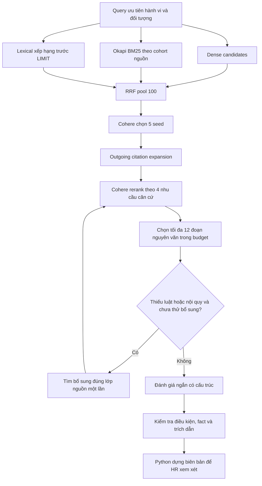

# Retrieval và Cohere rerank: triển khai và chạy thử

Bản triển khai dựa trên nghiên cứu ngày 14/10/2026. Mã được kiểm thử bằng fixtures có kiểm soát và HTTP giả lập; chưa có kết quả benchmark độ chính xác pháp lý trên bộ hồ sơ được chuyên gia duyệt.

## Cấu hình để chạy

1. Điền key thật vào dòng `COHERE_API_KEY=` trong `.env`. Model đã đặt là `rerank-v4.0-pro`. Không cần cài SDK Cohere: adapter dùng HTTP v2 qua httpx hiện có.
2. Khởi động lại backend để Settings đọc `.env`. Nếu chạy Docker desktop, dùng `make compose-desktop` như README để build/recreate backend; các thay đổi không cần migration mới.
3. Kiểm tra `/ready`: `rerank_configured=true` chỉ xác nhận có key, chưa xác nhận key hợp lệ/quota. Khi chạy hồ sơ, kiểm tra `agent_stage ... stage=rerank ... status=OK` hoặc trạng thái lỗi HTTP trong log.
4. Chạy lại hồ sơ lỗi hoặc tạo lượt đối chiếu mới. Kết quả đã lưu trước đây không tự được thay đổi.

Không gửi key vào chat hoặc commit `.env`; file này vẫn được Git ignore.

## Flow đã thực hiện



- Pool ứng viên và context cuối được cấu hình riêng. Sparse search chạy trên cohort luật/hướng dẫn và nội quy trước khi cắt kết quả; BM25 dùng thống kê toàn bộ cohort đủ điều kiện, không lấy 40 hàng tùy ý trước khi chấm.
- PostgreSQL FTS `ts_rank` còn là baseline riêng, không bị gọi nhầm là BM25.
- Mọi nhánh SQL lọc hiệu lực ngày sự kiện, ACTIVE, nguồn đang dùng, tài liệu đọc được và không bị soft-delete. Khóa/savepoint bảo vệ AsyncSession dùng chung giữa các nhánh của graph.
- Reverse graph mặc định tắt. Lỗi graph giữ ứng viên để audit nhưng đánh dấu suy giảm và không mở khóa mức.
- Cohere kiểm tra đầy đủ tập index và score hữu hạn; không cắt văn bản âm thầm để gửi API. Thiếu key, 401, timeout hoặc response không hợp lệ không được coi là rerank thành công.
- Chọn đoạn theo nội quy, luật/hướng dẫn, điều kiện/ngoại lệ và thủ tục. Không ép quota bằng một loại nguồn khác; xử phạt hành chính và tiền lệ ở pool audit riêng, không làm căn cứ chọn mức kỷ luật.
- Budget mặc định 40.000 byte UTF-8, giữ nguyên từng đoạn. Nếu cung cấp `SYNTHESIS_TOKENIZER_PATH` là tokenizer.json đúng model, dùng thêm ngân sách token cấu hình thay cho byte. Không tự tải tokenizer, không coi số ký tự là số token.
- Score threshold mặc định không đặt: cần hiệu chỉnh `RERANK_MIN_SCORE` bằng dữ liệu có nhãn.
- Tìm bù chỉ chạy tối đa một lần khi thiếu lớp luật hoặc nội quy. Đủ hai lớp nguồn chỉ là kiểm tra cấu trúc; không chứng minh đã lấy đủ mọi ngoại lệ. Thiếu điều kiện ngữ nghĩa vẫn cần LLM đối chiếu và HR/pháp chế xác nhận.

## Tổng hợp và khóa mức

DeepSeek nhận assessment schema gọn; phần report và handoff được Python dựng sau kiểm tra. Prompt cố định giảm từ 10.033 còn 3.239 ký tự và schema sinh ra khoảng 5.076 ký tự thay cho 7.717 ký tự; đây là số ký tự, không phải tổng token của request.

Mỗi điều khoản muốn hỗ trợ mức cần `supports_sanction`, trích dẫn đúng loại nguồn, danh sách điều kiện, key fact, giá trị fact nguyên văn và trích dẫn cho điều kiện. Guard kiểm tra quote thuộc chunk, mapping source type, giá trị khớp tình tiết đã xác nhận, thiếu fact/UNKNOWN/NOT_SATISFIED, xung đột và trạng thái retrieval. Trích luật không liên quan chỉ vì cũng có chữ “hợp đồng” không đủ mở khóa mức. Phải có trích dẫn hình thức tương ứng ở luật/hướng dẫn và nội quy, cùng các rule-condition records hợp lệ.

Các kiểm tra này xác minh cấu trúc và nguồn; chúng không phải máy suy luận pháp luật đầy đủ. Một quan hệ suy diễn bằng ngôn ngữ tự nhiên vẫn cần được kiểm chứng trên bộ chuẩn, và HR giữ bước xem xét. Sự hiện diện của quote không tự chứng minh đã liệt kê đủ điều kiện pháp lý.

Giới hạn synthesis mặc định: 300 giây mỗi request, 300 giây toàn bộ synthesis, max output 12.000 token, suy luận low. SDK retry bằng 0; model bị timeout không được chạy lại trong vòng sửa JSON. Một fallback model cùng provider vẫn có thể dùng trong thời gian còn lại. Lỗi vận hành được ghi riêng là `LLM_FAILED` hoặc `RERANK_FAILED`.

## Truy vết và kiểm chứng

`tool_calls.output` có candidate rankings, per-arm status, graph provenance, điểm Cohere từng nhu cầu, chunk chọn/bỏ, gap và kích thước context với đơn vị rõ ràng. Không log key hoặc response body từ lỗi Cohere.

Chạy kiểm thử:

```bash
.venv/bin/python -m pytest tests -q
```

Các regression mới kiểm query mã nguồn, index mapping, API lỗi, byte/token budget, thiếu ngoại lệ/nguồn, luật không liên quan, fact bị bịa, điều kiện không đáp ứng, lỗi graph, vòng tìm bù có giới hạn, HTTP request DeepSeek thực qua MockTransport và production graph với SQL trên fixture quan hệ.

Xem `eval/retrieval/README.md` để chấm bộ hồ sơ có nhãn chuyên gia. Công cụ hỗ trợ capture live và chấm offline, có evidence bundles thay thế. Không dùng nhãn do model tự sinh để tuyên bố độ chính xác pháp lý.

## Phần cần xác nhận bằng dữ liệu thực

- COHERE_API_KEY và database/corpus hiện tại cần hoạt động để đo chất lượng và latency thật. API key không được tạo tự động.
- Corpus hiện tại có scope nội quy HRCorp; chưa bổ sung hệ thống nhiều công ty. Khi phục vụ tổ chức khác cần mapping nguồn được phê duyệt, không tự lấy nội quy của công ty khác.
- Semantics ARCHIVED vẫn giữ nguyên như hệ thống cũ. Cần người quản lý corpus xác nhận bản nào đã từng có hiệu lực/được duyệt trước khi mở retrieval cho bản lịch sử; không tự cho mọi ARCHIVED vào căn cứ.
- Các metadata về hiệu lực, nguồn và quan hệ thay thế trong dữ liệu seed chưa được nghiên cứu này xác nhận pháp lý. Rerank không sửa được metadata nguồn sai.
- Chỉ sau benchmark trên corpus snapshot và reference được duyệt mới quyết định ngưỡng, top-k, budget và mức rủi ro có thể chấp nhận.
