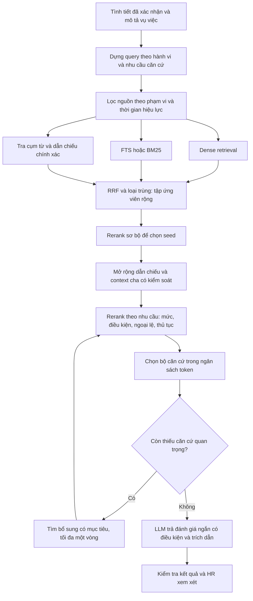

# Phương án retrieval và rerank cho P-029

Ngày nghiên cứu: 14/10/2026. Phạm vi: nghiên cứu nguồn gốc, kiểm tra code và đề xuất triển khai. Chưa thay đổi runtime, chưa chạy benchmark trên database sống, chưa xác nhận độ chính xác của một model rerank trên dữ liệu của project.

**Đề xuất:** giữ PostgreSQL/pgvector và mô hình hybrid; sửa cách dựng query, mở rộng tập ứng viên trước khi chọn cuối, dùng reranker đa ngôn ngữ thật, kiểm tra bộ căn cứ và điều kiện trước khi cho phép đề xuất mức. Không có cấu hình RAG hay model nào tự bảo đảm đúng 100%. Độ tin cậy phải được chứng minh bằng hồ sơ có nhãn được chuyên gia xác nhận và cơ chế dừng khi thiếu căn cứ.

## 1. Những điểm đã xác nhận từ code

| Điểm | Bằng chứng trong project | Ảnh hưởng |
| --- | --- | --- |
| Từ khóa hành vi có thể mất | `src/features/cite/model/terms.py`: hints → fact_lines → description, cắt ở 12 token đơn | Fact hợp đồng đứng trước có thể chiếm hết từ khóa của BM25/lexical |
| Nhánh tên BM25 dùng PostgreSQL FTS | `store.py:fetch_by_bm25()` gọi `ts_rank`, terms nối OR | Chưa phải Okapi BM25; không được đánh giá khả năng BM25 dựa trên tên node |
| Lexical lấy mẫu trước khi chấm | `store.py:fetch_candidates()` lọc ILIKE OR rồi LIMIT 40, không ORDER BY | Ứng viên tốt có thể bị loại trước khi `rank_passages()` nhìn thấy |
| Pool sau RRF bị cắt sớm | `pipeline.py:RETRIEVAL_K = 8` dùng cho từng nhánh và fusion | Reranker không thể khôi phục đoạn đã bị loại khỏi pool |
| Graph mở rộng từ seed chưa kiểm tra ngữ nghĩa | 5 seed đầu sau RRF, hai chiều, thêm tối đa 12 neighbor | Seed lệch có thể kéo thêm đoạn lệch |
| Neighbor bị cắt theo UUID | `store.py:fetch_graph_neighbors()` ORDER BY chunk id rồi LIMIT | Thứ tự ổn định nhưng không phản ánh độ hữu ích; rerank sau đó không thấy các neighbor đã bị cắt |
| Rerank đang là placeholder | `rerank.py`: bỏ query, trả nguyên passages | Chưa có bước chấm độ liên quan theo cặp query–đoạn |
| Thiếu ngân sách context ở bước chọn cuối | `_payload()` gửi toàn bộ content trong các lớp | Số đoạn và độ dài thực tế không được kiểm soát theo token |
| Kiểm tra trích dẫn chưa chứng minh áp dụng | `synthesis.py:guard()` kiểm quote nguyên văn, tên hình thức và có quote LAW/DECREE | Một quote luật không liên quan vẫn có thể qua điều kiện `_has_authority`; chưa kiểm chứng toàn bộ điều kiện áp dụng |
| Lọc lịch sử cần xem lại | `in_force_filter()` yêu cầu status ACTIVE; schema chỉ cho một ACTIVE/policy | Nếu ARCHIVED nghĩa là phiên bản cũ đã từng có hiệu lực, hồ sơ quá khứ có thể mất căn cứ. Cần xác nhận semantics, không tự coi mọi ARCHIVED là hợp lệ |

Tái hiện với nhóm GENERAL và thứ tự fact trong response tiết lộ mã nguồn: `search_terms()` trả `luật, lao, động, nội, quy, loại, hợp, đồng, xác, định, thời, hạn`. Không còn token về hành vi tiết lộ. Đây là kiểm tra hàm bằng dữ liệu được gửi, không phải capture query của lần chạy production.

Response người dùng gửi là template Python sau `OpenAITimeoutError`, không phải một assessment thành công của DeepSeek. Không dùng nó làm bằng chứng rằng DeepSeek đã suy luận sai. Nó cung cấp bằng chứng rằng căn cứ hiển thị có nhiều đoạn lệch chủ đề.

## 2. Cơ sở nghiên cứu và giới hạn

Mẫu retrieval nhiều giai đoạn thường dùng bộ tìm kiếm nhanh để tạo ứng viên, sau đó semantic reranking trên tập nhỏ hơn. Elastic mô tả rerank như bước tinh chỉnh sau hybrid/RRF. Điều này hỗ trợ giữ flow nền tảng hiện tại; không buộc project phải chuyển sang Elasticsearch. [Elastic: semantic reranking](https://www.elastic.co/docs/solutions/search/ranking/semantic-reranking).

PostgreSQL mô tả `ts_rank` là xếp hạng dựa trên tần suất lexeme, và các hàm ranking tích hợp không dùng thống kê toàn cục. Có thể giữ FTS làm baseline, nhưng cần gọi đúng tên và benchmark riêng nếu bổ sung BM25 thực sự. [PostgreSQL: controlling text search](https://www.postgresql.org/docs/current/textsearch-controls.html).

LegalBench-RAG đánh giá retrieval ở mức các span căn cứ cụ thể, thay vì chỉ tìm đúng văn bản hoặc đưa cả đoạn dài vào prompt. Benchmark này thuộc dữ liệu pháp lý khác, không chứng minh chất lượng trên luật lao động tiếng Việt. Ý tưởng áp dụng là gắn nhãn span/điều kiện cần lấy và đo riêng retrieval. [LegalBench-RAG, Pipitone & Alami, 2024](https://arxiv.org/abs/2408.10343).

Anthropic mô tả contextual retrieval và thử nghiệm retrieval pool rộng hơn trước rerank. Kết quả của họ là trên các bộ dữ liệu khác; không lấy các mức cải thiện hoặc top-k của họ làm cam kết cho P-029. Với project này, ưu tiên bổ sung context từ metadata/heading và phần dẫn nhập nguyên văn thay vì sinh thêm diễn giải pháp luật vào nguồn chứng cứ. [Anthropic: Contextual Retrieval](https://www.anthropic.com/engineering/contextual-retrieval).

RIRAG-2025 là shared task về truy xuất và trả lời câu hỏi quy định. Một hệ thống dự thi dùng nhiều retriever cộng reranker; đó là tham chiếu kỹ thuật, không phải tiêu chuẩn pháp lý hay chứng nhận production. [RIRAG-2025](https://aclanthology.org/2025.regnlp-1.1/), [AUEB-Archimedes system](https://aclanthology.org/2025.regnlp-1.8/).

## 3. Flow đề xuất



Hai lượt rerank là đề xuất riêng cho project để giảm mở rộng từ seed lệch; phải so sánh với phương án một lượt rerank sau expansion. Nếu chỉ một lượt cho chất lượng tương đương và latency tốt hơn, chọn một lượt. Vòng bổ sung có cờ đã chạy; sau một vòng vẫn thiếu thì trả trạng thái thiếu căn cứ, không lặp vô hạn.

### 3.1. Dựng query

Tách `case_summary`, `act_query`, `condition_facts`, `procedure_facts`, `exact_refs`. Không dùng vị trí fact trong danh sách để quyết định tầm quan trọng. Query hành vi phải giữ các thực thể trọng tâm và các cụm nhiều từ.

Ví dụ từ hồ sơ đã gửi, bỏ tên nhân viên vì không có giá trị truy xuất quy định:

```text
Hành vi: tiết lộ/cung cấp mã nguồn hệ thống và tài liệu kiến trúc
phần mềm cho người ngoài công ty thuộc tổ chức đối thủ.
Tìm: quy định áp dụng, hình thức xử lý, điều kiện, ngoại lệ và
thủ tục liên quan đến bảo mật thông tin và bí mật công nghệ.
```

Không biến cụm tìm kiếm “bí mật công nghệ” thành fact đã xác nhận rằng tài liệu chắc chắn là bí mật công nghệ. Không đưa mức xử lý mong muốn vào query để ép kết quả. “Có biên bản”, “hợp đồng xác định thời hạn” là tình tiết bổ sung, không được lấn át hành vi chính.

Tạo các query con: (a) hành vi/mức trong nội quy; (b) căn cứ pháp luật/điều kiện; (c) định nghĩa và ngoại lệ; (d) thủ tục khi cần đánh giá thủ tục. Query được dựng từ dữ liệu đã có. Nếu dùng LLM rewrite, lưu query gốc, kiểm tra thực thể và số liệu không bị thay đổi; lỗi rewrite vẫn tìm bằng query gốc.

Giữ cụm tiếng Việt như `mã nguồn`, `tiết lộ`, `bí mật kinh doanh` bằng phrase matching/term weighting. Thử word segmentation nếu bổ sung BM25, đo hiệu quả thay vì mặc định tốt hơn. Không đổi mọi term OR thành AND: truy vấn quá chặt cũng làm mất recall.

### 3.2. Nguồn và hiệu lực

Mọi nhánh dùng cùng scope: nguồn được phép dùng, phiên bản phù hợp ngày sự kiện, nội quy đúng tổ chức, không phải bản nháp, nguồn không bị xóa. Đối với scope công ty, project hiện chưa có company_id trong model Policy; nếu mở rộng nhiều công ty phải bổ sung mapping hoặc filter nguồn rõ ràng.

Kiểm tra cách ARCHIVED được quản lý để xử lý hồ sơ lịch sử. Không chỉ bỏ điều kiện ACTIVE: bản bị thu hồi, sai ingestion hoặc không từng có hiệu lực phải được phân biệt. Rà soát effective dates và quan hệ sửa đổi/thay thế với người quản lý corpus. Tên file/tên văn bản không đủ xác nhận quan hệ pháp lý.

Nếu một dẫn chiếu có target ngoài corpus hoặc phiên bản không resolve được, ghi rõ gap; không giả định đã đọc được nội dung đó.

### 3.3. Tạo ứng viên và fusion

Tách ba cấu hình: số ứng viên mỗi nhánh, số ứng viên sau fusion, số căn cứ đưa vào synthesis. Không dùng một RETRIEVAL_K cho cả ba giai đoạn.

Giữ embedding hiện tại để có baseline; sửa query trước khi đánh giá việc thay embedding. Nhánh FTS được đặt đúng tên. Có thể cải thiện FTS bằng trọng số heading/cụm hành vi rồi benchmark với BM25 thực sự. Không cần đổi database để đạt bước đầu này.

Lexical hiện trùng khá nhiều với FTS. Đề xuất dùng nó cho cụm nhiều từ, thuật ngữ hiếm và lookup điều/khoản khi query có dẫn chiếu rõ; so sánh fusion hai nhánh với ba nhánh để tránh đếm hai phiếu gần giống nhau. Khi lookup một điều được nhắc, vẫn kiểm tra đối tượng và hiệu lực.

Loại ứng viên trùng theo chunk id và xử lý phần văn bản overlap; giữ các phiên bản khác nhau riêng để không mất thông tin thời gian. Lưu thứ hạng/điểm riêng cho từng nhánh, RRF và rerank. Điểm RRF không phải xác suất đúng pháp luật.

SQL lexical phải có ordering theo điểm có ý nghĩa trước LIMIT hoặc duyệt toàn bộ pool đủ nhỏ. Tránh lấy 40 hàng tùy kế hoạch query rồi mới chấm. Với corpus lớn dùng index phù hợp; không mở LIMIT vô hạn.

Kiểm tra recall vector khi lọc hiệu lực với HNSW. pgvector cảnh báo approximate search kết hợp filter có thể trả thiếu ứng viên; dùng exact search trên eligible corpus làm baseline và kiểm tra EXPLAIN. Iterative scan là một lựa chọn nếu phiên bản hỗ trợ, không tự bật trước khi đo. [pgvector: filtering and iterative scans](https://github.com/pgvector/pgvector#filtering).

### 3.4. Rerank thật

Reranker nhận `(query, đoạn có context nguồn)` và trả thứ hạng/điểm, không tự sinh mức xử lý. Format đoạn gồm loại nguồn, tên văn bản, heading điều/khoản và content; metadata do hệ thống dựng, không do người dùng tùy ý ghi đè. Giữ mapping index → chunk id chính xác.

| Phương án thử | Cơ sở chọn | Điều cần đo |
| --- | --- | --- |
| Cohere `rerank-v4.0-pro` | Tài liệu hiện tại mô tả hướng tới tác vụ phức tạp; danh sách hỗ trợ có tiếng Việt | Recall/precision trên tiếng Việt pháp lý, timeout, chi phí, đường đi dữ liệu |
| Cohere `rerank-v4.0-fast` | Tài liệu mô tả ưu tiên latency/throughput | So sánh trên cùng candidate pool và nhãn, không mặc định fast đủ chính xác |
| BAAI `bge-reranker-v2-m3` tự host | Model card đa ngôn ngữ, có ví dụ chấm query–passage bằng FlagEmbedding | Chất lượng tiếng Việt domain này, tài nguyên phần cứng, token limit/truncation, latency trên máy triển khai |

Nguồn: [Cohere models](https://docs.cohere.com/v2/docs/rerank), [Cohere language support](https://docs.cohere.com/v2/docs/rerank-overview), [BAAI model card](https://huggingface.co/BAAI/bge-reranker-v2-m3).

Ưu tiên benchmark Cohere pro với BGE tự host; chọn theo dữ liệu, không tuyên bố model tốt nhất trước khi chạy. Dùng adapter async để thay model mà không đổi graph. Provider/API rerank mới là một tích hợp bổ sung; nghiên cứu này chưa gửi hồ sơ đến nhà cung cấp mới.

Không dùng ngưỡng 0.5/0.8 tùy ý. Cohere ghi rõ score phụ thuộc query; BGE có thể sigmoid score sang 0–1, nhưng thao tác đó không tạo xác suất đúng pháp luật. Hiệu chỉnh ngưỡng trên tập validation, đóng băng trước khi test. [Cohere: interpreting results](https://docs.cohere.com/v2/docs/reranking-best-practices), [BAAI: score normalization](https://huggingface.co/BAAI/bge-reranker-v2-m3).

Khi provider lỗi, giữ retrieval gốc để truy vết nhưng đánh dấu `rerank_failed/degraded`; không báo đã rerank thành công. Không tự nâng cấp kết quả thiếu kiểm tra thành SUPPORTED.

### 3.5. Graph và context điều khoản

Chọn seed đã qua kiểm tra liên quan sơ bộ. `confidence=HIGH` ở cạnh chỉ nói bộ parser tin vào dẫn chiếu, không nói neighbor áp dụng cho vụ việc.

Ưu tiên outgoing explicit references; reverse traversal chỉ mở theo mục tiêu cần tìm thêm căn cứ/ngoại lệ/nội quy. Đừng mở cả hai chiều vô điều kiện từ điều chung có quá nhiều văn bản dẫn về. Một-hop là mặc định thử nghiệm; nếu thiếu chain thì tìm bổ sung có giới hạn và provenance.

Thay cắt neighbor theo UUID bằng chọn theo seed relevance, loại dẫn chiếu, role còn thiếu và mức độ trực tiếp. Chỉ chấm điểm sau khi giữ đủ pool để có thể so sánh. Lưu seed id, edge direction, rule, target id, effective filter và lý do chọn/loại.

Khôi phục heading và phần dẫn nhập áp dụng chung cho khoản/điểm; giữ ngoại lệ và phủ định. Project đã có `section_title`, metadata/chapeau trong dữ liệu chunk; phải kiểm tra chúng được truyền tới rerank và synthesis đúng. Context tìm kiếm được bổ sung không thay thế quote nguồn nguyên văn. Không cắt đầu/cuối đoạn bằng ký tự nếu làm mất điều kiện.

### 3.6. Chọn bộ căn cứ và kiểm tra đủ thông tin

Chọn theo nhu cầu chứng cứ, không chỉ global top-k: hành vi và hình thức trong nội quy; căn cứ luật/hướng dẫn; điều kiện/ngoại lệ/định nghĩa; thủ tục nếu kết luận về thủ tục. Chỉ giữ role khi đoạn thực sự liên quan; không ép đủ quota bằng đoạn sai.

Tách PRECEDENT và ADMINISTRATIVE_PENALTY khỏi bộ căn cứ chọn mức kỷ luật theo semantics hiện tại của project. Chúng có thể nằm trong phần tham khảo riêng với ngân sách riêng.

Một candidate được xếp hạng cao chưa chứng minh điều khoản áp dụng. Đầu ra cần bảng `điều kiện → đoạn nguồn → fact đã xác nhận → SATISFIED/NOT_SATISFIED/UNKNOWN`. Nếu muốn xác minh bằng code, cần các predicate/quy tắc đã được kiểm tra; substring quote hay nhãn do LLM tự đánh không thay cho bước này. Chuyên gia phải kiểm tra những điều kiện diễn đạt tự nhiên chưa được chuẩn hóa.

Bước coverage chỉ kiểm tra thiếu role và các phụ thuộc đã biết; không thể biết mọi quy định còn thiếu trong luật chỉ từ các chunk đã lấy. Cần rule inventory có nhãn và gold evidence sets để kiểm thử độ đầy đủ. Có thể giữ nhiều gói căn cứ thay thế hợp lệ, không yêu cầu chỉ một danh sách chunk duy nhất.

Nếu thiếu căn cứ, tìm đúng role thiếu một lần rồi rerank lại. Nếu vẫn thiếu, dùng `INSUFFICIENT_EVIDENCE`; thiếu fact thì `NEED_MORE_FACTS`; timeout/rerank error thì trạng thái vận hành riêng. Không biến “retrieval không tìm thấy” thành “pháp luật không quy định”. HR quyết định bước tiếp theo theo workflow hiện tại.

### 3.7. Ngân sách context và synthesis

Đếm token bằng tokenizer phù hợp từng model, không quy đổi từ len() rồi coi là chính xác. Ngân sách gồm prompt, schema, case facts, passages và phần dành cho output/reasoning. Model rerank và model synthesis có tokenizer/giới hạn khác nhau.

Loại đoạn dư và overlap trước, giữ nguyên condition/exception quan trọng. Nếu bộ căn cứ cần thiết vượt budget, báo cần thêm bước đọc hoặc review; không bỏ ngoại lệ để đủ token. Synthesis chỉ trả assessment có cấu trúc ngắn; báo cáo dài có thể render từ dữ liệu đó. Đây là thay đổi riêng cần kiểm tra nội dung biên bản.

## 4. Cấu hình thử nghiệm ban đầu

Các giá trị dưới đây là điểm bắt đầu để so sánh, không phải thông số chuẩn hay kết quả đã kiểm chứng:

| Tham số | Mức thử |
| --- | --- |
| Dense và FTS/BM25 candidates | 20 / 40 / 60 mỗi nhánh mỗi query cần chạy |
| Fusion pool sau loại trùng | 60 / 100 / 150 |
| Seed đã rerank để mở graph | 3 / 5 |
| Graph candidate cap | 12 / 24; luôn log phần bị loại |
| Final evidence count | 6 / 10 / 14, điều chỉnh theo coverage và token |
| Evidence token budget | 4k / 6k / 8k, đo bằng tokenizer synthesis |
| Vòng tìm bổ sung | tối đa 1 |

Không cần chạy mọi tổ hợp đầy đủ. Dùng ablation từng thay đổi, sau đó chọn một số cấu hình tốt để so sánh kết hợp. Duy trì cùng corpus snapshot, query set và candidate mapping.

## 5. Đánh giá trước khi dùng cho đề xuất xử lý

Bộ RAGAS hiện tại chỉ có 5 mẫu và reference chưa được chuyên gia xác nhận. Điểm context_precision 0.9141/context_recall 0.3496 là tín hiệu để xem thiếu căn cứ, không phải kiểm định độ đúng production.

Tạo bộ pilot 50–100 query/hồ sơ có nhãn HR/pháp chế; đây là mức khởi đầu, không đủ tự chứng minh an toàn cho mọi trường hợp. Tách train/tuning/validation/test theo vụ việc hoặc nhóm điều khoản để tránh paraphrase của cùng hồ sơ lọt cả hai phía. Với nguồn thay đổi theo thời gian, có test lịch sử riêng.

Mỗi case cần: fact đã xác nhận/unknown, source version, span căn cứ đúng, các role bắt buộc/ngoại lệ, gói căn cứ thay thế chấp nhận được, hard negatives gần giống, trạng thái kỳ vọng và mức chỉ khi chuyên gia đã xác nhận đủ điều kiện.

Các nhóm test bắt buộc:

1. Tiết lộ mã nguồn nhưng chưa xác nhận thông tin là bí mật; có/không có quyền cung cấp.
2. Nghỉ không phép với ngưỡng số ngày và cửa sổ thời gian khác nhau; thiếu lý do hoặc thiếu cửa sổ.
3. Đi muộn lần đầu/tái phạm; chưa xác nhận tiền sử xử lý.
4. Điều kiện về người nước ngoài/cao tuổi/đại diện lao động thật sự có và thật sự không có.
5. Các phiên bản trước/sau hiệu lực, nội quy khác công ty, nguồn chưa có trong corpus.
6. Đoạn phủ định/ngoại lệ, mức tiền áp dụng cho đối tượng khác, nguồn xử phạt hành chính.
7. Mô tả bị cụt như “của nhân viên này”, thứ tự fact thay đổi, từ đồng nghĩa và dẫn chiếu điều khoản chính xác.
8. Graph có seed chung, reverse fanout lớn, cạnh sai/low confidence/unresolved, dẫn chiếu nhiều bước.
9. Rerank timeout, embedding lỗi, quote không tồn tại, JSON bị cắt.

Đo riêng từng tầng:

| Tầng | Chỉ số và cách hiểu |
| --- | --- |
| Candidate retrieval | Recall@pool trên gold spans/provisions; đoạn đúng có được đưa vào pool không |
| Final rerank | nDCG@k với nhãn graded; precision@k và recall@k; không chỉ hit một chunk |
| Bộ căn cứ | Tỷ lệ giữ đủ ít nhất một gold evidence bundle; recall của điều kiện/ngoại lệ quan trọng |
| Scope | Sai phiên bản, sai công ty, sai loại nguồn trong evidence được dùng |
| Assessment | Mức đề xuất sai trên case đủ điều kiện; kết luận dù còn unknown; đúng trạng thái cần bổ sung |
| Khả năng dừng | False-support rate và tỷ lệ dừng không cần thiết; tránh giảm sai bằng cách dừng mọi case |
| Vận hành | p50/p95 từng stage, timeout rate, token thực, chi phí/request, số nhánh thất bại |

So sánh: baseline → chỉ sửa query → query + pool rộng → thêm rerank → graph có seed kiểm tra → chọn theo coverage. Oracle evidence test dùng đúng bộ căn cứ chuyên gia chọn để tách lỗi reasoning khỏi lỗi retrieval. Đóng băng model và prompt khi đo cải tiến retrieval; benchmark model rerank trên cùng pool.

Điều kiện nghiệm thu: không có sai scope/quote trên tập test được duyệt; không đề xuất mức khi điều kiện bắt buộc unknown trong các ca trọng yếu; tất cả ca regression trọng yếu phải giữ được bộ căn cứ đúng hoặc báo gap phù hợp. Báo rõ mẫu số và khoảng bất định. Không quan sát lỗi trên một tập hữu hạn không đồng nghĩa tỷ lệ lỗi ngoài thực tế bằng 0. HR/pháp chế thống nhất mức rủi ro chấp nhận và cách review trước khi đưa vào sử dụng.

## 6. Thứ tự triển khai và vị trí thay đổi

1. **Đo và sửa query trước:** `terms.py`, `query.py`, `graph.py`, `pipeline.py`; regression cho case tiết lộ mã nguồn và thứ tự fact; log query plan và per-arm hits. Kiểm tra mô tả “của nhân viên này” ở intake, không suy đoán hành vi từ câu cụt.
2. **Sửa pool và nhánh sparse:** `store.py`, `rank.py`, `rrf.py`; tách candidate/final limits, loại pre-limit tùy ý, gọi đúng FTS/BM25, so sánh exact vector retrieval.
3. **Tích hợp reranker:** adapter mới trong services và `rerank.py`; timeout/degraded status, mapping index/chunk, model pinning, score riêng; benchmark API và self-host.
4. **Kiểm soát graph và chọn evidence:** `graph_expand.py`, `store.py`, node evidence selection mới; bảo toàn provenance/heading/chapeau, role gaps và token budget.
5. **Siết assessment:** `assessment.py`, `synthesis.py`, `decide.py`; kiểm tra condition/evidence mapping, tách lỗi vận hành khỏi thiếu căn cứ, giữ HR approval boundary.
6. **Mở rộng eval:** nhãn được chuyên gia duyệt, held-out cases, oracle test, paired comparisons và báo cáo stage metrics. Chỉ đổi default sau khi có kết quả so sánh.

Trace nên chứa corpus/model/prompt version, query theo role, candidate ids/ranks/scores mỗi nhánh, graph edges, rerank status, evidence được chọn và lý do bỏ, gaps, token count và latency. Dữ liệu fact nguyên văn chỉ vào trace có kiểm soát truy cập; log vận hành thông thường dùng id và số đo.

**Kết quả của nghiên cứu này là phương án có thể triển khai và đánh giá, chưa phải tuyên bố flow đã được sửa hoặc đủ độ chính xác để ban hành xử lý.**
