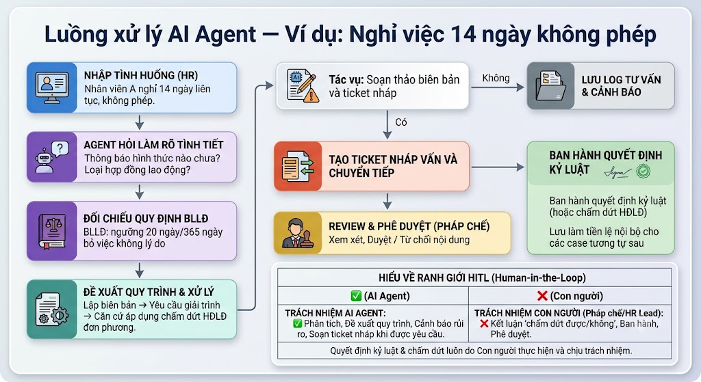

# Product Requirements Document (PRD)

## 1. Thông Tin Chung (Document Information)
- **Tên sản phẩm:** HR Help
- **Mã dự án:** P-029
- **Phiên bản:** 1.0
- **Ngày cập nhật:** 20/09/2026
- **Trạng thái:** In Review
- **Mentor:** Ngô Đình Luân - Trần Hữu Khánh Văn

## 2. Mục Tiêu Sản Phẩm (Product Objectives)
- Giảm tải khối lượng công việc và tăng độ chính xác trong việc xử lý vi phạm nhân viên cho HR và quản lý.

## 3. User Stories
- Là một nhân viên HR, tôi muốn nhập mô tả về tình huống vi phạm của nhân viên và được hệ thống tự động tra cứu các quy định, nội quy liên quan và đề xuất phương án xử lý, để tôi có thể đưa ra quyết định nhanh chóng và có căn cứ.

## 4. Yêu Cầu Chức Năng (Functional Requirements)
- Đăng nhập, đăng ký 2 vai trò: Quản lý và Pháp chế duyệt
- Chat để phân tích tình huống xử lý nhân viên
- *(Ghi chú: Có thể add dashboard quản lý số ngày đi muộn)*

## 5. Yêu Cầu Phi Chức Năng (Non-Functional Requirements)
- Bảo mật dữ liệu vụ việc và nhân sự

## 6. Luồng Người Dùng & Xử Lý AI Agent (User Flow & AI Agent Flow)

### 6.1. Các bước trong luồng xử lý (Ví dụ: Nghỉ việc 14 ngày không phép)
1. **Nhập tình huống (HR):**
   - HR/Quản lý nhập mô tả vụ việc (Ví dụ: *Nhân viên A nghỉ 14 ngày liên tục, không phép*).
2. **Agent hỏi làm rõ tình tiết:**
   - AI Agent chủ động đặt câu hỏi để thu thập đủ ngữ cảnh pháp lý (Ví dụ: *Đã có thông báo bằng hình thức nào chưa? Loại hợp đồng lao động là gì?*).
3. **Đối chiếu quy định BLLĐ & Nội quy:**
   - Hệ thống tự động tra cứu quy định (Ví dụ: *BLLĐ: ngưỡng 20 ngày/365 ngày bỏ việc không lý do...*).
4. **Đề xuất quy trình & Xử lý:**
   - Đề xuất các bước thực hiện đúng chuẩn: *Lập biên bản → Yêu cầu giải trình → Căn cứ áp dụng chấm dứt HĐLĐ đơn phương*.
5. **Tác vụ: Soạn thảo biên bản và ticket nháp:**
   - **Nếu Không:** Lưu log tư vấn & cảnh báo.
   - **Nếu Có:** Tạo ticket nháp tư vấn và chuyển tiếp:
     - **Review & Phê duyệt (Pháp chế):** Pháp chế xem xét, Duyệt / Từ chối nội dung.
     - **Ban hành quyết định kỷ luật:** Ban hành quyết định kỷ luật (hoặc chấm dứt HĐLĐ) và lưu làm tiền lệ nội bộ cho các case tương tự sau.

### 6.2. Ranh giới Human-in-the-Loop (HITL)
| Phân định | Trách nhiệm chi tiết |
|---|---|
| **AI Agent** | - Phân tích tình huống. - Đề xuất quy trình. - Cảnh báo rủi ro. - Soạn ticket nháp khi được yêu cầu. |
| **Con người (Pháp chế / HR Lead)** | - Kết luận 'chấm dứt được/không'. - Ban hành quyết định. - Phê duyệt. *→ Quyết định kỷ luật & chấm dứt luôn do Con người thực hiện và chịu trách nhiệm.* |

## 7. Tech Stack
- LLM + LangGraph
- RAG
- Vector DB
- FastAPI, React, PostgreSQL, Redis
